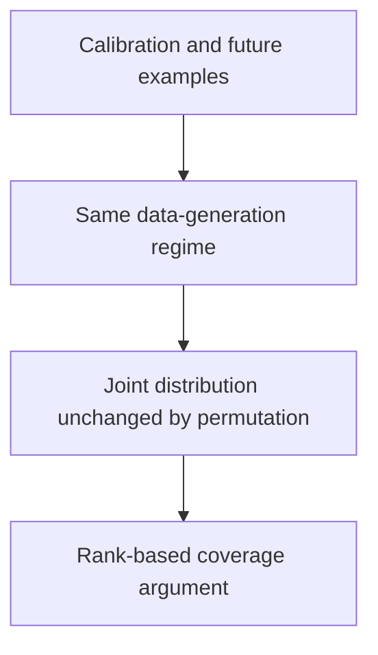

Exchangeability means a collection of random observations has a joint distribution that is unchanged when their order is permuted. Independent and identically distributed samples are exchangeable, but exchangeability can also hold in some dependent settings. Conformal prediction relies on calibration examples and the future example behaving symmetrically under this assumption.

For ordinary split conformal prediction, train the predictor separately and apply the same fixed scoring rule to calibration and future examples. Using calibration labels to tune the predictor or select among scoring rules can break the required score symmetry. Its usual guarantee is marginal coverage over a future draw, not conditional coverage for every tenant or individual request. See [Angelopoulos and Bates' introduction](https://arxiv.org/abs/2107.07511).

## What breaks the coverage argument

If a new request comes from a later traffic regime, a different tenant, a changed model version, or a selectively filtered population, calibration and prediction examples may no longer be exchangeable. The ordinary conformal rank argument then need not hold. Randomly shuffling a file does not repair a changed data-generation process or make correlated time windows independent.

## Example

An inference-latency interval is calibrated on low-traffic weekday requests. Saturday introduces larger prompts and a model with a different batching policy. The new residual can no longer be treated as interchangeable with the earlier calibration residuals, even if request identifiers are shuffled before analysis. A release should measure recent rolling coverage, inspect high-length and high-load slices, and recalibrate or use methods explicitly designed for drift when the exchangeability assumption fails.

## Why it matters here

Theoretical uncertainty claims are only as sound as their sampling assumptions. Deployment changes, benchmark contamination, temporal dependence, and tenant heterogeneity can silently invalidate a mathematically correct interval procedure.

## Related terms

- [Conformal prediction](glossary://conformal-prediction)
- [Data drift](glossary://data-drift)
- [Evaluation slice](glossary://evaluation-slice)
