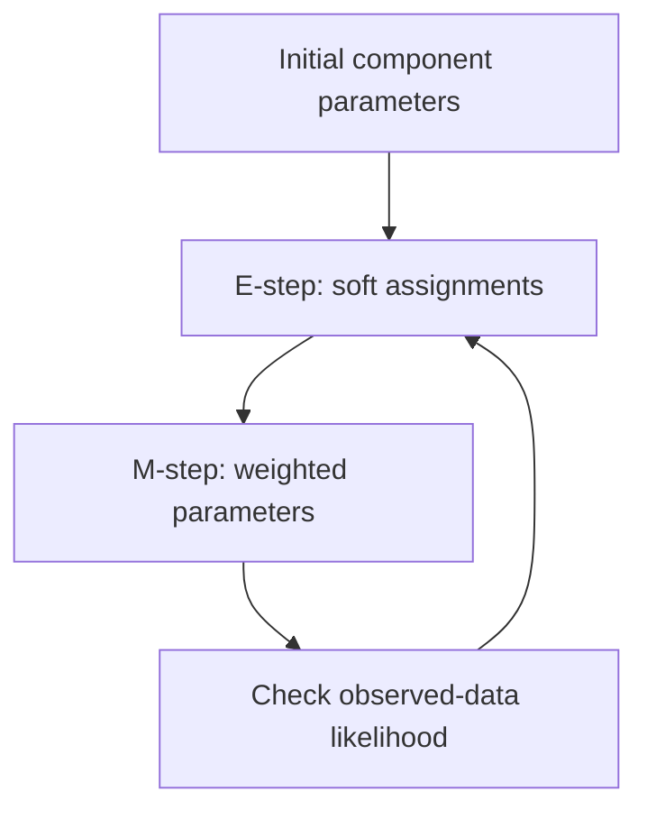

Expectation-maximization is an iterative procedure for fitting models with unobserved variables or incomplete data. The expectation step computes a distribution over the missing information using the current parameters. The maximization step updates parameters using those expected assignments. Under an exact implementation, each completed iteration is monotone in observed-data likelihood, while convergence can still lead to a poor local optimum.

## Alternate soft assignment and parameter fitting

For a Gaussian mixture, the E-step assigns each observation a responsibility for every component. The M-step recomputes component weights, means, and covariances using those responsibilities as fractional counts. EM fits the chosen mixture model; model selection, covariance safeguards, and validation determine whether the resulting clusters answer the real-world question.

## Example

Take response times `[28, 31, 33, 85, 90, 94]` and initialize one component near 30 and another near 90. The E-step gives early observations high fast-component responsibility and later observations high slow-component responsibility. The M-step shifts the means toward the responsibility-weighted averages of their assigned points. Starting both means near 30 can create a worse solution, so researchers compare multiple initializations and inspect the final likelihood.

## Why it matters here

EM explains missing-data reasoning, soft clustering, latent variables, and why nonconvex likelihood objectives require diagnostic checks. It bridges classical probabilistic modeling to variational and modern generative methods.

## Related terms

- [Gaussian mixture model](glossary://gaussian-mixture-model)
- [Maximum likelihood estimation](glossary://maximum-likelihood)
- [Variance](glossary://variance)
