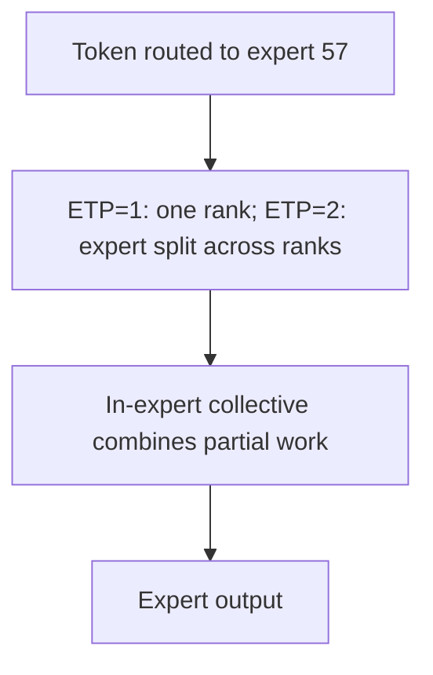

**Expert tensor parallelism (ETP)** splits the parameter matrices of one MoE expert across multiple ranks. EP answers "which rank owns each expert?" ETP answers "does one expert itself need several ranks to execute?"

ETP can make an individual expert fit by distributing its matrices and computation across devices, but it adds communication inside the expert after tokens have already paid routing cost. Small experts often run more efficiently with ETP=1, leaving each expert local to one EP rank.

## Ownership versus execution

With EP=8 and ETP=1, eight ranks divide the expert bank and each selected expert runs locally. With ETP=2, every expert is also split over pairs of ranks. Megatron's MoE parallel folding can describe expert layers with ETP × EP × expert-DP × PP while dense layers use another factorization.

## Diagram

## Example

A GLM-5.3 routed expert has roughly 37.75 million parameters from its gated up and down projections. At BF16, those weights alone occupy about 75.5 MB. Keeping that expert local with ETP=1 avoids an in-expert collective, but this small subtotal does not prove that all layers, gradients, optimizer states, and activations fit on the rank.

## Why it matters here

The masterclass proposes EP=64 and ETP=1 for its GLM-5.3 learner candidate. Reading those knobs separately prevents the common mistake of assuming every expert is spread across all 64 GPUs. Runtime support and memory fit still require validation.

## Related terms

- [Expert parallelism](glossary://expert-parallelism)
- [Tensor parallelism](glossary://tensor-parallelism)
- [Mixture of experts](glossary://mixture-of-experts)
- [GEMM](glossary://gemm)
- [NVIDIA Megatron](glossary://nvidia-megatron)
