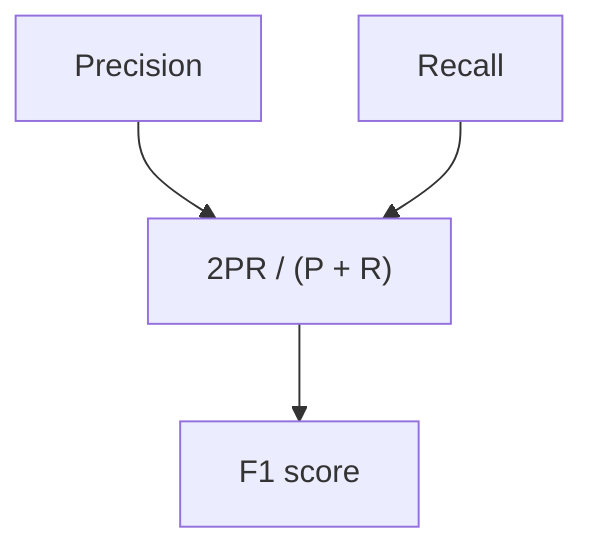

The F1 score summarizes precision and recall using their harmonic mean. It rewards a classifier that simultaneously finds positive cases and avoids false positives. Because the harmonic mean is pulled toward its smaller input, a high score requires both quantities to be reasonably strong. F1 is useful for comparing thresholds, but it does not encode asymmetric operational costs.

## Formula and missing costs

$F_1=2PR/(P+R)=2\mathrm{TP}/(2\mathrm{TP}+\mathrm{FP}+\mathrm{FN})$, where $P$ is precision and $R$ is recall. The formula weights false positives and false negatives equally in its denominator. Therefore two thresholds can have identical F1 while producing sharply different financial, safety, or reviewer-capacity outcomes. Multiclass reporting must specify whether the score is micro, macro, or weighted average.

F1 lies between zero and one when defined and ignores true negatives. If there are no actual or predicted positives, its count-form denominator is zero; report the evaluation library's chosen zero-division convention rather than treating the result as a measured perfect or failed classifier.

## Example

A classifier identifies four true positives, creates four false positives, and misses zero positives. Precision is 0.5, recall is 1.0, and F1 is approximately 0.667. Another threshold identifies two true positives, creates zero false positives, and misses two positives. Its precision is 1.0, recall is 0.5, and F1 is again approximately 0.667. If a missed review costs 120 dollars and an unnecessary review costs 18 dollars, the policies cost 72 versus 240 dollars.

## Why it matters here

Access-review, safety, and anomaly lessons teach that metric selection is part of product design. F1 provides a compact classifier summary, but release decisions still need confusion-matrix counts, explicit error costs, policy constraints, and held-out traffic slices.

## Related terms

- [Precision](glossary://precision)
- [Recall](glossary://recall)
- [Decision threshold](glossary://decision-threshold)
