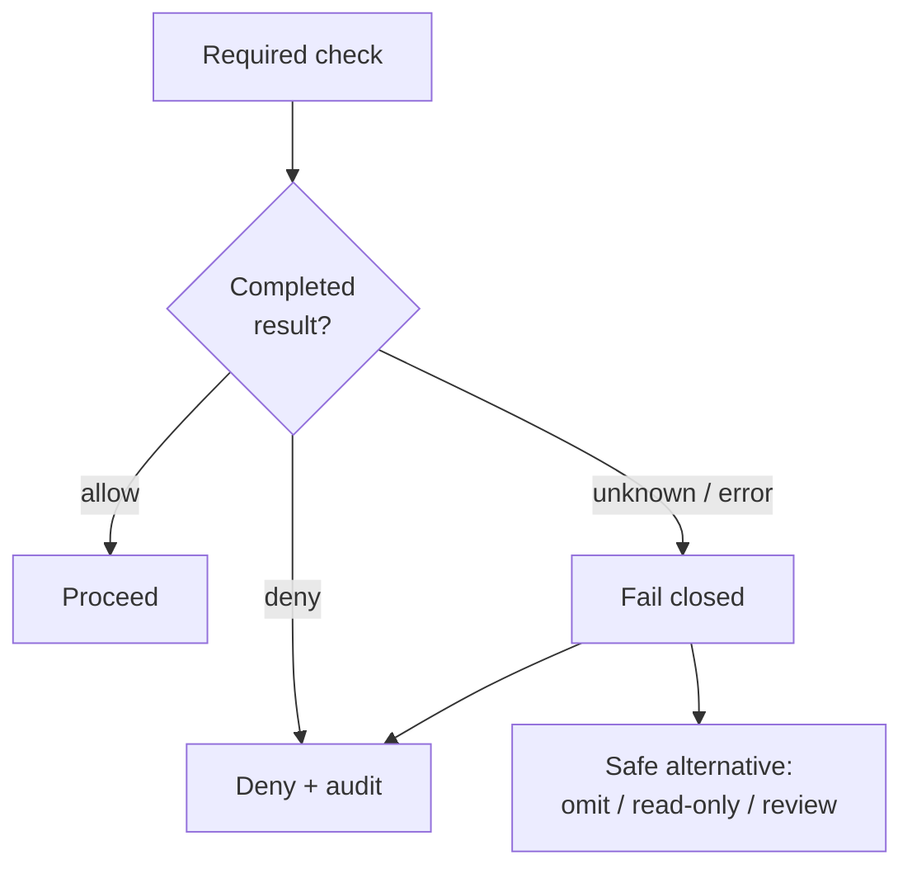

**Fail closed** (also called *fail-secure* in access-control contexts) is a design posture: when a required safety, auth, or integrity check remains incomplete, the action stays denied, blocked, or stopped until the check succeeds. The software authorization default under uncertainty is closed. Physical life-safety literature sometimes uses *fail-safe* for opening under power loss; that usage describes a different priority.

The opposite is **fail open**: if the check is missing, times out, errors, or returns garbage, traffic or access still proceeds. Firewalls, door locks, and authorization services all make this choice explicitly. In LLM products the same choice shows up at every perimeter where private text might enter a prompt, a tool might run, or a policy service might be down.

Fail closed preserves the authorization perimeter when verification fails: grant source of truth and run sensitive side effects only after a successful check. A service can still return a clear error, omit a document, route to human review, or offer a safe degraded path that preserves privileges.

## Intuition

Security controls stop bad outcomes. When a control fails, fail-closed handling keeps the action blocked, while fail-open handling lets it proceed:

| Failure mode | Fail closed | Fail open |
| --- | --- | --- |
| Policy service timeout | Deny the action | Allow the action |
| ACL metadata missing | Omit the document | Treat as public / visible |
| Signature or checksum invalid | Reject payload | Accept payload |
| Safety classifier unreachable | Block or hold for review | Send the message |
| Allowlist lookup error | No tool execution | Execute the proposed tool |

Classic hardware analogies: a bank vault door that stays locked on power loss is fail closed; a fire-exit magnet lock that releases on power loss is fail open (life safety over theft). Choose the default for each asset by comparing the harm of a false *allow* with the harm of a false *deny*.

In code, the shape of the check matters as much as the product policy. Catching a timeout and continuing, or only branching on an explicit `"deny"` token, fails open under uncertainty. Requiring a successful, affirmative allow (and mapping errors to deny) fails closed:

```python
# Fail open: policy outage or unknown outcome still runs the side effect
try:
    if authz.decide(user, action) == "deny":
        raise PermissionError("denied")
except TimeoutError:
    pass  # check incomplete → proceed anyway
do_sensitive_work()

# Fail closed: only an explicit allow after a completed check continues
try:
    decision = authz.decide(user, action)
except Exception as exc:
    raise PermissionError("authz check incomplete") from exc
if decision != "allow":
    raise PermissionError("not allowed")
do_sensitive_work()
```

A bare `if not user.is_allowed(): raise ...` / `if user.is_allowed(): ...` pair is usually equivalent for pure booleans. The production bug is almost always the default path: treating missing evidence, timeouts, or unhandled status values as allow.

## Diagram



## Example

Enterprise RAG: top-$k$ retrieval returns $12$ chunks. Before packing context, each chunk must pass a live ACL check for principal $P$. Policy:

- Max ACL age for protected content: $5$ minutes
- ACL service timeout budget: $80\,\mathrm{ms}$ per check (or batch equivalent)
- On timeout, missing grant, or stale snapshot: **omit the chunk** (fail closed on that resource)
- If every high-scoring protected chunk is omitted and no public fallback remains, return an abstention such as "I can't access that source right now." Empty authorized context has no evidence to support a grounded answer.

Concrete pass:

| Chunk | Score | ACL result | In prompt? |
| --- | --- | --- | --- |
| `hr-comp-plan.md` | $0.91$ | timeout after $80\,\mathrm{ms}$ | No |
| `eng-oncall.md` | $0.87$ | allow, snapshot age $2\,\mathrm{min}$ | Yes |
| `legal-ma.docx` | $0.84$ | snapshot age $31\,\mathrm{min}$ (stale) | No |
| `public-faq.md` | $0.71$ | public grant | Yes |

Only `eng-oncall.md` and `public-faq.md` enter the model. The system keeps public material available while withholding private text when authorization checks fail. A fail-open design that treats timeout as allow could put `hr-comp-plan.md` into the context window, where later refusal phrasing cannot remove the disclosure.

```python
def include_chunk(chunk, principal, max_age_s=300, timeout_s=0.08):
    try:
        decision = acl_service.check(principal, chunk.doc_id, timeout=timeout_s)
    except Exception:
        audit("acl_check_failed_omit", principal, chunk.doc_id)
        return False  # fail closed on this resource
    if decision.allowed is not True:
        return False
    if decision.snapshot_age_s > max_age_s and chunk.classification != "public":
        audit("acl_stale_omit", principal, chunk.doc_id)
        return False
    return True
```

The same posture applies to agents: if the policy gate for `deploy_production` cannot reach the approval service, the deployment remains blocked. Return a structured denial the scaffold can explain, and keep the gate result attached to the request.

## Where it shows up in LLM systems

Name the failure, then name the closed behavior:

1. **Retrieval / RAG.** ACL service down, stale grants, missing tenant filter, revoked access not yet reconciled: omit chunks; do not serve protected text under old grants past your revocation SLO.
2. **Tool calling.** Unknown tool name, schema parse failure, allowlist service error, spend-cap service unavailable: do not execute side effects. Prefer an [action allowlist](glossary://action-allowlist) that defaults to empty.
3. **Policy and safety gates.** Require a complete classifier result and any required human approval before sending; route timeouts or incomplete risk scores to block, hold, or review.
4. **Caches and rate limits.** A Redis flush that zeros counters can accidentally fail *open* on abuse limits; design whether outage means "block new traffic," "use local defaults," or "degrade features" so a dependency blip is not a floodgate.
5. **Integrity.** Bad webhook signatures, unsigned model artifacts, failed checksum on a prompt bundle: reject; do not treat "couldn't verify" as "good enough."

Trusted application code and infrastructure enforce fail-closed behavior. Prompt text like "never reveal private data" requests a response; omitting unauthorized chunks and refusing unauthenticated tools enforce the perimeter.

## Trade-offs

Failing closed trades availability (and sometimes false denials) for confidentiality and integrity. Users see more "try again" or thinner answers when dependencies flap. That is often the right cost for HR docs, medical notes, payments, deletes, and cross-tenant isolation. Low-risk public reads can degrade more gently: serve public index only, skip personalization, or lengthen cache TTL while still blocking private joins.

Operational partners for a fail-closed control:

- **Redundancy and SLOs** so the closed path is rare
- **Clear denial reasons and audit events** so support and security can tell outage from attack
- **Chaos and integration tests** that kill the ACL service alongside tests for successful allow paths
- **Scoped degrade** that never widens privilege (read-only public content is fine; "allow all writes" is not)

Exercise the fail-closed path under timeout during integration tests so its denial and audit behavior are verified.

## Why it matters here

LLM products assemble untrusted model proposals with trusted side effects: retrieval into the context window, tool APIs, deploys, and exports. Acting without a successful source of truth check can expose protected data or execute an unauthorized action. Fail closed turns incomplete information into a safe default at those partitions so a policy gate, ACL filter, or kill path still protects you when services stall, metadata is stale, or the model invents a confident tool call.

## Related terms

- [Policy gate](glossary://policy-gate)
- [ACL](glossary://acl)
- [Action allowlist](glossary://action-allowlist)
- [permission scope](glossary://permission-boundary)
- [Kill switch](glossary://kill-switch)
