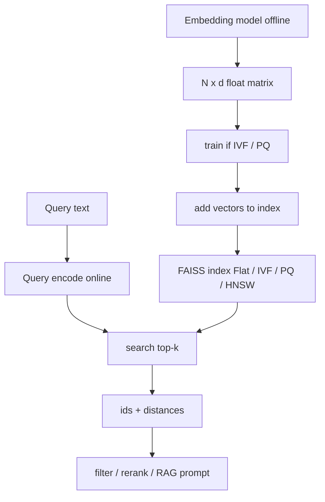

**FAISS** (Facebook AI Similarity Search) is an open-source C++ library (with Python bindings) for exact and approximate nearest neighbor search, clustering, and vector compression over dense embeddings. Developed primarily at FAIR (Meta), it offers a toolbox of indexes, including flat exhaustive search, inverted-file partitions (IVF), product and residual quantizers, graph indexes such as HNSW, and GPU kernels for the same APIs. It consumes vectors from an encoder and focuses on search and compression; persistence, access control, and managed database operations belong to other system layers.

The core job is: given database vectors $\{x_i\}_{i=1}^{N} \subset \mathbb{R}^d$ and a query $q \in \mathbb{R}^d$, return the $k$ nearest ids under a fixed metric (usually $L_2$ or inner product). Exact search is $O(N \cdot d)$ per query. Approximate indexes trade a controlled amount of geometric error for lower latency and memory so million- and billion-scale retrieval stays interactive.

FAISS handles vector indexing. Product code or a store such as Qdrant, pgvector, or Pinecone supplies persistence, multi-tenant ACL filters, concurrent writers, sharding, backups, and HTTP APIs; these systems may reimplement FAISS-style algorithms. This boundary is useful for learning because you can measure index recall, latency, build time, and memory independently.

## Intuition

Think of FAISS as the engine room under dense retrieval. Your bi-encoder maps chunks and queries into $\mathbb{R}^d$. FAISS builds an *index* from the chunk vectors to avoid scoring every row on each query. Flat indexes provide the exact baseline by scanning all vectors. IVF opens nearby clusters. PQ stores short codes for each vector. HNSW walks a proximity graph. Real systems compose these pieces as workload-specific building blocks. Common examples include IVFPQ; HNSW as a coarse quantizer in front of IVF lists; and flat full-precision reranking of a short ANN shortlist.

The "embedding contract" from the FAISS design paper is the right mental model:

1. The encoder was trained so distances in embedding space match the task.
2. The index must approximate *exact* neighbor search under that same metric as faithfully as active resource budgets allow.

If you train with cosine / normalized inner product and index with raw $L_2$ on unnormalized vectors, both stages can look "working" while retrieval is wrong.

## Formula

Exact nearest neighbor under Euclidean distance:

$$
j^\star = \arg\min_{i=1..N} \lVert q - x_i \rVert_2
$$

`IndexFlatL2` returns **squared** Euclidean distances. Squaring preserves the neighbor ordering, but changes the numerical distance values and any threshold applied to them.

Top-$k$ is the same ordering truncated after $k$ ids. Maximum inner product search (MIPS; `IndexFlatIP` and many retrieval setups):

$$
j^\star = \arg\max_{i=1..N} \langle q, x_i \rangle
$$

After L2-normalizing both sides, $\langle q, x \rangle = \cos(q, x)$, so IP on unit vectors is the usual dense-retrieval path.

With a codec $C$ (encoder to codes) and decoder $D$, asymmetric distance computation (ADC) scores the *uncompressed* query against *decoded* database vectors without requiring the original floats in the hot path:

$$
j^\star \approx \arg\min_i \lVert q - D(C(x_i)) \rVert_2
$$

ANN fidelity against exact geometric top-$k$ set $E_k$ for approximate set $A_k$:

$$
\mathrm{ANN\text{-}recall@}k = \frac{|A_k \cap E_k|}{k}
$$

Average over held-out queries to measure index quality. Human relevance labels are needed to measure task recall.

## How it works

Typical build and query lifecycle:

1. **Choose metric and dtype.** Match the embedding model (`METRIC_L2` vs `METRIC_INNER_PRODUCT`). Prefer float32 for the main path unless you deliberately quantize.
2. **Pick an index family** for the $N$, $d$, memory, and latency budget (table below).
3. **Train if required.** IVF and PQ need a training sample to learn centroids / codebooks (`index.train(xt)`). Flat and many HNSW flat variants do not.
4. **Add vectors** (`index.add(xb)`), optionally with external ids.
5. **Search** (`D, I = index.search(xq, k)`): distances and neighbor ids.
6. **Evaluate** against an exact flat baseline on the same queries before shipping knobs.

| Family | FAISS types (examples) | Idea | Main knobs |
| --- | --- | --- | --- |
| Flat | `IndexFlatL2`, `IndexFlatIP` | Exact scan of all vectors | none |
| IVF | `IndexIVFFlat` | Partition into `nlist` lists; scan `nprobe` lists | `nlist`, `nprobe` |
| PQ / IVFPQ | `IndexPQ`, `IndexIVFPQ` | Compress subvectors to codes; optional IVF coarse stage | $M$ subquantizers, `nbits`, `nprobe` |
| HNSW | `IndexHNSWFlat` | Multi-layer navigable graph walk | $M$, `efConstruction`, `efSearch` |
| Scalar / binary | `IndexScalarQuantizer`, `IndexBinary*` | Cheap per-dimension or Hamming codes | bits, lists |

Factory strings such as `"IVF4096,Flat"` or `"IVF16384,PQ64"` build the same compositions without hand-wiring every object. GPU indexes mirror the CPU API for several families so the same script can move hot indexes onto CUDA without rewriting the retrieval loop.

## Diagram



## Example

Suppose a RAG corpus: $N = 10{,}000{,}000$ chunks, each a $d = 768$ float32 embedding from a bi-encoder trained for inner product after L2 normalize.

**Raw storage.** $10^{7} \times 768 \times 4$ bytes $\approx 30.7$ GB of vectors alone, before graph edges or metadata. Exact flat search is a strong offline baseline and a weak online default at this scale on a single CPU box.

**Baseline (exact).**

```python
import faiss
import numpy as np

d = 768
xb = np.random.randn(10_000_000, d).astype("float32")  # stand-in for real embeddings
faiss.normalize_L2(xb)
index_exact = faiss.IndexFlatIP(d)
index_exact.add(xb)

xq = xb[:64].copy()  # 64 eval queries
D_exact, I_exact = index_exact.search(xq, k=10)
```

**Approximate (IVF + full-precision vectors).** A common starting composition is IVF with flat vectors inside lists:

```python
nlist = 4096
quantizer = faiss.IndexFlatIP(d)
index_ivf = faiss.IndexIVFFlat(quantizer, d, nlist, faiss.METRIC_INNER_PRODUCT)
# train on a sample that matches production (often 1%–10% of N, or a fixed large sample)
index_ivf.train(xb[:200_000])
index_ivf.add(xb)
index_ivf.nprobe = 32  # lists visited per query; raise for recall, lower for latency
D_ivf, I_ivf = index_ivf.search(xq, k=10)
```

Rough scan cost if lists are balanced: each query scores about $nprobe \times (N / nlist)$ vectors, e.g. $32 \times (10^{7}/4096) \approx 78{,}000$ candidates instead of $10^{7}$.

**Compression path.** `IndexIVFPQ` with $M = 64$ subquantizers at 8 bits each stores 64 bytes of PQ codes per vector, plus typically an 8-byte ID and shared list/codebook overhead. The index can fit where full float32 cannot. Expect some drop in ANN-recall@k; measure it, then optionally rerank a shortlist with full-precision vectors if you still keep them on disk or in a second store.

**What you report for this lab.** For the same 64 (or better, thousands of) queries: ANN-recall@10 vs `IndexFlatIP`, p50/p95 search latency, RSS memory, and build time. A typical ship bar for first-stage RAG might be ANN-recall@100 $\ge 0.95$ under production filters *and* task recall@k on labeled tickets; either number alone can lie.

## What fails in production

- **Metric mismatch.** Cosine intent with unnormalized IP, or $L_2$ indexes under a model trained for IP, silently shuffles neighbors.
- **Untrained or undertrained IVF/PQ.** Searching before `is_trained`, or training on a tiny non-representative sample, yields uneven lists and bad codes.
- **Stale centroids after embedding change.** A new model or chunker changes vector geometry; retrain the quantizer and rebuild the index with the new vectors.
- **Filters after ANN.** FAISS id selectors and app-level ACLs can empty the candidate set even when global recall looks fine. Measure filtered recall.
- **Treating FAISS like a DB.** No durable multi-writer story out of the box; you own snapshotting (`write_index` / `read_index`), blue-green rebuilds, and id maps from integer rows back to chunk URIs.
- **Tuning only latency.** Fast `nprobe` or low `efSearch` that drops the gold chunk before the reranker makes the LLM look broken.

## Why it matters here

Curriculum and production RAG both need a place where ANN theory becomes measurable. FAISS is that lab: flat baselines, IVF probes, PQ memory, HNSW graphs, and GPU paths under one API. Managed vector stores hide the same knobs behind product names; once you have measured FAISS recall and latency on *your* embeddings, those knobs stop being magic. Dense retrieval, hybrid search, and reranking stages all depend on a first-stage index that actually still holds the evidence.

## Related terms

- [ANN search](glossary://ann-search)
- [IVF](glossary://ivf)
- [Product quantization](glossary://product-quantization)
- [HNSW](glossary://hnsw)
- [Dense retrieval](glossary://dense-retrieval)
