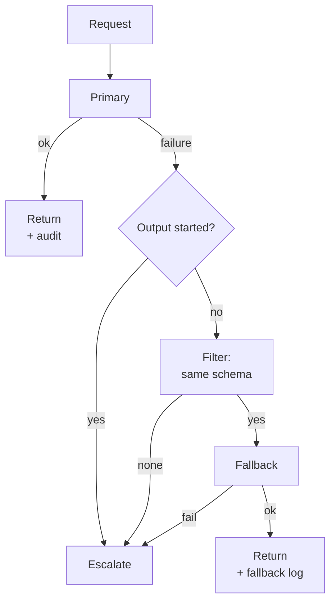

A **fallback lane** is a named secondary [provider route](glossary://provider-route) that the system may take when the primary model, plan, or provider cannot finish the request. The replacement path must satisfy the same product schema (privacy, schema, tools, review, budget ceiling); otherwise the gateway escalates instead of silently weakening the product during an outage.

In LLM systems a *lane* is a concrete generation path: provider + model + region + measured capabilities + cost/latency profile. Primary selection is normal [routing policy](glossary://routing-policy). Fallback is what happens *after* a classified failure (or a pre-call incompatibility) when the preferred lane is out. Gateways (for example LiteLLM-style UIs) often expose ordered model fallbacks for ordinary call failures (rate limits, timeouts, 5xx after retries), plus dedicated chains for context-window overflow and content-policy blocks; those knobs decide *when* another model may be tried. Your schema still decides *which* replacement is legal.

## Intuition

A fallback is safe only when the secondary path preserves the request formats. After a provider outage, open [circuit breaker](glossary://circuit-breaker), or quota exhaustion, route to lane B only if private data stays private, structured output still validates, and tool allowlists still hold. If no compatible lane remains, [fail closed](glossary://fail-closed) or escalate instead of silently weakening guarantees with an unevaluated model.

| Pattern | Question | Typical action |
|---|---|---|
| **Retry backoff** | Was this a blip on the *same* path? | Wait, try again on primary |
| **Circuit breaker** | Is this dependency sick enough to stop probing? | Skip primary for a cooldown |
| **Fallback lane** | Is there a *different, schema-compatible* path? | Route to B (or escalate) |
| **Load balancing** | How do we share healthy capacity? | Split traffic while all peers work |

Retries assume the primary may recover soon. Fallbacks assume you need a different path *now*. Combining them without a shared deadline multiplies cost: every failed primary attempt can still bill tokens or connection time before the backup runs.

## How it works

A production-safe fallback pipeline compiles The schema, checks candidate lanes, bounds attempts, and logs decisions. A bare exception handler that calls another API skips those controls.

1. **Compile The schema.** From the request: data class, context size, schema/citation needs, human-review flag, max answer cost, tool permissions, latency budget.
2. **Filter candidate lanes.** Keep only lanes that can honor the full schema. Drop anything that would lose citations, review, privacy region, or required tools.
3. **Attempt primary.** Invoke the ranked primary. Apply per-lane timeouts and limited [retry backoff](glossary://retry-backoff) for true blips.
4. **Classify the failure.** Transparent failover is usually safe for timeouts and rate limits *before any user-visible output*. For mid-stream drops and partial answers, stop or escalate so users know the answer was interrupted. Context-window and content-policy failures may use separate chains; select a lane that still meets the full schema, such as a larger private model for a request that needs more context.
5. **Select fallback.** Exclude the failed lane, re-filter by schema and circuit health, pick the next ranked lane (often lowest measured cost among survivors).
6. **Bound attempts and spend.** Cap total generation attempts and wall-clock time across primary + fallback. Failed primary work can still consume budget even when no answer is returned.
7. **Log the event.** Record policy id, primary lane, fallback lane, reason codes, cost deltas, and whether the user saw a degraded path.

```python title="schema-preserving-fallback.py"
from dataclasses import dataclass
from decimal import Decimal

@dataclass(frozen=True)
class Lane:
    name: str
    private_ok: bool
    schema_ok: bool
    citations_ok: bool
    review_ok: bool
    cost_usd: Decimal

@dataclass(frozen=True)
class schema:
    needs_private: bool
    needs_schema: bool
    needs_citations: bool
    needs_review: bool
    max_cost_usd: Decimal

TRANSPARENT = {"timeout_before_output", "rate_limit_before_output"}

def honors(lane: Lane, c: schema) -> bool:
    if c.needs_private and not lane.private_ok:
        return False
    if c.needs_schema and not lane.schema_ok:
        return False
    if c.needs_citations and not lane.citations_ok:
        return False
    if c.needs_review and not lane.review_ok:
        return False
    return lane.cost_usd <= c.max_cost_usd

def choose_fallback(
    schema: schema,
    lanes: list[Lane],
    failed: str,
    failure: str,
    healthy: set[str],
) -> Lane | None:
    if failure not in TRANSPARENT:
        return None  # stop / escalate; do not swap generators mid-answer
    candidates = [
        lane for lane in lanes
        if lane.name != failed
        and lane.name in healthy
        and honors(lane, schema)
    ]
    if not candidates:
        return None
    return min(candidates, key=lambda lane: (lane.cost_usd, lane.name))
```

This selector checks lane eligibility. Pass the **remaining** request budget in `max_cost_usd` after reserving or reconciling primary attempts, and enforce billing, tool, review, and data controls again during execution. `cost_usd` must represent a bounded reservation for the configured token limits when the budget is a hard cap; a historical average cannot enforce that limit.

## Diagram



## Example

Support assistant: evaluated answer must stay at most $0.005$ USD, keep tenant-private data on private lanes, emit structured JSON with citations, and require human review for high-risk access requests.

| Lane | Private | Schema + citations + review | Evaluated answer cost |
|---|---|---|---|
| `primary-private-cited-review` | yes | yes | $0.0032$ |
| `local-private-cited-review` | yes | yes | $0.0041$ |
| `cheap-text-fallback` | yes | no (plain text only) | $0.0004$ |

Primary times out after $1.8$s with no tokens streamed. Failure class: `timeout_before_output` (transparent). Shared request deadline: $2.5$s; max generation attempts: $2$.

Assume the primary consumed at most $0.0009$ of the total budget and the fallback reserves at most $0.0041$. The provider may charge for failed primary work even when it streamed no tokens, so a larger charge could make this fallback ineligible under the $0.005$ total ceiling.

1. Exclude `primary-private-cited-review`.
2. Re-apply the full schema. `cheap-text-fallback` is under budget but fails schema/citations/review, so it is **not** eligible.
3. `local-private-cited-review` is healthy and schema-compatible; it becomes the fallback lane with reason `primary_timeout_before_output;contract_preserved`.
4. Remaining wall-clock budget is about $0.7$s. If local also fails, escalate; do not invent a third weaker lane under the same attempt policy.

That is the same shape production gateways use: ordered fallbacks after retries, plus separate chains for context-window and content-policy errors when those failures need different targets. Test the backup model's schema, tools, and privacy behavior before promoting it.

## Compatibility checklist

Before promoting a lane as a fallback for another, verify parity (or deliberate, logged degradation) on:

- Prompt and chat-template behavior
- Structured output / JSON schema strictness
- Tool names, arguments, and allowlists
- Safety and refusal policy
- Context window and context handling (truncate vs reject)
- Data residency and tenancy isolation
- Streaming behavior (can you start over cleanly?)
- Cost and latency under the shared deadline

A backup that cannot honor the same schema creates a second incident class: silent schema drift, missing tools, weaker refusals, or private text on a public model.

## What to measure

Track fallback as product telemetry alongside infrastructure health:

- **Fallback rate** by route and tenant
- **Activation reason** (`timeout`, `rate_limit`, `circuit_open`, `quota`, `capability`)
- **Quality delta** vs primary (eval slice or shadow score)
- **Cost and latency change** per successful fallback
- **Escalation rate** when no compatible lane remains
- **User-visible degradation** flag when the path is intentionally weaker

A fallback is useful only when both the primary failure and the fallback outcome are visible in the audit trail.

## Why it matters here

Curriculum lessons on model gateways, support bots, and code completion treat fallback lanes as **declared product behavior under stress**, with explicit rules for switching paths. Local symbol completion when remote inference is slow, a private regional model when the primary private lane is open-circuited, and metered API capacity when a subscription quota is exhausted are all fallback lanes. Design them so incidents stay available while safety, schema, and cost specifications remain intact.

## Related terms

- [Provider route](glossary://provider-route)
- [Routing policy](glossary://routing-policy)
- [Circuit breaker](glossary://circuit-breaker)
- [Fail closed](glossary://fail-closed)
- [Retry backoff](glossary://retry-backoff)
