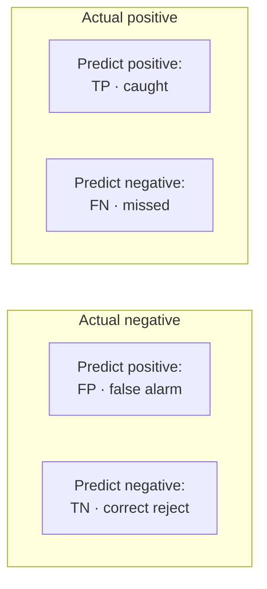

A **false negative (FN)** is a case that is truly positive but is treated as negative. In binary classification that means the true label is positive and the model predicts negative: a real positive was missed. In scikit-learn's confusion-matrix convention, that count is $C_{1,0}$ when class $1$ is the positive class.

The same phrase appears in contrastive and retrieval training with a slightly different object of "treated as." There, a **false-negative pair** is a pair that *should* be a positive match (same label, paraphrase, multi-relevant document) but the loss treats it as a negative and pushes the embeddings apart. Both meanings share the same damage pattern: a true match is denied, so metrics undercount success and gradients (or product actions) go the wrong way.

## Formula

From the four cells of a binary [confusion matrix](glossary://confusion-matrix):

$$
\mathrm{FN}=\#\{\,y=1,\ \hat{y}=0\,\}
$$

$$
\mathrm{recall}=\frac{\mathrm{TP}}{\mathrm{TP}+\mathrm{FN}},\qquad
\mathrm{FNR}=\frac{\mathrm{FN}}{\mathrm{TP}+\mathrm{FN}}=1-\mathrm{recall}
$$

FN is a raw count. Recall (true positive rate) is the share of actual positives you still catch. The **false negative rate (FNR)**, also called the miss rate, is the complementary share of positives you miss. Do not confuse FNR with the **false omission rate** $\mathrm{FN}/(\mathrm{FN}+\mathrm{TN})$, which conditions on negative *predictions* instead of true positives. Raising the [decision threshold](glossary://decision-threshold) for "positive" usually moves mass from TP into FN: fewer alarms, more misses. Product cost is rarely symmetric: the cost of one FN versus one false positive (FP) is a product choice, not a default of $0.5$ on the score.

In hypothesis testing language, a Type II error is also called a false negative (failing to detect a real effect). Classification FN is the ML instance of that idea when "detect the positive class" is the alternative of interest.

## Diagram



Only the positive row can produce FN. If positives are rare, accuracy can look fine while FN dominates risk.

## Example

A security **intent** classifier routes alerts. On a 200-alert slice, 40 alerts truly indicate `credential-leak` and 160 do not. At the shipped threshold:

|  | Pred other | Pred credential-leak |
|--|------------|--------------------|
| **True other** | TN $= 150$ | FP $= 10$ |
| **True credential-leak** | **FN $= 12$** | TP $= 28$ |

- Accuracy $= (28+150)/200 = 0.89$
- Precision $= 28/(28+10) = 0.74$
- Recall $= 28/(28+12) = 0.70$

Twelve credential-leak alerts went to the wrong queue (FN). Accuracy still looks strong because other alerts dominate. If a missed credential leak costs more than a false escalation, lower the threshold or fix the slice that produces those 12 misses; do not optimize headline accuracy alone.

```python
from sklearn.metrics import confusion_matrix, recall_score

# 0 = other, 1 = credential-leak
y_true = [0] * 160 + [1] * 40
# TN=150, FP=10 among other; FN=12, TP=28 among credential-leak
y_pred = [0] * 150 + [1] * 10 + [0] * 12 + [1] * 28

cm = confusion_matrix(y_true, y_pred, labels=[0, 1])
tn, fp, fn, tp = cm.ravel()
assert (tn, fp, fn, tp) == (150, 10, 12, 28)
assert recall_score(y_true, y_pred) == tp / (tp + fn)  # 0.7
```

## Contrastive and retrieval sense

In the usual one-positive-per-anchor in-batch InfoNCE or Multiple Negatives Ranking setup, other rows' positive candidates serve as negatives for an anchor. That is cheap supervision and one reason batch size matters, but it assumes those candidates are not valid matches for that anchor. Paraphrases, multi-answer queries, and unlabeled relevant passages can violate the assumption. Such a pair is a **false negative under the sampling assumption**. Multi-positive or explicitly masked variants need not treat every off-diagonal pair as negative.

```python
# In-batch setup: every non-diagonal pair is treated as negative.
# Rows 0 and 3 share a label, so (0,3) and (3,0) are false-negative pairs.
labels = ["auth", "latency", "schema", "auth"]
false_neg_pairs = [
    (i, j)
    for i in range(len(labels))
    for j in range(len(labels))
    if i != j and labels[i] == labels[j]
]
print(false_neg_pairs)  # [(0, 3), (3, 0)]
```

Effects on training:

- The gradient for a false-negative pair **repels** embeddings that should attract. That is the opposite of the desired geometry.
- Lower temperature $\tau$ sharpens InfoNCE and amplifies the bad push.
- Larger batches and aggressive [hard-negative](glossary://hard-negative) mining raise the chance of sampling true matches as "negatives," especially when labels are incomplete (common in MS MARCO-style data).
- Mitigations used in practice: shared-label masks, multi-positive contrastive losses, softer negatives, guide-model filtering of in-batch candidates, and positive-aware margins when mining hard negatives (drop candidates whose score is too close to the true positive).

Incomplete relevance judgments create a related eval artifact: the system retrieves a useful document, but the qrels omit it, so evaluation scores that hit as wrong. The model prediction may be a true positive; the scoring error comes from incomplete relevance labels.

## Why it matters here

Safety classifiers, routing, fraud, and eval gates live or die on whether misses are acceptable. A high FN rate on jailbreaks, PII leaks, or critical intents is a production failure even when precision looks fine. Dense retrieval and embedding training depend on clean negatives: false-negative pairs and noisy hard-negative mines silently train the model to push valid evidence away. Label quality, threshold policy, batch construction, and incomplete qrels all show up as FN-shaped damage. When something "should have been caught" or "should have retrieved," count FN first, then decide whether the fix is threshold, model, data, or mining.

## Related terms

- [Confusion matrix](glossary://confusion-matrix)
- [Precision and recall](glossary://precision-recall)
- [Decision threshold](glossary://decision-threshold)
- [Hard negative](glossary://hard-negative)
- [InfoNCE](glossary://infonce)
