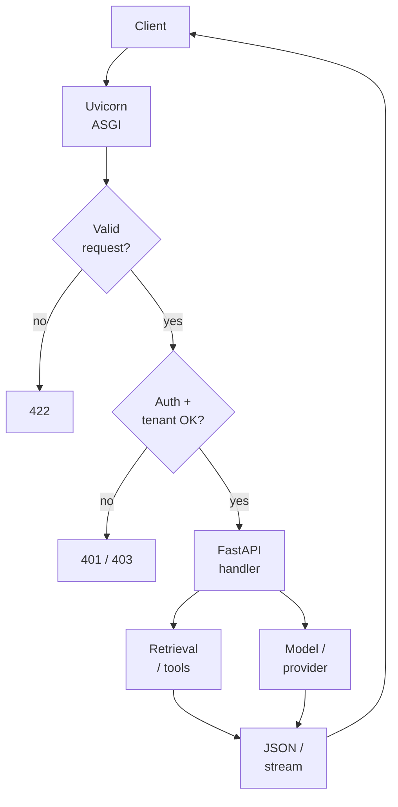

FastAPI is a modern Python web framework for building typed HTTP APIs. You declare path operations with standard type hints; the framework validates request data, serializes responses, injects shared dependencies, and generates [OpenAPI](https://spec.openapis.org/oas/v3.1.0) docs from those same declarations. Under the hood it sits on [Starlette](https://www.starlette.dev/) (ASGI routing, middleware, WebSockets, streaming) and [Pydantic](glossary://pydantic) (runtime validation and JSON Schema). You run it with an ASGI server such as Uvicorn.

Model-serving engines such as [vLLM](glossary://vllm) batch tokens on a GPU. FastAPI provides the *application perimeter* around that work: auth, tenant checks, schema validation, timeouts, streaming shape, and stable error codes before and after the model call.

## Intuition

Model code usually starts as a notebook or script. Product clients need a wire formats: which URL, which JSON fields, which status codes, how partial tokens arrive, and what a rejection looks like. FastAPI turns those specifications into executable code. A single Pydantic model both rejects bad JSON with a `422` and documents the expected body in `/docs`.

The payoff for LLM services is early failure. A missing `tenant_id` or oversized prompt should never start retrieval or burn decode tokens. A good FastAPI layer fails closed on shape and auth, then delegates generation to the engine or provider.

## How it works

1. **Route + types.** Decorators like `@app.post("/answer")` bind an HTTP method and path to a function. Parameters annotated with Pydantic models, path/query types, or `Depends(...)` tell FastAPI how to parse the request.
2. **Validate before the handler.** Invalid bodies become structured validation errors before your handler runs. Dependencies can execute during request processing before all body errors are resolved, so keep expensive generation out of validation and authentication dependencies.
3. **Dependencies.** Shared steps (API key check, tenant resolution, DB session) are functions or classes injected via `Depends`. Sub-dependencies form a tree; OpenAPI includes their parameters too.
4. **Handler body.** Your code calls retrieval, a provider, or a local engine. Prefer `async def` when you `await` async I/O clients. Use plain `def` for blocking libraries so FastAPI can run them in a threadpool instead of stalling the event loop.
5. **Response.** Return a dict, a Pydantic model, or a streaming response. A declared `response_model` validates and filters ordinary response data. A directly returned `Response`, including a stream, bypasses that model validation, so its wire format needs its own schema.

## Example

A document QA service exposes `POST /v1/answer`. The body must include a non-empty question, a tenant id, and optional conversation state. Validation runs before any embedding or generation cost.

```python
from typing import Annotated
import os
import secrets

from fastapi import Depends, FastAPI, Header, HTTPException
from pydantic import BaseModel, Field

app = FastAPI(title="Doc QA")

class AnswerRequest(BaseModel):
    question: str = Field(min_length=1, max_length=4000)
    tenant_id: str = Field(min_length=1)
    conversation_id: str | None = None
    max_sources: int = Field(default=5, ge=1, le=20)

class AnswerResponse(BaseModel):
    answer: str
    tenant_id: str
    sources: list[str]
    usage: dict[str, int]

async def require_api_key(x_api_key: Annotated[str | None, Header()] = None) -> str:
    expected_key = os.environ.get("DOC_QA_API_KEY")
    if not expected_key:
        raise HTTPException(status_code=503, detail="authentication unavailable")
    if not x_api_key or not secrets.compare_digest(x_api_key, expected_key):
        raise HTTPException(status_code=401, detail="invalid or missing api key")
    return x_api_key

@app.post("/v1/answer", response_model=AnswerResponse)
async def answer(
    req: AnswerRequest,
    _: Annotated[str, Depends(require_api_key)],
) -> AnswerResponse:
    # Demo response only. Before real retrieval, resolve the authenticated
    # principal and authorize req.tenant_id against its tenant memberships.
    return AnswerResponse(
        answer="...",
        tenant_id=req.tenant_id,
        sources=["doc://policy-12"],
        usage={"input_tokens": 812, "output_tokens": 96},
    )
```

Concrete failure modes this catches early:

| Client sends | Result |
|---|---|
| `{}` | `422` with field errors (no model call) |
| `question` of length 0 | `422` (constraint) |
| no `X-API-Key` | `401` from the dependency |
| valid body + verified key | handler runs; tenant authorization still required before retrieval |

For token streaming (chat UIs), return a Starlette `StreamingResponse` that yields SSE or chunked bytes as the engine produces tokens. Document the stream format in the [API schemas](glossary://api-contract); clients should not scrape free-form prose for control flow.

Set `DOC_QA_API_KEY` through the server's secret configuration; merely checking that a header exists is not authentication. The sample handler returns a hard-coded answer and usage counters. Add retrieval, model inference, and billing instrumentation to the service path before using those values as real usage.

## Diagram



## perimeter choices

Design the shell around successful requests and failure paths:

- **Request and response schemas** with size limits (`max_length` on prompts, caps on `max_tokens`).
- **Auth and tenant isolation** as dependencies, not ad hoc checks mid-handler.
- **Timeouts and deadlines** so a hung provider does not pin a worker forever ([deadlines and TTL](glossary://ttl-deadline)).
- **Streaming shape** (SSE event names, final `done` / `error` events, cancel when the client disconnects).
- **Async vs blocking:** `async def` that calls synchronous Hugging Face or NumPy work without a threadpool or process pool will block other requests on that worker.
- **Stable errors:** prefer documented `error.code` values over unstructured `500` text after work has already started.

Bad wrappers accept vague JSON, start expensive retrieval, then return a stack trace. A better perimeter rejects bad input early and keeps the success envelope stable even when generation wording changes.

## Trade-offs

| Choice | Gain | Cost |
|---|---|---|
| FastAPI as app shell | typed schemas, OpenAPI, DI, Python ML ecosystem | Not GPU batching; pair with a real inference engine for high throughput |
| Auto OpenAPI from code | Docs stay close to implementation | Still need versioning and human review for breaking changes |
| `async def` everywhere | Great for many concurrent I/O waits | Blocking calls inside async handlers hurt latency under load |
| One process, many routes | Simple deploy for demos and internal tools | Long generations need timeouts, concurrency caps, and often a queue |

## Why it matters here

FastAPI is the practical bridge from Python ML code to product APIs in LeetLLM labs and production services. Reliable model serving combines a checkpoint with specifications, auth, timeouts, streaming, and permissions. FastAPI provides the application perimeter for those controls.

## Related terms

- [Pydantic](glossary://pydantic)
- [API schemas](glossary://api-contract)
- [Request path](glossary://request-path)
- [Structured output](glossary://structured-output)
- [Deadlines and TTL](glossary://ttl-deadline)
