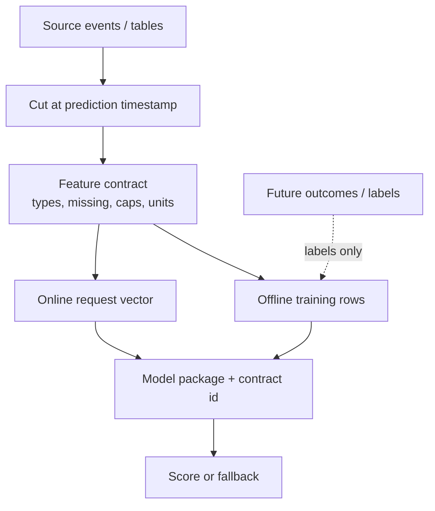

A **feature contract** is the versioned agreement that says exactly which model inputs exist, how each is typed and computed, which values are allowed, how missing or late data is handled, and which time boundary must hold at prediction time. It is stronger than a column list or a JSON schema alone: two pipelines can share names and dtypes and still disagree on units, windows, caps, null policy, freshness, and whether a value was known *before* the prediction was made.

Treat the contract as shared product logic between training, offline evaluation, and online serving. The same definition builds historical training rows (via [point-in-time joins](glossary://point-in-time-join)) and live request vectors. When those paths diverge, you get [training-serving skew](glossary://training-serving-skew) without changing a single model weight. Feature stores, registries, and model packages ship contract implementations; product teams define the contract's semantics.

## Intuition

A feature can have the right type and still mean the wrong thing. `queue_backlog` might be:

- open-ticket count at prediction time offline,
- latest counter from a cache online,
- null-filled to $0$ in one path and left missing in another,
- uncapped offline and hard-capped online.

The contract makes those choices explicit so train, eval, and serve share the same interpretation. Schema validation checks declared types and fields; contract tests also compare time semantics, units, and missing-value policy.

## What belongs in the contract

Pin at least these fields per feature (and at the feature-set / model-input level):

| Dimension | What to specify | Why it breaks without it |
| --- | --- | --- |
| Identity | Stable name, version, owner, source table or service | Undeclared consumers and silent renames |
| Entity keys | Join keys and grain (job, request, user, …) | Wrong row joined at train or serve |
| Type and units | dtype, units, allowed range or enum | Float that is actually a count or ratio |
| Missing policy | Reject, impute, indicator bit, abstain / fallback | $0$ vs "unknown" confuses the model |
| Transforms | Caps, log1p, categorical maps, `other` bucket, vector order | Fitted artifacts that don't travel with the model |
| Time boundary | Event time vs available time vs [prediction timestamp](glossary://prediction-timestamp) | Future leakage and inflated offline metrics |
| Freshness | Max age for normal score vs fallback vs block | Stale-but-typed rows score as if current |
| Backfill rules | Whether corrected history may rewrite past values | Offline "truth" the online path never saw |

Version the whole input set (`eta-features-v1`, `features-v3`) alongside its individual columns. A model package should pin the contract id it was trained against so a serving mismatch can fail closed.

## Example

Job SLA prediction at `2026-05-01 09:00` for job `J-204`. The product asks: will this job miss its SLA? Only history available at that timestamp may enter the model.

| Feature | Type | Missing / range rule | Time rule |
| --- | --- | --- | --- |
| `runner_pool` | categorical | reject if absent; unseen $\to$ `other` | known at queue time |
| `queued_minutes` | numeric | reject if absent; $\ge 0$ | measured at prediction |
| `hours_since_last_heartbeat` | numeric | cap at $180$; reject if negative | last heartbeat $\le$ prediction time |
| `queue_backlog` | numeric | non-negative; cap at $5000$; units = open tickets | before prediction timestamp |
| `queue_backlog_missing` | $\{0,1\}$ | $1$ when source feed failed | pairs with backlog |
| `priority_job` | boolean | default `false` only if source guarantees it | known at prediction |

Concrete valid row at 09:00 (six-slot fixed order the model expects):

```text
[a100-pool, 42.0, 0.5, 18.0, 0, 0]
# runner_pool, queued_minutes, hours_since_last_heartbeat,
# queue_backlog, queue_backlog_missing, priority_job
```

A noon heartbeat, `finished_at`, and post-SLA escalation stay outside the contract. They may exist on the source record for labels later; they must not appear as features.

Define missing-backlog behavior as product policy and enforce the range and cap from the table:

```python
from math import isfinite

CAP = 5000.0

def encode_queue_backlog(value):
    # Missing != measured zero. The indicator preserves the failure signal.
    if value is None:
        return {"queue_backlog": 0.0, "queue_backlog_missing": 1}
    v = float(value)
    if not isfinite(v) or v < 0:
        raise ValueError("queue_backlog must be finite and non-negative")
    return {
        "queue_backlog": min(v, CAP),
        "queue_backlog_missing": 0,
    }

assert encode_queue_backlog(0) == {"queue_backlog": 0.0, "queue_backlog_missing": 0}
assert encode_queue_backlog(None) == {"queue_backlog": 0.0, "queue_backlog_missing": 1}
assert encode_queue_backlog(9000) == {"queue_backlog": 5000.0, "queue_backlog_missing": 0}
```

Allowlist the keys so a leaked label field fails before training or scoring:

```python
ALLOWED = {
    "runner_pool",
    "queued_minutes",
    "hours_since_last_heartbeat",
    "queue_backlog",
    "queue_backlog_missing",
    "priority_job",
}

def assert_contract_keys(features: dict) -> None:
    blocked = sorted(set(features) - ALLOWED)
    if blocked:
        raise ValueError(f"fields outside contract: {blocked}")
```

## How it works at train and serve

1. **Define** the versioned feature set before training (names, policies, time cut).
2. **Build offline rows** with point-in-time joins: for each label row, require event time $\le$ prediction timestamp and preserve what the serving path could actually access then. For delayed or backfilled sources, this also requires available time $\le$ prediction timestamp; event time alone can leak information.
3. **Fit transforms** that must ship with the model (category maps, caps, scalers) and freeze them inside the package.
4. **Serve** the same computation path online: entity keys $\to$ latest valid features under the same policies $\to$ fixed vector order $\to$ model.
5. **Gate** on contract version, key allowlist, ranges, freshness, and parity samples (recompute one production prediction through the offline path at the same timestamp and diff field by field).

In open-source feature stores such as Feast, a **feature view** declares schema and sources; a **feature service** groups the exact features one model version needs for historical and online retrieval. That grouping implements a model-scoped feature contract; define missing-value and freshness policies explicitly as part of it.

## Diagram



When offline and online behavior diverge, inspect the feature contract and its enforcement first.

## Contract checks

Test before bad features reach the model:

- Missing values, stale values, out-of-range values, delayed sources
- Backfills and point-in-time joins (event time vs available time)
- Unseen categoricals (`other` vs reject)
- Key allowlists and fixed vector order
- Live serving traces against the pinned contract id
- Offline/online parity on held-out production timestamps

Record owner, source, units, null policy, freshness target, timestamp semantics, backfill rules, and allowed transformations with the version id.

## Why it matters here

A model can fail when a feature means one thing offline and another thing online. Curriculum lessons on feature engineering, leakage, SLA prediction, and monitoring treat the feature contract as a release artifact: freeze it with the snapshot, training pipeline, decision policy, and previous model pointer. For LLM systems the same idea applies to retrieval metadata, permission flags, and other structured side inputs: if a field was unavailable when the action was chosen, it cannot enter that historical action's features or prompt context. Fit preprocessing statistics only on the permitted training data.

## Related terms

- [Training-serving skew](glossary://training-serving-skew)
- [Feature store](glossary://feature-store)
- [Feature freshness](glossary://feature-freshness)
- [Point-in-time join](glossary://point-in-time-join)
- [Feature leakage](glossary://feature-leakage)
