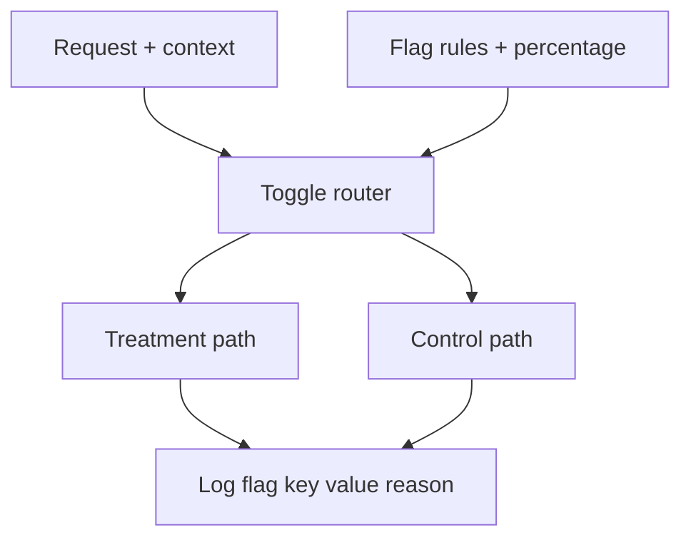

A **feature flag** (also called a feature toggle, feature flipper, or feature bit) is a runtime control that chooses which code path, configuration, or product behavior runs for a given request **without redeploying**. You ship both the old and new paths in one build; a **toggle router** evaluates a named flag against **context** (user, tenant, conversation, environment, percentage, overrides) and returns on/off or a multivariate value. The deployable artifact can already contain the candidate. Exposure is a separate, reversible decision.

Pete Hodgson's standard treatment frames flags as the mechanism that **separates deployment from release**: incomplete or risky work can sit on trunk and in production as latent code while only selected cohorts see it. OpenFeature formalizes the same idea as a vendor-agnostic evaluation API: application code asks for a flag value given evaluation context; a provider supplies rules from a local file, in-house service, or commercial flag platform.

In AI systems, flags select behavior throughout the stack: model routes, prompt templates, retrievers, safety thresholds, tool allowlists, eval gates, cache namespaces, and provider failover paths. Many apparent "model bugs" come from flag state, assignment, or overrides, so inspect those before changing model code.

## Categories

Manage flags according to their purpose and lifetime. Hodgson's useful split:

| Category | Job | Typical lifetime | Dynamism |
|---|---|---|---|
| **Release** | Ship latent code; turn a feature on when ready | Days to a few weeks | Mostly static per environment |
| **Experiment** | A/B or multivariate comparison under sticky assignment | Hours to weeks (until power is enough) | Per request / per user |
| **Ops** | Degrade or kill a path under load or incident | Short, or permanent kill switches | Must flip in seconds without a deploy |
| **Permissioning** | Premium, beta, internal dogfood, tenant entitlement | Months to years | Per user / per tenant |

Release and short ops flags are inventory with carrying cost: remove them when the behavior is permanent or abandoned. Keep permissioning flags and a small set of long-lived kill switches when they serve deliberate product or reliability controls.

## Diagram



## How evaluation works

1. **Name the decision.** Prefer a product-shaped question (`use_cross_encoder_rerank_v2`) over a megatoggle (`next_gen_ai`). Decouple the **toggle point** (where control flow branches) from the **decision logic** (who is eligible and why).
2. **Build evaluation context.** User id, tenant, plan, locale, conversation id, environment, internal cookie, and any experiment salt. Server-side evaluation is the default for model, tool, and safety flags; client-visible flags are easier to spoof.
3. **Resolve rules.** Hard off, hard on for a list, percentage of a hashed key, environment overrides, then per-request overrides for dogfood. A multivariate flag can return a model alias, temperature band, tool pack, or another configured value.
4. **Default safely.** If the flag service is down, use an explicit safe value and count evaluations that hit the default. For a release flag that may mean **off** / previous behavior; for a flag enabling a required safety check it may mean **on**, or denying the action. The name's boolean polarity does not determine safety.
5. **Log the outcome.** Record flag key, resolved value, reason (rule match, percentage, override, default), assignment key, and config version on every request that can affect quality, cost, or safety.

For a percentage rollout with sticky assignment, a common router rule is:

$$
b = H(\textit{assignmentKey} \parallel \textit{flagSalt}) \bmod 100,\qquad
\text{enabled} \iff b < p
$$

where $H$ is a stable, well-distributed hash over the assignment key space, $p$ is the intended percentage ($0 \le p \le 100$), and the salt is fixed for the flag so reshuffling doesn't happen when you only change unrelated flags. Stability keeps the same key in the same bucket across evaluations; uniformity keeps actual exposure near nominal $p$ (a biased hash skews who gets the treatment). Raising $p$ from $5$ to $25$ keeps previously enabled keys enabled if the hash is consistent; changing the salt reassigns the whole population.

## Example

You want a new cross-encoder reranker on support chat without a full cutover.

- **Flag:** `rerank_cross_encoder_v2` (boolean release + canary flag).
- **Assignment key:** conversation id (sticky multi-turn; see [stable assignment](glossary://stable-assignment)).
- **Rules:** off globally; on for internal staff; then $p = 5$ of production conversations; hard off for tenants that forbid third-party ranking.
- **Paths:** treatment calls the cross-encoder; control keeps the bi-encoder top-$k$ order.
- **Defaults:** on flag-service timeout, stay on control.

Define rule precedence explicitly: a tenant's third-party restriction overrides staff and percentage exposure. Enforce that restriction as authorization outside the release flag too; an override or a later flag removal must not grant forbidden access.

Hold $5\%$ for $45$ minutes through peak traffic. Tag every request with flag value, reason, model, prompt version, and retriever version. Watch treatment vs control: p95 end-to-end latency, citation-present rate, acceptance of drafted replies, cost per chat, safety failures on access-control and PII paths, and fallback rate to the old ranker.

Suppose treatment p95 jumps from $1.8$s to $3.2$s while acceptance is only slightly better. Flip the flag to $0\%$ (or disable the rule) without redeploying. That is the ops value of the flag: [rollback](glossary://rollback) switches configuration to the previous path while the existing build supplies both implementations. If metrics stay green, step $p$ through $5 \to 25 \to 50 \to 100$ of eligible traffic, then remove the temporary release flag. Preserve permanent tenant restrictions and any required fallback for ineligible traffic.

```python
def rank_passages(query, passages, ctx, flags):
    use_v2 = flags.bool(
        "rerank_cross_encoder_v2",
        default=False,
        context={
            "tenant": ctx.tenant_id,
            "conversation": ctx.conversation_id,
            "employee": ctx.is_employee,
        },
    )
    if use_v2:
        return cross_encoder_rerank(query, passages)
    return bi_encoder_order(passages)
```

## Production failure modes

- **Flag debt.** Nested `if` trees for finished launches make every change combinatorial. Cap active release flags; schedule removal when a flag hits $100\%$ or is abandoned.
- **Unlogged evaluation.** Without flag value and reason on the request, you cannot attribute a bad answer to eligibility, sticky key, override, stale SDK cache, or percentage.
- **Non-sticky keys.** Hashing per request mid-conversation mixes models, prompts, and memories; experiments and canaries become uninterpretable.
- **Combinatorial testing.** You do not need every flag combination. Prefer testing expected production config, the safe fallback config, and high-risk interactions you know couple (model + safety policy + tools).
- **Client-controlled treatment.** Letting the browser freely enable model or tool paths is an abuse surface. Gate risky AI paths server-side.

## Why it matters here

Feature flags are how AI teams practice continuous delivery on behavior that is expensive to reverse: new prompts, rerankers, agent tools, provider routes, and safety thresholds. They power [canary rollouts](glossary://canary-rollout), [traffic splits](glossary://traffic-split), [A/B tests](glossary://ab-testing), and [kill switches](glossary://kill-switch) on the same control plane. Used well, they shrink blast radius and make incidents one config flip away from the last known-good path. Used poorly, they become permanent product complexity and an invisible source of training-serving and multi-variant skew. Treat each flag as temporary inventory with an owner, an expiry, and a logged evaluation path.

## Related terms

- [Canary rollout](glossary://canary-rollout)
- [Kill switch](glossary://kill-switch)
- [A/B testing](glossary://ab-testing)
- [Stable assignment](glossary://stable-assignment)
- [Traffic split](glossary://traffic-split)
