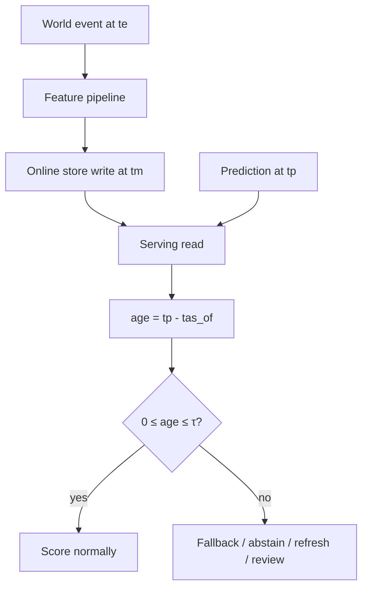

**Feature freshness** is how old a feature value is relative to the [prediction timestamp](glossary://prediction-timestamp): the gap between "when the world (or pipeline) last updated this input" and "when the model scores." A typed, non-null feature can still be unusable if that gap exceeds The schema for the decision being made.

Freshness measures feature age; serving latency measures time to read the value. An online store can return quickly while serving a value that describes the world from an hour ago. Model staleness measures time since weights were trained, so a freshly deployed model can still score stale inputs.

## Intuition

Every feature value has clocks attached to it. At minimum you need:

| Clock | What it answers |
| --- | --- |
| Event time $t_e$ | When the underlying state or fact happened in the world |
| Materialization time $t_m$ | When the feature row became available in the store the model reads |
| Prediction time $t_p$ | When the model is asked to score |

Pipeline lag ($t_m - t_e$) can hide behind a recent materialization stamp if you only track one timestamp. A late-arriving correction can also look "fresh" by write time while describing an older event. Treat event time and materialization time as separate fields so lag cannot masquerade as real-world state.

## Formula

For a feature $f$ used at prediction time $t_p$, define age from the timestamp the serving path actually trusts:

$$
\mathrm{age}(f) = t_p - t_{\mathrm{as\_of}}(f).
$$

Teams usually set $t_{\mathrm{as\_of}}$ to event time when they care about how old the *signal* is, or to materialization time when they care about how long the *online row* has been sitting. When both matter, record both and enforce both:

For an aggregate, specify the window's end or source watermark rather than assuming the latest event timestamp means the whole window is current. For a slowly changing fact, the last change can be old while a recent verification confirms it is still valid; distinguish last-change time from last-verified time.

$$
\begin{align*}
\mathrm{signal\_age}(f) &= t_p - t_e(f), \\
\mathrm{store\_age}(f) &= t_p - t_m(f), \\
\mathrm{pipeline\_lag}(f) &= t_m(f) - t_e(f).
\end{align*}
$$

A freshness SLA is a per-feature (or per-feature-group) bound $\tau_f$ such that the request is safe only if $\mathrm{age}(f) \le \tau_f$ for every required feature. Failures of that inequality should not be averaged away; the binding constraint is the worst required field.

**Clock caveat:** age math assumes comparable clocks. Use timezone-aware timestamps (prefer UTC), pick an authoritative field when event time and write time disagree, and budget for producer vs scorer clock skew. Naive local times and mixed zones are a common online-decisioning incident class; they can make a fresh value look stale (or the reverse) without any pipeline change.

## Example

An online incident-escalation model needs velocity features (`error_count_5m`, `distinct_services_1h`). Training builds each row with a [point-in-time join](glossary://point-in-time-join) so features match what was knowable at that historical $t_p$. Online serving reads a cache refreshed by an hourly batch.

At $t_p = 14{:}47$:

| Feature | $t_e$ | $t_m$ | $\mathrm{signal\_age}$ | $\mathrm{store\_age}$ | Max age $\tau$ | Decision |
| --- | --- | --- | ---: | ---: | ---: | --- |
| `error_count_5m` | 13:50 | 14:00 | 57 min | 47 min | 5 min | stale |
| `service_tier` | 14:40 | 14:40 | 7 min | 7 min | 24 h | ok |
| `runbook_version` | 06:00 | 06:05 | ~9 h | ~9 h | 24 h | ok |

At the 14:47 request, the cache row is 47 minutes old. That age makes a five-minute error counter unusable because three failures at 14:40 never entered the count the model was trained to trust. A daily capacity forecast with the same 47-minute lag may still be valid. Measure freshness at prediction time against The schema for *that* feature and action.

```python
from datetime import datetime, timedelta, timezone

def feature_age(prediction_ts: datetime, as_of: datetime) -> timedelta:
    if prediction_ts.utcoffset() is None or as_of.utcoffset() is None:
        raise ValueError("timezone-aware timestamps required")
    return prediction_ts - as_of

def is_fresh(prediction_ts: datetime, as_of: datetime, max_age: timedelta) -> bool:
    if max_age < timedelta(0):
        raise ValueError("max_age must be non-negative")
    age = feature_age(prediction_ts, as_of)
    return timedelta(0) <= age <= max_age

tp = datetime(2026, 2, 4, 14, 47, tzinfo=timezone.utc)
as_of = datetime(2026, 2, 4, 14, 0, tzinfo=timezone.utc)
assert not is_fresh(tp, as_of, max_age=timedelta(minutes=5))
assert is_fresh(tp, as_of, max_age=timedelta(hours=24))
```

## How it works

Feature pipelines produce values on a schedule (batch), continuously (stream), or on demand at request time. Serving then applies a policy:

1. **Read** the online value and its timestamps with the feature vector.
2. **Compute** age against $t_p$ (and optionally pipeline lag).
3. **Compare** to the max age in the [feature schemas](glossary://feature-contract).
4. **Act**: score normally, use a fallback feature or default, abstain, refresh synchronously, or route to human review.

Batch refresh shortens average age only up to the schedule period. Streaming and on-demand paths shrink lag toward event arrival time, at higher operational cost. Hybrid models are normal: slow features (service metadata, ownership, runbook version) stay batch; fast features (error rate, queue depth, saturation) stream or compute on request.

Training-time freshness is a separate but related concern: how recent the training slice is, and whether offline rows use the same windows and availability rules as online. When training sees near-instant point-in-time features and serving sees multi-hour snapshots, the gap is a form of [training-serving skew](glossary://training-serving-skew) even if column names match.

## Diagram



## Serving policy

Define max age **per feature and action**. Track distributions and tails alongside means:

| Metric | Why |
| --- | --- |
| Max / p95 / p99 age by feature | Averages hide the one field that should block serving |
| Source lag and materialization lag | Separates world delay from pipeline delay |
| Fraction of scores with any stale required feature | Capacity and reliability signal |
| Fallback and abstention rate from freshness | Product impact of the policy |
| Decisions made with stale inputs | Catches soft-fail paths that still ship a score |

Emit feature timestamps (and ages) on every prediction trace so operators can separate model error from stale state when quality drops.

## Why it matters here

LeetLLM production lessons on batch and streaming features, monitoring, and capacity forecasting treat freshness as a request-time safety check. Stale queue scans, heartbeats, indexes, permissions, and error counters make a fluent model operationally wrong. Freshness policies in the feature schemas make serving behavior explicit: what is safe to score, what falls back, and what must fail closed until the pipeline catches up.

## Related terms

- [feature schemas](glossary://feature-contract)
- [Feature store](glossary://feature-store)
- [Prediction timestamp](glossary://prediction-timestamp)
- [Point-in-time join](glossary://point-in-time-join)
- [Training-serving skew](glossary://training-serving-skew)
