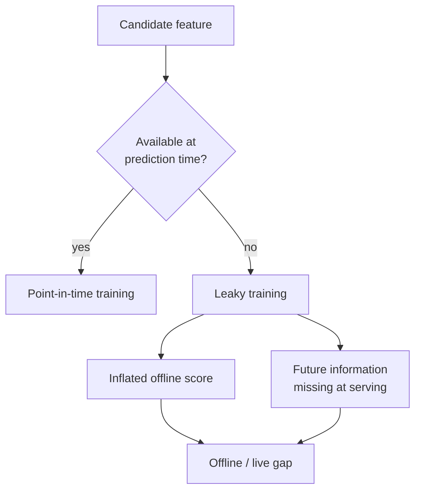

Feature leakage (also called target leakage or, more broadly, data leakage) is the use of information during training or evaluation that would not be legitimately available at prediction time. The model exploits a proxy for the answer, a post-outcome artifact, or statistics computed with future or holdout data instead of a pattern available in production. Offline metrics then look excellent, and production performance collapses.

The classical formulation treats leakage as any introduction of target or label information that should not be available at prediction time. In practice that shows up in two families: **feature leakage** (column-wise: a duplicate label, a proxy for the label, or post-event data joined into the feature matrix) and **train-test contamination** (row-wise or pipeline-wise: holdout rows influence fit, preprocessing, or feature selection). Both inflate reported skill without improving real prediction.

## Intuition

Leakage is a time machine hidden in the dataset. At score time the system only knows what has already happened and already arrived. Training rows built from a cleaned warehouse often know more: corrected labels, late-arriving events, human-review outcomes, and global aggregates computed over the full table. If those facts enter as features, the model memorizes "what already happened" instead of "what could have been predicted."

A feature name can look innocent. `final_run_status`, `postmortem_severity`, `time_to_recovery`, `label_confidence`, or even `ticket_resolution_notes` may be strongly predictive and completely unavailable when the decision must be made.

## Example

A job-risk model predicts whether a queued training run needs human review before launch ($y=1$ means "needs review"). Training uses 10,000 historical runs. Among the features is `final_run_status` (filled after completion) and a seven-day failure aggregate that includes failures *after* the review decision.

| feature | AUC contribution (illus.) | available at review time? |
| --- | --- | --- |
| queued_tasks, requested_gpu_hours | moderate | yes |
| owner_prior_failure_rate (as of decision) | moderate | yes |
| final_run_status | very high | **no** |
| failures_next_7d | high | **no** |

With the leaky columns, validation AUC is $0.97$. After dropping them and rebuilding aggregates with a [point-in-time join](glossary://point-in-time-join) as of each run's [prediction timestamp](glossary://prediction-timestamp), AUC falls to $0.71$. Production scoring never had `final_run_status` at review time, so the $0.97$ number was fiction.

The same trap appears in LLM systems when a historical evaluation retrieves document revisions unavailable at its prediction time, when retrieval indexes expose withheld benchmark answers, or when holdout prompts participate in tuning. Retrieving an answer from an authorized corpus is legitimate for an open-book RAG task; the evaluation's declared information boundary determines whether it is leakage. Classify a document edit by checking its availability at prediction time and how the label was created.

## How it enters

| Path | What leaks | Typical surface |
| --- | --- | --- |
| Post-outcome columns | Label proxies, review notes, final statuses | Ticket exports, warehouse denormalized tables |
| Temporal aggregates | Future windows, "next 7 days" stats | Feature SQL without event-time cutoffs |
| Late-arriving joins | Events with `event_time < t` but `available_time > t` | Streams, backfills, corrected facts |
| Pipeline contamination | Scaler / imputer / SelectKBest fit on all rows | Notebooks that preprocess before split |
| Group / duplicate leakage | Same patient, user, or ticket across splits | Random row splits on non-IID data |
| Label process artifacts | Human review fields that *are* the decision | QA tools that write both feature and label |
| Eval / corpus leakage | Test stems or answers in train, RAG, or demos | Public benchmarks, internal golden sets |

scikit-learn's rule of thumb matches production practice: never call `fit` on data that should stay holdout. Fit transforms on train only, then `transform` validation and test (or use a pipeline so cross-validation refits inside each fold).

```python
# Wrong: feature selection sees the whole matrix (including holdout)
X_sel = SelectKBest(k=25).fit_transform(X, y)
X_train, X_test, y_train, y_test = train_test_split(X_sel, y)

# Right: split first; fit selection only on train
X_train, X_test, y_train, y_test = train_test_split(X, y)
sel = SelectKBest(k=25).fit(X_train, y_train)
X_train_sel, X_test_sel = sel.transform(X_train), sel.transform(X_test)
```

## Worked numbers

scikit-learn's common-pitfalls demo builds a binary classification problem with 200 rows, a random label ($P(y=1)=0.5$), and 10,000 pure-noise features. Selecting the 25 "best" features *before* the split yields accuracy about $0.76$ even though $X$ and $y$ are independent: selection locked onto chance correlations that only exist because the holdout participated. Splitting first and fitting selection on the train fold only returns accuracy near chance ($0.5$). The $0.26$ accuracy gap comes from holdout leakage: feature selection captures chance correlations when holdout rows join fitting, while train-only selection stays near chance.

For a deployment that predicts future cases from past data, random $k$-fold can train on information from the future of its validation cases. Evaluate with past training windows and later scoring windows, and require every feature $x$ used for a prediction at time $t$ to satisfy:

$$
\text{event\_time}(x) \le t \quad \text{and} \quad \text{available\_time}(x) \le t
$$

A fact that describes the past still leaks when it reaches the store after $t$; check both event time and availability time.

## Diagram



## Leakage audit

For each feature (and each derived embedding / aggregate), fill a small availability table before trusting offline scores:

| column | meaning |
| --- | --- |
| feature | name / version |
| source | table, log, or human tool |
| created_at / available_at | when the value could be read |
| depends_on_label | yes / no / indirect |
| available_at_prediction | would serving have this at `prediction_ts`? |

Then:

1. Rebuild the matrix with only features marked available.
2. Prefer time-based or group-based splits over random rows.
3. Fit preprocessing and feature selection inside the train fold only.
4. Diff offline vs online feature values for the same entity and timestamp ([training-serving skew](glossary://training-serving-skew) often co-occurs with leakage).
5. Treat suspiciously high offline scores on messy human behavior as a bug until proven otherwise.

## Why it matters here

AI systems combine logs, labels, embeddings, human feedback, and retrieval corpora, so leakage often enters through pipelines rather than one obvious column. Ranking labels used as serving features, RAG indexes that hold eval answers, and fine-tunes on near-duplicates of golden sets are the same failure mode under different names. Catching it protects the difference between benchmark success and real prediction skill, and it is why point-in-time joins, prediction timestamps, clean splits, and contamination checks show up throughout the curriculum.

## Related terms

- [Point-in-time join](glossary://point-in-time-join)
- [Prediction timestamp](glossary://prediction-timestamp)
- [Training-serving skew](glossary://training-serving-skew)
- [Train, validation, and test split](glossary://train-validation-test-split)
- [Benchmark contamination](glossary://benchmark-contamination)
