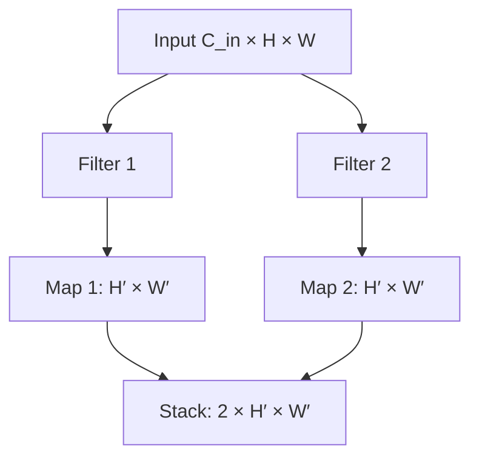

A **feature map** (also called an **activation map**) is the spatial grid of responses produced by one learned [convolution kernel](glossary://convolution-kernel) as it slides over an input. Each entry is the filter's match strength at that location; stacking many maps along the channel axis yields the layer's full output volume. In the common CNN picture, "one map = one channel": a layer with 64 filters emits 64 maps of height $H$ and width $W$.

The same idea generalizes beyond images: any layer that keeps a spatial (or temporal) layout of activations is producing feature maps. Intermediate CNN tensors, U-Net skip tensors, and diffusion backbone activations are all feature maps. Kernel methods also call a transformation $\phi(x)$ into a high-dimensional space a feature map; that usage refers to a different concept.

## How it works

A standard ungrouped 2D convolution takes an input volume of shape $(C_{\mathrm{in}}, H_{\mathrm{in}}, W_{\mathrm{in}})$ (batch omitted). Each of the $C_{\mathrm{out}}$ filters has shape $(C_{\mathrm{in}}, k_h, k_w)$ and computes one scalar per spatial position by local weighted sum plus optional bias. With $g$ groups, a filter instead spans $C_{\mathrm{in}}/g$ input channels. Sliding that filter over the plane fills one $H_{\mathrm{out}} \times W_{\mathrm{out}}$ map. The $C_{\mathrm{out}}$ maps stack into the output volume $(C_{\mathrm{out}}, H_{\mathrm{out}}, W_{\mathrm{out}})$.

In PyTorch layout (`NCHW`), a batch of feature maps is a tensor of shape `(N, C, H, W)`. A single map for sample $n$ and channel $c$ is the slice `Y[n, c, :, :]`. Early maps often fire on edges, colors, or local textures; deeper maps respond to larger, more abstract patterns because the [receptive field](glossary://receptive-field) of each cell has grown.

Spatial size is set by kernel size, [stride](glossary://stride), [padding](glossary://padding), and dilation (PyTorch formula):

$$
H_{\mathrm{out}} = \left\lfloor \frac{H_{\mathrm{in}} + 2p - d(k_h - 1) - 1}{s} \right\rfloor + 1
$$

and the same form for $W_{\mathrm{out}}$, using that axis's parameters. With stride $s=1$, pad $p=(k-1)/2$, and dilation $d=1$, spatial size is preserved ("same" padding for odd $k$). Stride $2$ approximately halves resolution; pooling does so only with suitable kernel and stride settings. Downsampling can discard small-object information, depending on what the channels and skip paths preserve.

## Formula

For one output channel $c'$ at position $(i,j)$ (stride 1, no padding, cross-correlation as in PyTorch):

$$
Y_{c',i,j} = b_{c'} + \sum_{c=0}^{C_{\mathrm{in}}-1} \sum_{u=0}^{k_h-1} \sum_{v=0}^{k_w-1} X_{c,\, i+u,\, j+v}\, K_{c',c,u,v}
$$

The full feature map for channel $c'$ is the array of all $Y_{c',i,j}$ over valid $(i,j)$. $K$ filters $\Rightarrow$ $K$ maps $\Rightarrow$ depth $K$ in the output volume.

## Example

**Tiny edge map.** Single-channel $4 \times 4$ patch, $3 \times 3$ kernel, stride $1$, padding $0$:

$$
H_{\mathrm{out}} = \left\lfloor \frac{4 - 3}{1} \right\rfloor + 1 = 2
$$

so the feature map is $2 \times 2$. With padding $1$ (same padding), the map stays $4 \times 4$: every input pixel gets a centered kernel application.

**Multi-channel volume (CS231n-style).** CIFAR-sized RGB input $32 \times 32 \times 3$, first conv with $K=12$ filters of size $5 \times 5$, stride $1$, pad $2$:

- each filter has $5 \times 5 \times 3 = 75$ weights (+1 bias)
- output volume is $32 \times 32 \times 12$ (12 feature maps of size $32 \times 32$)
- after $2 \times 2$ max pool stride $2$: $16 \times 16 \times 12$

A feature map stores the response field of one learned filter across spatial positions. A bright blob reflects the learned pattern; compare several channels and depths before assigning a semantic label.

**Production shape check.** A detector backbone that maps $640 \times 640$ to a $20 \times 20$ map (total stride $32$) gives each cell a large receptive field but only coarse localization. Small logos or UI icons can vanish in intermediate maps long before the head. If mAP for small objects is poor, inspect early map resolution and total stride before blaming the loss.

## Two-filter example

## Visualization and debugging

Read feature maps as channel activations on an input grid; meaningful visual explanations require additional analysis. Useful checks:

- **Dead maps:** a channel that is near zero for many inputs can mean a dead ReLU path or an unused filter (high learning rate is a classic cause).
- **Spatial collapse:** early downsampling can erase fine structure. Extra channel width cannot recover information already lost, although channels or skip paths may preserve detail despite a smaller grid.
- **Memory:** early high-resolution maps dominate activation memory. A $224 \times 224 \times 64$ map is about $3.2$M floats per sample; three such layers already cost tens of MB before gradients.

In vision-language models and diffusion U-Nets, the same maps feed cross-attention, skip connections, or latent denoisers. Pixel-space diffusion is expensive partly because every denoising step runs over full-resolution feature maps; latent diffusion moves that work to a smaller spatial grid.

## Why it matters here

Feature maps are the intermediate currency of vision stacks: they encode *where* each filter responded and at what resolution. Reading shapes, total stride, and receptive field from those maps is how you debug missed small objects, bloated GPU memory, and design choices in CNN encoders, ViT patch grids, and image generators.

## Related terms

- [Convolution kernel](glossary://convolution-kernel)
- [Stride](glossary://stride)
- [Padding](glossary://padding)
- [Receptive field](glossary://receptive-field)
- [Max pooling](glossary://max-pooling)
