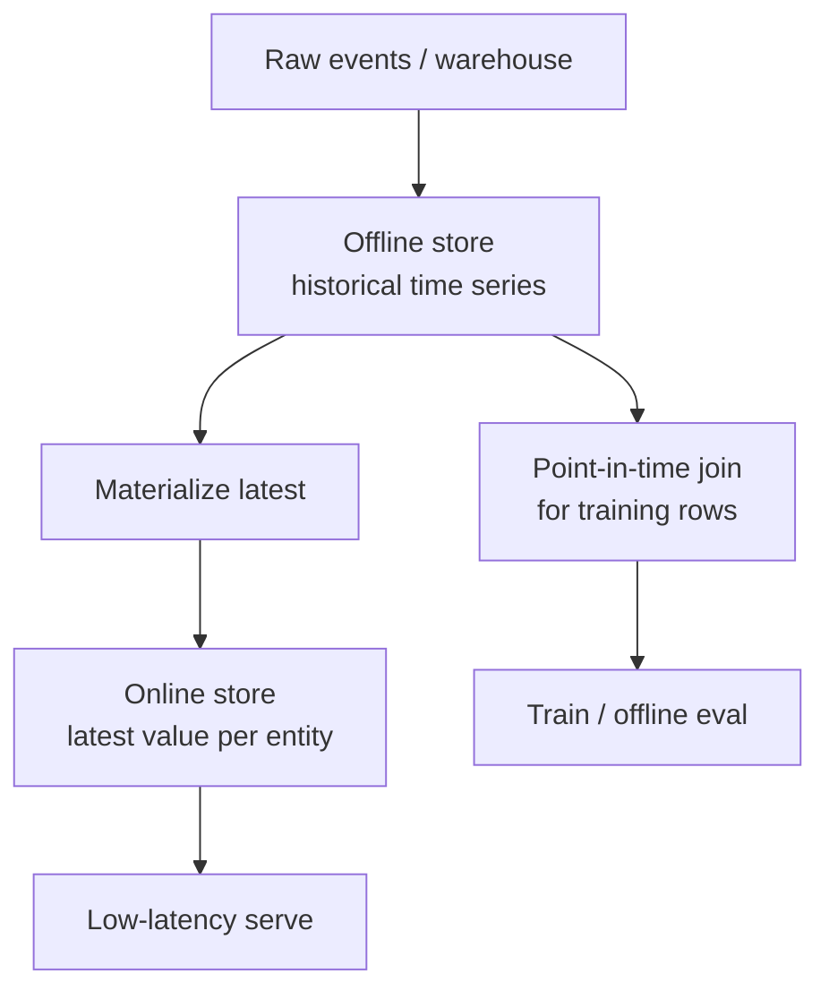

A **feature store** is a shared system that defines, materializes, and serves model input features so the same named signal can be used for historical training and for low-latency online prediction. It provides an operational schema around **entities** (the keys you join on, such as `user_id` or `ticket_id`), **feature definitions** (name, type, units, time window, null policy), and two storage paths optimized for different access patterns: an **offline store** of historical time-series values, and an **online store** of the latest values per entity for real-time lookup.

In practice the product value is consistency. Offline training needs months of history with [point-in-time joins](glossary://point-in-time-join). Online serving needs millisecond key lookups. Shared definitions and materialization paths keep notebooks and services from inventing their own `queue_backlog` logic, which can create [training-serving skew](glossary://training-serving-skew) even when column names match.

Open-source systems such as Feast, managed platforms such as Tecton or Google Cloud's [Feature Store](https://docs.cloud.google.com/gemini-enterprise-agent-platform/machine-learning/featurestore/latest/overview), and in-house stacks around a warehouse plus Redis or DynamoDB implement variants of this pattern. Historical and online storage may be separate resources or reuse an existing warehouse; supported transformation and retrieval features vary. Time correctness and serving parity still require explicit validation.

## Diagram



## How it works

1. **Register entities and feature views.** An entity is the join key. A feature view groups related features from one source (for example hourly driver stats, or 30-day ticket aggregates) with a TTL and schema.
2. **Write or compute into the offline store.** Batch jobs, streams, or push APIs land timestamped feature rows in a warehouse, lake, or files. History is retained so you can rebuild training sets.
3. **Historical retrieval.** Given an entity dataframe of `(entity_key, event_timestamp[, label])`, the store joins each row to the latest eligible feature values with timestamp at or before that row's prediction time (and within TTL). That is the point-in-time join.
4. **Materialization.** A controlled job copies the current (or as-of) feature values into the online store. Online stores typically keep **only the latest value per entity key**, not full history, so lookups stay cheap.
5. **Online serving.** The prediction service requests features by entity key; the online store returns a vector of values (or nulls / defaults under the [feature schemas](glossary://feature-contract)). Include freshness and materialization lag in production SLOs.

Event-time joins need availability and version history when late arrivals or corrections matter. Check backend semantics and apply the serving freshness policy explicitly because online TTL behavior varies by backend.

Feast documents this split explicitly: the offline store builds training datasets and feeds materialization; the online store holds latest values for low-latency inference. A feature server or SDK sits in front so Python training code and non-Python services share one retrieval model.

## Example

Support-ops model scores each open ticket for SLA risk at prediction time $t$. Features include `queue_backlog_p95_1h` (p95 open tickets in the assignee's queue over the past hour) and `recent_failure_count_7d`.

**Offline path.** For a training row with `ticket_id=T9`, `assignee_id=A3`, `event_timestamp=2026-04-10 12:00 UTC`, historical retrieval must use only feature rows with event time $\le 12{:}00$ that were also *available* by then. A warehouse row written at 12:40 that backfills the 11:55 backlog must not leak into this example.

```text
entity: assignee_id=A3  prediction_ts=2026-04-10T12:00Z
feature history (event_time -> value):
  11:00 -> 12
  11:55 -> 18   available_at=12:40   # too late for a 12:00 score
  12:05 -> 19   # future relative to prediction_ts
eligible at 12:00 under availability rules: 11:00 -> 12
```

**Online path.** At live scoring, materialization has pushed the latest computed backlog into Redis (or DynamoDB, Bigtable, etc.) under key `A3`. Serving reads that key in a few milliseconds. Match the offline and online *definitions* of `queue_backlog_p95_1h`, including its window, percentile, entity grain, and null handling.

```python
# Conceptual check against an online value captured when ts occurred.
# A latest-only online store cannot reconstruct arbitrary historical ts.
assert offline_value("A3", "queue_backlog_p95_1h", ts) == captured_online_value(
    "A3", "queue_backlog_p95_1h", prediction_ts=ts
)
```

If training used a daily warehouse rollup and serving uses a live counter with a different window or null policy, offline AUC can look strong while production quality collapses. The store only helps if both paths share definitions, tests, and materialization.

**LLM-adjacent case.** Personalized RAG or prompt enrichment may store `recent_failure_count`, `avg_queue_minutes_30d`, and a `release_pattern_embedding` under the same entity. Offline eval of the assistant must retrieve embeddings and scalars as they existed at each historical request time; online the gateway fetches the latest entity features. Record the embedding model checkpoint, chunker version, and normalization hash with the feature metadata.

## Scope and neighboring systems

A feature store catalogs features, performs time-correct joins, and serves agreed values online. Pipelines (Airflow, dbt, streaming jobs) produce the values. Orchestrators schedule materialization and [backfills](glossary://backfill). Warehouses remain the long-term source of truth for history.

## Trade-offs

| Concern | Offline store | Online store |
| --- | --- | --- |
| Workload | Training sets, batch score, backfill | Real-time inference |
| Latency | Seconds to minutes (scan/join) | Milliseconds (key lookup) |
| History | Months or years of versions | Latest value per entity (typical) |
| Failure mode | Future leakage, wrong TTL, slow joins | Stale materialization, missing keys, hot keys |
| Typical backends | BigQuery, Snowflake, Hive, Parquet | Redis, DynamoDB, Bigtable, SQLite (dev) |

Centralizing features works when specifications define ownership, schema, and "latest" semantics consistently across batch and stream. Publish features with owners, units, freshness targets, and parity tests.

## Why it matters here

Feature stores connect model accuracy to production data systems. Shared definitions, point-in-time retrieval, materialization, and tests give "same feature offline and online" an engineering basis. In classic MLOps they power fraud, ranking, and SLA models. In LLMOps they still matter for structured context and embedding-backed user or document features that feed prompts and RAG, where silent skew between notebook pipelines and serving is as damaging as weight drift. When offline and production evaluations differ, compare feature-path parity before investigating model behavior.

## Related terms

- [feature schemas](glossary://feature-contract)
- [Feature freshness](glossary://feature-freshness)
- [Point-in-time join](glossary://point-in-time-join)
- [Training-serving skew](glossary://training-serving-skew)
- [Feature leakage](glossary://feature-leakage)
