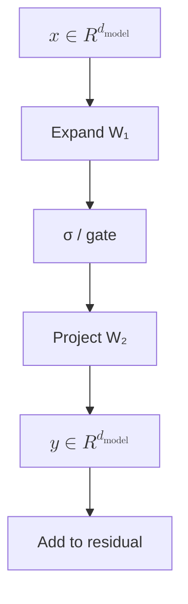

A transformer feed-forward network (FFN), also called the MLP or position-wise feed-forward sublayer, is the per-token multilayer perceptron inside each transformer block. After attention mixes information across positions, the FFN expands each token's residual vector, applies a nonlinearity (or a gate), and projects back to model width. The same weights run at every sequence position; only the activations differ. In a standard dense stack this path holds most non-embedding parameters, so the FFN often dominates capacity, FLOPs, and training activation memory.

## Intuition

Think of each block as two complementary jobs:

1. **Attention** reads other positions and writes context into the residual stream.
2. **FFN** transforms the *current* position's features without looking at neighbors.

Attention is about *who* to read from. The FFN is about *what to compute* on the local residual features: detect patterns, apply nonlinear filters, and write an update back. Interpreting the two-layer FFN as an unnormalized key-value memory (Geva et al., 2021) is useful: the first matrix acts like keys that fire on input patterns; the second acts like values that write associated feature directions into the residual stream.

## Diagram

## Formula

Original position-wise FFN from Vaswani et al. (2017), applied independently at each position:

$$
\mathrm{FFN}(x) = \max(0,\, x W_1 + b_1)\, W_2 + b_2
$$

with $x \in \mathbb{R}^{d_{\mathrm{model}}}$, $W_1 \in \mathbb{R}^{d_{\mathrm{model}} \times d_{\mathrm{ff}}}$, $W_2 \in \mathbb{R}^{d_{\mathrm{ff}} \times d_{\mathrm{model}}}$. The base Transformer used $d_{\mathrm{model}} = 512$ and $d_{\mathrm{ff}} = 2048$ (a $4\times$ expansion). Bias-free variants drop $b_1, b_2$. GELU or SiLU often replace ReLU in later models.

Many modern LLMs use a gated FFN (SwiGLU; Shazeer, 2020) with three projections and no bias:

$$
\mathrm{FFN}_{\mathrm{SwiGLU}}(x) = \bigl(\mathrm{SiLU}(x W_g) \odot (x W_u)\bigr) W_d
$$

where $\mathrm{SiLU}(z) = z \cdot \sigma(z)$ and $\odot$ is elementwise multiply. Three matrices cost more than two at the same intermediate width, so architects often set $d_{\mathrm{ff}}$ to about $\tfrac{2}{3}$ of a two-matrix intermediate width so total parameters and FLOPs stay comparable (Shazeer, 2020).

Ignoring biases, dense two-matrix FFN parameters per layer scale as:

$$
|\theta_{\mathrm{FFN}}| \approx 2\, d_{\mathrm{model}}\, d_{\mathrm{ff}}
$$

vs roughly $4\, d_{\mathrm{model}}^2$ for full multi-head attention (Q, K, V, O). With $d_{\mathrm{ff}} = 4\, d_{\mathrm{model}}$, that is about $8\, d_{\mathrm{model}}^2$ for the FFN against $4\, d_{\mathrm{model}}^2$ for attention, matching the common "FFN is about two-thirds of the block" rule of thumb. Under GQA or MQA the attention parameter count shrinks further, so the FFN share of non-embedding params is even larger than that 2:1 sketch.

## Example

**Base Transformer numbers.** One token vector of width $512$ expands to $2048$, ReLU zeros negative coordinates, then projects back to $512$. Parameter count for that FFN (with biases): about $2 \times 512 \times 2048 + 2048 + 512 \approx 2.1\mathrm{M}$ weights, shared across every position in the sequence.

**LLaMA-style 7B MLP.** Configs use $d_{\mathrm{model}} = 4096$ and intermediate size $11008$ with SwiGLU (`gate_proj` and `up_proj` to $11008$, `down_proj` back to $4096$, bias free). Per layer:

$$
|\theta_{\mathrm{MLP}}| \approx 3 \times 4096 \times 11008 \approx 135\mathrm{M}
$$

Across 32 layers that is on the order of $4\mathrm{B}$ parameters in MLPs alone. At inference, every token pays that matmul cost; during training you also store (or recompute) the large $d_{\mathrm{ff}}$ activations for the backward pass.

**MoE.** In mixture-of-experts models, each expert is usually an FFN. A router picks top-$k$ experts per token so parameter count can be huge while active FLOPs stay closer to a smaller dense MLP.

## How it works in a block

Typical pre-norm decoder step for residual $h$:

1. Normalize $h$, run self-attention, add residual.
2. Normalize again, run FFN on each position, add residual.
3. Pass the updated residual to the next layer (or to the LM head at the top).

The FFN never mixes sequence positions by itself. Any cross-token information it uses must already sit in $h$ from earlier attention writes. That is why "attention gathers, MLP processes" is a solid first mental model, even though real circuits interleave both sublayers across depth.

Parameter counts alone cannot predict runtime. FFN work scales linearly with sequence length, while full attention's query-key and value mixing scale quadratically. At long context, attention can dominate FLOPs or memory despite having fewer parameters; optimized attention and recomputation also change which activations are stored.

## What to inspect in configs and production

| Knob | Why it matters |
|---|---|
| `intermediate_size` / $d_{\mathrm{ff}}$ | Width of the expand; dominates MLP params and activation memory |
| Activation / gate | ReLU, GELU, SiLU, SwiGLU change both quality and kernel choice |
| Bias | Many LLMs are bias-free; a mismatch breaks checkpoint load |
| Dense vs MoE | Sparse experts change serving (routing, expert parallel, load balance) |
| Tensor parallel split | Large `up`/`gate`/`down` matmuls are prime TP shard targets |
| Checkpointing | Training often checkpoints around FFN blocks to cut activation HBM |

Wrong intermediate size, wrong gate order, or GELU vs SiLU will load weights into the wrong shapes or silently compute a different function. On the serving side, FFN GEMMs are bandwidth- and FLOP-heavy at large $d_{\mathrm{ff}}$, so fused kernels and tensor parallelism pay off quickly.

## Why it matters here

Curriculum material on transformers includes the FFN alongside attention: the MLP holds most parameters, does most of the block's dense FLOPs, and is the piece SwiGLU, MoE routing, activation checkpointing, and tensor-parallel shards rework. When you size a model, profile a training step, or debug a custom block, inspect $d_{\mathrm{model}}$, $d_{\mathrm{ff}}$, and the gate formula alongside head count.

## Related terms

- [SwiGLU](glossary://swiglu)
- [Mixture of experts](glossary://mixture-of-experts)
- [Residual stream](glossary://residual-stream)
- [Self-attention](glossary://self-attention)
- [Transformer](glossary://transformer)
