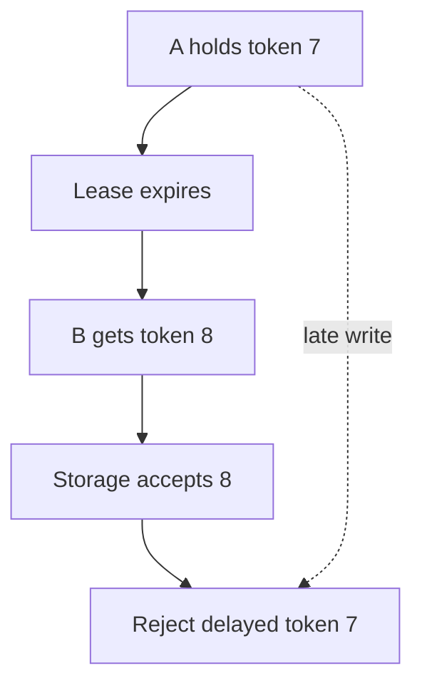

A **fencing token** is a monotonically increasing ownership generation attached to a lease and checked by the system performing a protected write. A resource that remembers the highest accepted generation can reject a delayed former owner's writes after it has observed a newer generation.

## A lease alone cannot stop a paused worker

Worker A acquires generation $7$, pauses, and misses its lease deadline. Worker B acquires generation $8$ and updates the shared run. When A resumes, it may still believe it owns the run. If the storage layer accepts A's write without checking generation, the stale worker can corrupt B's newer result.

The protected resource must atomically reject writes carrying generation $7$ once generation $8$ has been accepted. Checking the lease only in an application process isn't enough if ownership can change between validation and the actual write.

Issuing token $8$ at the lock service does not by itself tell a separate resource that token $7$ is stale. If rejection must begin immediately at acquisition or expiration, the resource also needs an atomic ownership/lease check or publication of the new generation. Repeated writes by the same current owner may use the same token.

## Example

An evaluation registry issues `fencing_token=1` to worker A at time zero with a ten-second lease. At time ten, worker B acquires the same run and receives token `2`. A heartbeat or completion request carrying token `1` must fail; a request carrying B's still-active token `2` can proceed.

For a registry-wide counter, a successful lease on a different run also advances the next token. Gaps are harmless: unsuccessful acquisitions may consume counter values. The required invariant is that each new owner receives a token greater than prior owners' tokens for the protected resource, with enforcement that cannot regress.

## Why it matters here

Worker leases, training controllers, evaluation runners, and retryable workflows all need ownership checks that survive pauses and redelivery. Fencing makes stale-worker rejection a concrete invariant instead of a timing assumption.

## Related terms

- [TTL deadline](glossary://ttl-deadline)
- [Workflow checkpoint](glossary://workflow-checkpoint)
- [Idempotency](glossary://idempotency)
- [State machine](glossary://state-machine)
