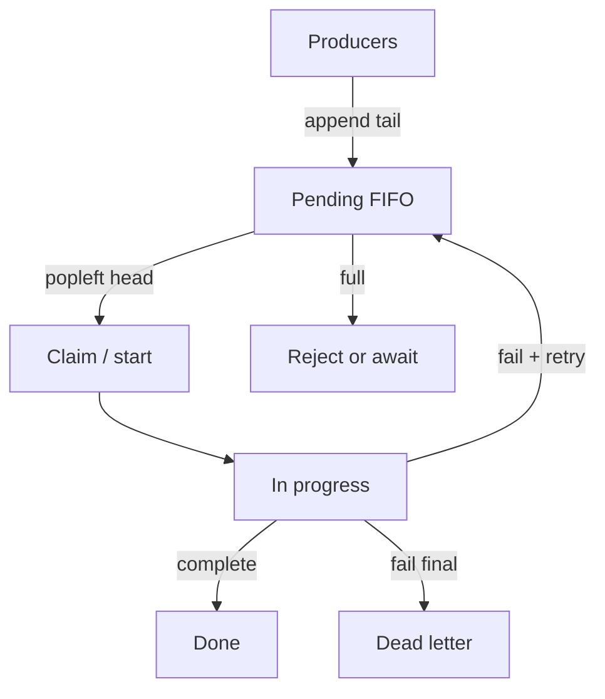

A **FIFO work queue** (first-in, first-out) is a buffer that hands work to workers in **arrival order**: the earliest enqueued item is the next one claimed. Producers append at the tail; consumers take from the head. The policy is sometimes called FCFS (first-come, first-served).

FIFO defines *service order*: it tells you which ready job goes next. Durable storage, exactly-once side effects, fair multi-tenant throughput, and bounded latency under overload require additional mechanisms such as bounds, leases, retries, and idempotent handlers.

## Intuition

Think of a single ticket line. FIFO means "arrived first, served first"; priority and cost-aware policies decide which job is most urgent or cheapest for the GPU. That makes FIFO systems easy to reason about and to test: given a sequence of enqueues and no concurrent reordering, dequeue order is fully determined.

The cost is **head-of-line (HOL) blocking**. When the item at the head is slow, stuck, or waiting on a dependency, everything behind it waits even if those jobs would finish quickly on free capacity. FIFO respects *arrival order*; use deadline or priority rules to serve latency budgets and urgent jobs first.

With **multiple workers** pulling from one shared FIFO queue, *claim* order stays FIFO, but *completion* order can differ: worker A can claim job 1, worker B claim job 2, and B finish first. If you need strict sequential *effects* (for example, apply ledger events for one account in order), either use one consumer for that stream or partition into ordered **message groups** (one FIFO sub-queue per key) so independent keys run in parallel and related keys stay ordered.

## How it works

A minimal in-process model keeps two pieces of state:

1. **Pending:** a FIFO structure (`collections.deque` with `append` / `popleft`, or a bounded `queue.Queue` / `asyncio.Queue`).
2. **In progress:** which worker currently owns which item (needed once you care about crash recovery and retries).

Typical lifecycle:

1. **Enqueue** at the tail if capacity allows; otherwise reject or block (backpressure).
2. **Start / claim:** move the head item into a worker's ownership map. Capacity for *pending* often frees at claim time even while the job is still running.
3. **Complete:** drop ownership; the job is done.
4. **Fail:** either re-enqueue (front for immediate retry, back for delayed retry), or drop / dead-letter after a max attempt count.

Durable brokers add ordering and recovery at the network edge with different contracts. SQS FIFO uses message groups and visibility timeouts; Redis Streams consumer groups track pending entries that can be reclaimed; Kafka uses partition ordering and consumer offsets. Concurrent handlers still need serialized effects or an explicit transaction protocol to preserve application-side order.

```python title="fifo-work-queue.py"
from collections import deque
from typing import Any


class WorkQueue:
    """Bounded pending FIFO with explicit worker ownership."""

    def __init__(self, max_pending: int) -> None:
        if max_pending <= 0:
            raise ValueError("max_pending must be positive")
        self.max_pending = max_pending
        self.pending: deque[Any] = deque()
        self.in_progress: dict[str, Any] = {}

    def enqueue(self, item: Any) -> bool:
        if item is None:
            raise ValueError("None is reserved for no item")
        if len(self.pending) >= self.max_pending:
            return False  # backpressure: caller rejects or waits
        self.pending.append(item)
        return True

    def start(self, worker_id: str) -> Any | None:
        if worker_id in self.in_progress or not self.pending:
            return None
        item = self.pending.popleft()
        self.in_progress[worker_id] = item
        return item

    def complete(self, worker_id: str) -> Any | None:
        return self.in_progress.pop(worker_id, None)

    def fail(self, worker_id: str, *, retry: bool = True) -> Any | None:
        if retry and worker_id in self.in_progress and len(self.pending) >= self.max_pending:
            raise BufferError("retry queue full; ownership retained")
        item = self.in_progress.pop(worker_id, None)
        if item is not None and retry:
            self.pending.append(item)  # retry at back; front would re-HOL
        return item
```

Retry-at-back avoids pinning a poison message at the head forever. Retry-at-front preserves "try me again immediately" but can re-create HOL blocking if the failure is systemic.

This in-process example assumes serialized method calls and uses `None` only as the no-item sentinel. A full retry queue retains ownership and requires a later retry, explicit rejection or dead-letter policy. Concurrent callers need synchronization around the compound checks and state changes.

## Diagram



## Example

An embedding pipeline accepts document chunks into a pending FIFO with `max_pending = 64` and three workers. Jobs arrive as:

| $t$ (s) | Event | Pending (head → tail) | In progress |
|---:|---|---|---|
| 0 | enqueue `c1`, `c2`, `c3`, `c4` | `c1 c2 c3 c4` | (none) |
| 1 | workers `w1`,`w2`,`w3` start | `c4` | `w1:c1`, `w2:c2`, `w3:c3` |
| 2 | `c2` finishes in 1 s; `c1` is a 30 s pathologically large chunk | `c4` | `w1:c1`, `w3:c3` |
| 2 | `w2` starts next | empty | `w1:c1`, `w2:c4`, `w3:c3` |

Claim order was `c1`, `c2`, `c3`, then `c4`. Completions can be `c2` → `c3` → `c4` → `c1`. FIFO controls *who gets the next free worker*; parallel workers can complete jobs in a different order.

**HOL latency.** Suppose interactive requests sit behind one bulk job in a *single-worker* FIFO:

- Bulk job service time $S_{\mathrm{bulk}} = 120\,\mathrm{s}$
- Interactive job service time $S_{\mathrm{chat}} = 2\,\mathrm{s}$
- Chat arrives just after bulk is claimed

Chat waits about $120\,\mathrm{s}$ for the bulk job, then runs for $2\,\mathrm{s}$, so time in system is about $122\,\mathrm{s}$. Priority scheduling could have run chat first. With $N$ chat jobs already queued behind bulk on a single worker, the $k$-th chat's wait is roughly residual bulk time plus the service times of the $k-1$ chats ahead of it.

Under Little's law for a stable system, average jobs in system $L$ and arrival rate $\lambda$ relate to average time in system $W$ by $L = \lambda W$. An unbounded FIFO that accepts every spike grows $L$ and therefore $W$ for *all* later arrivals, including short ones. Bounding pending depth and rejecting or awaiting on full is how FIFO coexists with latency SLOs.

**Ordered stream (one group).** For deployment `api-v17`, events `start`, then `rollback`, must apply in order. Put both on the same message group or partition key so consumers never process `rollback` before `start` completes or returns to visibility. Independent deployments use different keys so workers fan out safely.

## Reliability contract

FIFO order alone does not make processing correct after crashes. State the full contract:

| Concern | What to decide |
|---|---|
| **Claim lease** | Visibility timeout or wall-clock lease; reclaim to pending when the worker dies mid-job |
| **Retries** | Max attempts; retry at front vs back; exponential backoff elsewhere |
| **Idempotency** | Same job id must not double-charge, double-embed, or double tool-call |
| **Dead letter** | Where poison messages go after final failure |
| **Capacity** | Bound pending (and often in-flight); block, reject `429`, or shed |
| **Cancellation** | Can a waiting job leave the queue without running? |
| **Concurrency** | Shared FIFO vs per-key ordered groups for parallel ordered streams |

Amazon SQS FIFO queues illustrate the distributed form: order *within* a message group ID and parallel consumption across groups. One receive can return several messages from the same group; process that batch in order if effects must be ordered. Subsequent receives cannot fetch more from that group until its received messages are deleted or become visible again. Deduplication IDs reduce producer-retry duplicates within the broker's window; handlers still need idempotency for redelivery and repeated side effects.

## Trade-offs

| Policy | Next job chosen by | Strength | Weakness |
|---|---|---|---|
| **FIFO** | Arrival time | Simple, deterministic, easy tests | HOL blocking; ignores urgency |
| **Priority / deadline** | Importance or deadline | Protects interactive / SLA tiers | Starvation without aging or quotas |
| **Fair / multi-queue** | Per tenant or class share | Isolates noisy neighbors | More state and tuning |
| **LIFO** | Most recent | Cache-hot or cancel-stale work | Starves old arrivals |

Use FIFO as the default when work units are similar in cost, order is part of correctness (BFS frontiers, sequential event apply per key), or you want the simplest interview- and production-grade baseline. Layer priority only when latency classes truly differ, and keep a FIFO (or fair queue) per class so each class still has a clear order.

## Why it matters here

Coding labs (bounded worker queues, crawlers, embedding fans) and production LLM stacks both start from "who runs next?" FIFO is the default answer until variance or multi-tenancy forces something else. Interview and production failures cluster in the same places: unbounded pending depth, missing ownership after claim, retry that re-blocks the head, and assuming completion order equals enqueue order under concurrency. Mastering FIFO means stating order *and* the reliability and backpressure contract around it.

## Related terms

- [collections.deque](glossary://collections-deque)
- [asyncio.Queue](glossary://asyncio-queue)
- [Backpressure](glossary://backpressure)
- [Priority scheduling](glossary://priority-scheduling)
- [Idempotency](glossary://idempotency)
