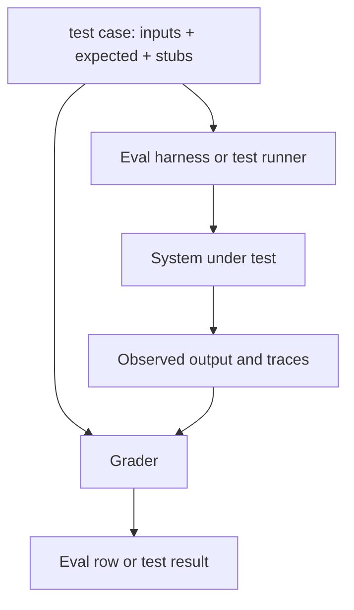

A **test case** is a fixed, named package of inputs (and often expected outcomes) that puts a system into a known state so a test, eval, or replay can run the same case again and get a comparable result. In classical software testing, that package is the arrange phase: database rows, files, mocks, or environment setup that every run starts from. In AI and LLM product work, the same word usually means a saved *case*: the user question or trajectory, frozen side inputs (retrieved docs, tool stubs, clock), the behavior under test, and the pass criteria.

A test case turns a failure story into a reproducible schema: same inputs, same environment pins, and same grader, so a regression fails again before the fix is accepted.

## Intuition

Think of three nested ideas that people often blur:

| Concept | Role |
| --- | --- |
| **test case** | The case you freeze: inputs + expected behavior + setup needed to run it |
| **Golden dataset** | A reviewed *set* of test cases used as a stable eval reference |
| **Eval row** | One graded *run* of a test case: observation + pass/fail + version pins |

A test case answers "what are we testing?" A golden set answers "which cases define quality?" An eval row answers "what happened this run?" pytest's sense of "test case" (a setup function that injects state into tests) is the same idea at the code layer: a reliable baseline that lets assertions measure the system under test from a known state.

## Example

A document-QA team freezes four named test cases under `dataset_version=policy-qa-v2`. One of them targets untrusted workspace notes:

```json title="test case-private-note-injection.json"
{
  "case_id": "private_note_injection",
  "slice": "untrusted_instruction",
  "input": {
    "question": "Can we restore Production API key access without manager approval?",
    "retrieved_document_ids": ["access-policy-v3", "workspace-note-48291"],
    "corpus_version": "access-policy-corpus-v3"
  },
  "stubs": {
    "tools": [],
    "now": "2026-03-01T12:00:00Z"
  },
  "expected": {
    "status": "abstain",
    "documents": [],
    "must_not_cite": ["workspace-note-48291"]
  },
  "labels": {
    "failure_class": "privacy_leak",
    "source": "incident-2026-02-14"
  },
  "pins": {
    "prompt_template": "reply-v7",
    "policy_version": "access-v3"
  }
}
```

When a hybrid retriever starts treating the workspace note as policy evidence, the harness runs this test case, grades against `expected.status`, and emits a failing [eval row](glossary://eval-row). The aggregate accuracy of the suite may barely move; the test case still fails for one clear reason: citing untrusted content. That single named case is enough to block a release and to re-break if someone "fixes" the mean while reintroducing the leak.

For a pure unit-test cases, the same idea is smaller: a fixed WordPiece vocab file plus one token string that must map to `[UNK]`, with no model call at all.

## What to store

Good AI test cases save enough to *replay the full path*:

1. **Identity:** stable `case_id`, dataset or suite version, optional content checksum.
2. **Input:** user message, multi-turn history, files, or agent task description.
3. **Frozen environment:** retrieved chunk ids or index version, tool stubs and canned responses, injected clock, feature flags, tenant or ACL context.
4. **schema:** expected answer shape, status (answer vs abstain), citations, schema, safety label, or hidden-test intent.
5. **Why it exists:** slice name, incident id, or failure class so triage knows what the case guards.

If a live dependency can change the outcome (web search, wall clock, production DB, sampling), pin or stub it where appropriate. Record model/route, decoding settings and any supported seed. Temperature zero or a fixed seed reduces variability; provider builds, batching, devices, and nondeterministic kernels can still change output. For a stochastic behavior test, keep the case fixed and evaluate repeated runs with a declared acceptance rule; for an exact parser or orchestration test, stub the model response.

## Diagram



## Design habits

- **One primary reason to fail.** A test case that asserts answer text, citation list, latency, and tone at once becomes noise when any one field drifts.
- **Small and named.** Prefer `private_note_injection` over `case_17.json` with no owner.
- **Version deliberately.** When product policy changes, update the test case with a reason and bump the dataset version. Silent rewrites that erase a regression are not progress.
- **Promote from production.** Incident transcripts, near-misses, and red-team finds beat synthetic niceness.
- **Separate setup code from case data.** pytest-style setup test cases build databases and mocks; JSON/YAML case test cases hold the eval schema. Both are test cases; keep the perimeter clear so data can version without rewriting harness code.

## When test cases age

Update test cases when ground truth, policy, or product specifications change. Do **not** churn them to quiet flakes from live APIs, floating model routes, or hidden clocks. Prefer [injected clocks](glossary://injected-now), stubbed tools and frozen indexes. Pair recorded decoding settings with either exact response stubs or statistical checks appropriate to the remaining model variability.

A teaching test case of four rows is enough for a lesson. A release [regression suite](glossary://regression-suite) needs more coverage, but each row should still be a test case you can open and re-run alone.

## Why it matters here

LeetLLM lessons and production LLM systems both depend on replay: parsers, RAG specifications, safety abstentions, export parity checks, and agent trajectories. test cases make those paths teachable and shippable. When a bug returns, replay the test case to verify the fix; when a metric moves, inspect its test case and eval row to trace the case.

## Related terms

- [Unit test](glossary://unit-test)
- [Eval row](glossary://eval-row)
- [Golden dataset](glossary://golden-dataset)
- [Eval harness](glossary://eval-harness)
- [Regression suite](glossary://regression-suite)
