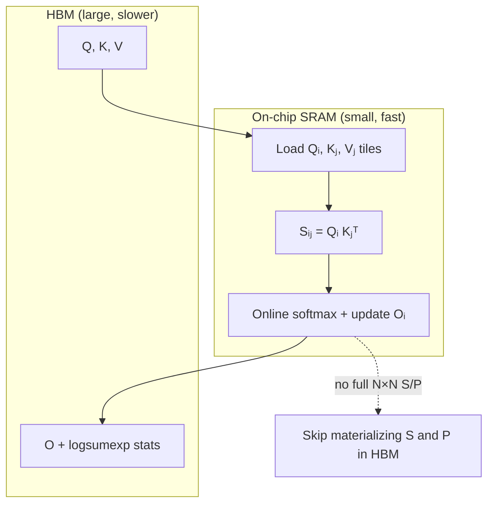

FlashAttention is an **exact** attention algorithm that is **IO-aware**: it tiles $Q$, $K$, and $V$, runs softmax and the value multiply in fast on-chip SRAM, and never materializes the full $N \times N$ score matrix in GPU [HBM](glossary://hbm). Asymptotic matmul work stays the same order as standard attention (backward recomputes tiles: more FLOPs, far fewer HBM bytes); bytes moved drop sharply, which is why wall-clock time and peak memory both improve.

Dao, Fu, Ermon, Rudra, and Ré (NeurIPS 2022) introduced it to fix a mismatch between theory and practice. Many approximate attention papers cut FLOPs, yet real GPUs are often limited by memory traffic. FlashAttention attacks that bottleneck with tiling, [online softmax](glossary://online-softmax), fused CUDA kernels, and selective recomputation in the backward pass.

## Intuition

Standard multi-head attention for one head is

$$
S = QK^{\top},\quad
P = \mathrm{softmax}(S),\quad
O = PV
$$

with $Q,K,V \in \mathbb{R}^{N \times d}$ (scale $1/\sqrt{d}$ and masks omitted for clarity). A naive kernel writes $S$ and $P$ (each $N \times N$) to HBM between GEMMs and softmax. When $N \gg d$ those matrices dominate traffic and activation memory.

FlashAttention keeps the **same mathematical result** (up to floating-point reorderings). It loads blocks of $K$ and $V$ into SRAM, streams blocks of $Q$, accumulates partial outputs with online softmax statistics $(m, \ell)$ (row max and sum of exponentials), and writes only the final $O$ plus small per-row stats. The backward pass recomputes attention tiles on-chip from $Q,K,V$ and those stats instead of reloading a full $P$ from HBM.

FlashAttention preserves transformer math while changing how the kernel maps work onto the HBM/SRAM hierarchy.

## How it works

1. **Tile** inputs into blocks sized so $K_j$, $V_j$, a $Q_i$ slice, and partial $O_i$ fit in on-chip memory.
2. **Score on-chip:** $S_{ij} = Q_i K_j^{\top}$ lives only in SRAM for that tile.
3. **Online softmax:** update running max $m$ and sum $\ell$, rescaling earlier partial outputs when a new max appears (see [online softmax](glossary://online-softmax)).
4. **Fuse** matmul, mask, softmax, and $PV$ in one kernel so intermediates are not round-tripped through HBM.
5. **Recompute** in the backward pass: store $O$ and logsumexp-style stats ($O(N)$ extra), not the full $N \times N$ attention matrix.

### IO complexity (from the paper)

For sequence length $N$, head dimension $d$, and on-chip SRAM capacity $M$ measured in **elements** of the working dtype (paper notation; physical SRAM is tens to hundreds of KB of bytes) with $d \le M \le Nd$:

| Algorithm | HBM accesses (order) | Extra memory for attention intermediates |
|---|---|---|
| Standard | $\Theta(Nd + N^{2})$ | $\Theta(N^{2})$ for $S$/$P$ |
| FlashAttention | $\Theta(N^{2} d^{2} / M)$ | $\Theta(N)$ for softmax stats |

When $d^{2} \ll M$, FlashAttention issues **many fewer** HBM accesses. The [original paper](https://arxiv.org/abs/2205.14135) reports linear extra activation memory, about **15%** end-to-end speedup on BERT-large (sequence length 512) over the MLPerf 1.1 record, and **3×** training speedup on GPT-2 (sequence length 1K) over its reported HuggingFace/Megatron baselines. These measurements are specific to those workloads; benchmark other GPUs, sequence lengths, and baselines separately.

## Formula (online block combine)

For two consecutive score blocks $S^{(1)}, S^{(2)}$ on a query row block, online softmax tracks

$$
m^{(j)} = \max\bigl(m^{(j-1)}, \mathrm{rowmax}(S^{(j)})\bigr),\quad
\ell^{(j)} = e^{m^{(j-1)}-m^{(j)}}\ell^{(j-1)} + \mathrm{rowsum}\bigl(e^{S^{(j)}-m^{(j)}}\bigr)
$$

and rescales the running output accumulator by $e^{m^{(j-1)}-m^{(j)}}$ before adding $\tilde{P}^{(j)} V^{(j)}$. At the end of the column loop, divide by $\ell$ (FlashAttention-2 delays some of that scaling to cut non-matmul FLOPs). The result equals full-row $\mathrm{softmax}(S)V$, not a local-softmax approximation.

## Diagram



## Example

One head, $N = 4096$, FP16 scores. A dense score matrix alone is

$$
N^{2} \times 2\ \mathrm{bytes} = 4096^{2} \times 2 \approx 33.6\ \mathrm{MB}
$$

With 32 heads that is roughly **1 GB** of intermediate score storage **per layer** if you materialize $S$ (and often another similar buffer for $P$ or for backward). FlashAttention keeps tile-sized $S_{ij}$ on-chip and $O(N)$ softmax statistics in HBM, so peak activation memory scales as $O(N)$ instead of $O(N^{2})$.

Runtime intuition: standard attention is memory-bound on long sequences because softmax and the $N \times N$ traffic dominate. Same matmul FLOPs with far less HBM traffic raises effective [arithmetic intensity](glossary://arithmetic-intensity) and shortens wall time even though the backward pass **recomputes** tiles (more FLOPs, fewer bytes).

## Generations in practice

| Version | Focus | Rough takeaway |
|---|---|---|
| **FlashAttention** (Dao et al., 2022) | IO-aware tiling, online softmax, fused kernel | Exact attention, linear extra mem, large HBM savings |
| **FlashAttention-2** (Dao, 2023/2024) | Less non-matmul work; parallelize over sequence; better warp partitioning | About **2×** over FA1 in many A100 benches; higher % of peak FLOPs/s |
| **FlashAttention-3** (Shah et al., 2024) | Hopper asynchrony (TMA/WGMMA), GEMM–softmax overlap, FP8 | About **1.5–2×** over FA2 on H100 FP16 in reported benches; strong FP8 path |
| **FlashAttention-4** (Zadouri et al., 2026) | Blackwell pipelines, reduced softmax work, tensor memory; CuTe DSL implementation | The [paper](https://arxiv.org/abs/2603.05451) reports up to **1.3×** over cuDNN 9.13 and **2.7×** over Triton for its B200 BF16 benchmarks |

In libraries you often meet these as backends behind a single API. Availability depends on the library version and hardware; inspect the dispatch path to see which kernel generation actually runs.

## In code (PyTorch)

Modern PyTorch dispatches fused attention (including FlashAttention-family kernels when shapes, dtype, mask, and GPU allow) through `scaled_dot_product_attention`:

```python
import torch
import torch.nn.functional as F

# q, k, v: (batch, heads, seq, head_dim), typically fp16/bf16 on CUDA
out = F.scaled_dot_product_attention(q, k, v, is_causal=True)
```

For debugging, force or inspect backends (`FLASH_ATTENTION`, memory-efficient, math) with `torch.nn.attention.sdpa_kernel` / SDP backend context managers in current PyTorch versions. Always confirm the **kernel path** that actually ran: unsupported head dim, dtype, mask type, dropout, or GPU generation can silently fall back to a slower implementation.

## Trade-offs and production boundaries

- **Exact for supported dense / causal-style masks.** Block-sparse FlashAttention is a separate extension that changes which attention edges exist.
- **Hardware- and shape-sensitive:** head dimension, sequence length, batch×heads occupancy, causal vs arbitrary mask, dropout, and GPU generation (Ampere vs Hopper kernels differ) decide eligibility.
- **Numerics:** exact means no algorithmic approximation to the supported attention pattern. Reordered floating-point operations can change rounding; FP8/FP4 paths introduce additional quantization error. Adversarial rows with late maxima stress bad implementations.
- **Bottleneck fit:** when MLP work, communication, or data loading dominate, attention speedups have little effect on end-to-end latency.
- **Decode vs prefill:** long **prefill** benefits most from avoiding $N^{2}$ materialization. Autoregressive **decode** is often dominated by weight and [KV cache](glossary://kv-cache) bandwidth; FlashAttention still helps, but GQA/MQA, paging, and batching matter as much.

## Why it matters here

FlashAttention is the canonical example that **transformer architecture** and **GPU kernel design** are different levers. Long-context training and inference became practical partly because exact attention could be made HBM-friendly without changing model math. When you profile long-context prefill, compare backends, or read serving stacks (vLLM, TGI, TensorRT-LLM), FlashAttention-style kernels are the default assumption for multi-head attention performance.

## Related terms

- [Online softmax](glossary://online-softmax)
- [HBM](glossary://hbm)
- [Self-attention](glossary://self-attention)
- [Arithmetic intensity](glossary://arithmetic-intensity)
- [KV cache](glossary://kv-cache)
