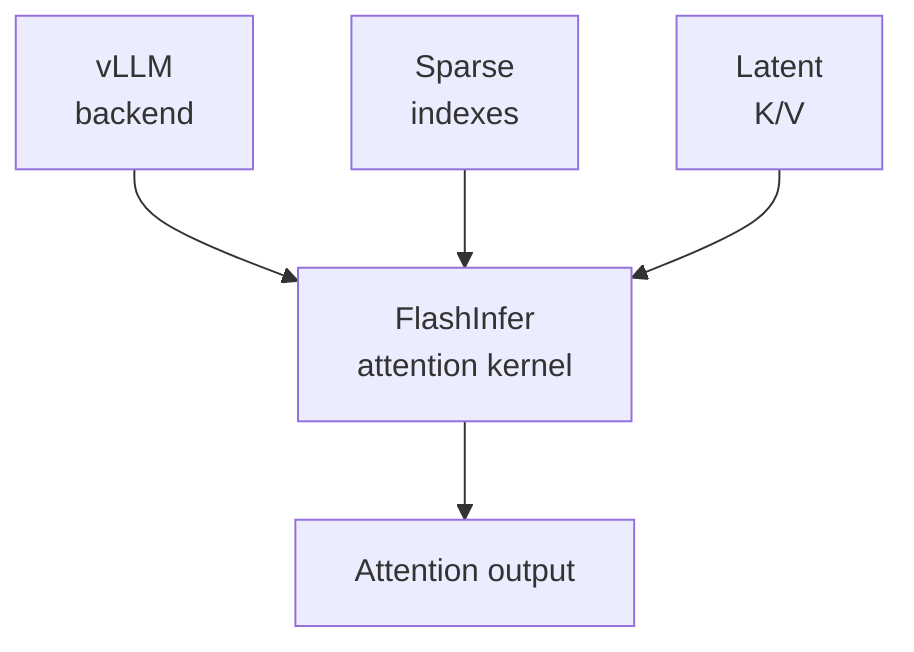

**FlashInfer** is an [open-source kernel library](https://github.com/flashinfer-ai/flashinfer) for LLM inference and serving. It provides GPU primitives for attention, GEMM, MoE, sampling, normalization, communication, and related serving operations, with APIs designed for dynamic request shapes and NVIDIA accelerators. Individual kernels support different GPU architectures and dtypes.

An inference engine such as vLLM can select FlashInfer as a backend for supported attention paths. vLLM still owns scheduling, KV allocation, and model execution; FlashInfer supplies optimized kernels underneath those decisions.

## Sparse MLA role

For models with multi-head latent attention and sparse position selection, a backend must consume latent KV state plus selected indexes efficiently. Backend support is model-, dtype-, GPU-, and phase-specific, so prefill and decode may use different kernel choices.

## Diagram

## Example

A rollout configuration requesting `FLASHINFER_MLA_SPARSE` selects a sparse MLA attention backend where that name is supported by the pinned engine version. Current [vLLM implementations](https://docs.vllm.ai/en/latest/api/vllm/v1/attention/backends/mla/flashinfer_mla_sparse/) distinguish hardware-specific FlashInfer sparse MLA paths. Check startup logs and profiling to confirm the path actually executed. An attention-backend setting doesn't select the MoE expert kernel, which is configured separately.

## Why it matters here

Trainer and generator implement the same GLM attention math through different kernel stacks. Parity tests should compare selected positions, logits, and log probabilities before assuming backend speedups are behavior-neutral.

## Related terms

- [vLLM](glossary://vllm)
- [Multi-head latent attention](glossary://multi-head-latent-attention)
- [DeepSeek Sparse Attention](glossary://deepseek-sparse-attention)
- [KV cache](glossary://kv-cache)
- [CUDA](glossary://cuda)
