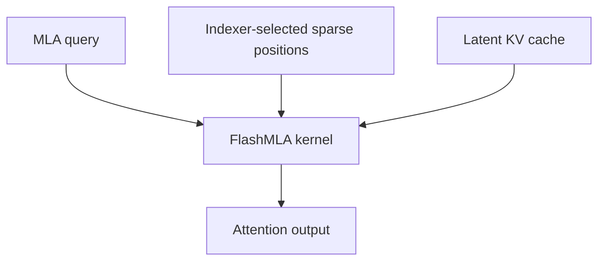

**FlashMLA** is [DeepSeek's optimized attention-kernel library](https://github.com/deepseek-ai/FlashMLA), originally developed for Multi-head Latent Attention. It includes dense and sparse paths, dense MHA prefill, and newer fused attention operations for supported NVIDIA architectures, CUDA versions, dtypes, model variants, and KV layouts. The repository's support matrix is kernel-specific; support for one model or phase does not imply support for another.

## Boundary

MLA is model architecture. FlashMLA is one possible implementation. Serving engine still owns request scheduling, page allocation, batching, and model execution. DSA or another indexer still decides which sparse positions are selected.

Backend support changes quickly. Validate GPU compute capability, CUDA build, query length, cache format, causal behavior, and numerical tolerance on exact deployed commit.

## Diagram

## Example

Sparse decode call supplies one or more query positions, latent KV pages, and selected indexes to compatible FlashMLA kernel. Engine still controls scheduling and cache pages.

## Why it matters here

FlashMLA is a useful alternative and reference implementation for GLM sparse MLA. The supplied rollout selects FlashInfer; use execution traces to attribute the active attention path before naming a backend.

## Related terms

- [Multi-head Latent Attention](glossary://multi-head-latent-attention)
- [DeepSeek Sparse Attention](glossary://deepseek-sparse-attention)
- [FlashInfer](glossary://flashinfer)
- [FlashAttention](glossary://flashattention)
- [KV cache](glossary://kv-cache)
