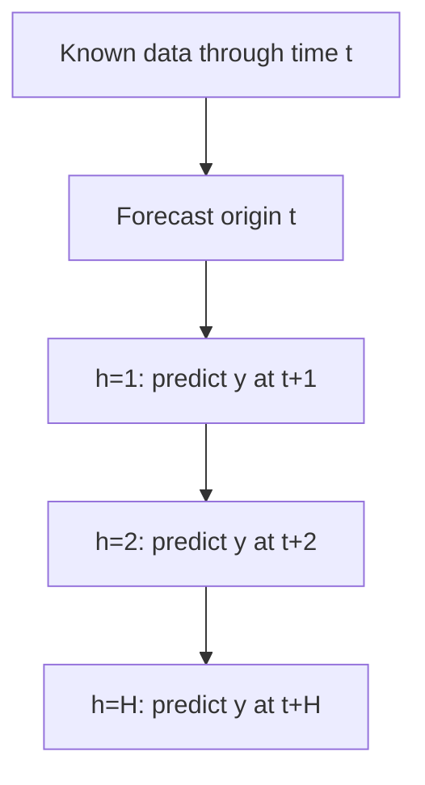

A **forecast horizon** is how far into the future a forecast targets, measured from the **forecast origin** (the last time you are allowed to know data). If the origin is time $t$ and you predict $y_{t+h}$, the horizon is $h$ steps. The horizon is both a modeling choice and a product contract: it sets which future label you score, which features may exist, and which decision the forecast can support.

In standard notation the $h$-step-ahead forecast made at origin $t$ is written $\hat{y}_{t+h|t}$. The left side of the bar is the target time; the right side is the information cutoff. Horizon $h=1$ is one-step-ahead. Multi-step work either produces a path $\hat{y}_{t+1|t},\ldots,\hat{y}_{t+H|t}$ or a single far point at $h=H$.

## Formula

For a series observed at discrete times $1,2,\ldots,t$:

$$
\hat{y}_{t+h|t} = f\!\left(\mathcal{I}_t\right),\qquad h \in \{1,2,\ldots,H\}
$$

where $\mathcal{I}_t$ is the information set available at the origin (past targets, lagged features, known future calendars, and so on). The forecast error at that horizon is

$$
e_{t+h} = y_{t+h} - \hat{y}_{t+h|t}.
$$

Evaluate multi-step forecast errors at the target horizons on held-out periods. Fit-set residual size describes training fit; the deployment decision depends on horizon-$h$ accuracy.

## Example

Daily batch-job volume for a model-serving cluster. At end of day $t =$ Monday 2026-01-26 you know counts through Monday.

| Horizon $h$ | Target day | Question the forecast answers |
| --- | --- | --- |
| $1$ | Tuesday | Staff the next on-call shift |
| $2$ | Wednesday | Pre-warm a second replica set |
| $7$ | Next Monday | Reserve weekly capacity |

A one-day model that beats seasonal naive on $h=1$ can still lose badly at $h=7$, where weekly seasonality and launch uncertainty dominate. Report MAE (or other metrics) **by horizon** alongside any pooled summary over a week of mixed lead times.

Seasonal-naive weekly lag predicts Friday volume $132$. Observed Friday is $160$ after a launch, so $e_{t+h}=+28$ at the horizon that lands on that Friday. The same model might have only a few jobs of error on ordinary mid-week $h=1$ days. Horizon is what makes those errors incomparable if you blend them.

## Diagram



All horizons share the same origin $t$. Past data (and anything else already known at $t$, including published calendars) may feed features. Outcomes and features that only become known after $t$ are illegal for that origin, even if the warehouse has them when you build training rows later.

## Information contract

The horizon defines the allowed feature lag. For a two-day-ahead forecast of day $t+2$, you may not use any field that only becomes known on day $t+1$, even if the warehouse has it when you build training rows later. That includes "yesterday's final count," late-arriving telemetry, and post-event labels.

```text
origin t = 2026-01-26 (features must be available by end of day t)
target  t+2 = 2026-01-28
OK:  volumes, lag features, known holidays through 2026-01-26
LEAK: 2026-01-27 midnight volume, next-day launch flag published after t
```

Match evaluation to serving: same origin cadence, same $H$, and the same gap when features or labels arrive late. A clean offline task that predicts with future-aligned features does not measure the production horizon.

## Multi-step strategies

To cover $H>1$ steps you typically choose one of:

1. **Recursive (iterated):** train one-step, feed predictions back as inputs for later steps. Errors can compound as $h$ grows.
2. **Direct:** train a separate model (or head) per horizon $h$, so $\hat{y}_{t+h|t}$ does not depend on earlier predicted values.
3. **Multi-output / sequence:** emit the full path in one shot (common in neural forecasters).

None of these changes the definition of horizon; they only change how $\hat{y}_{t+h|t}$ is produced. Pick the strategy that matches the decision path and re-check error curves by $h$.

## Why it matters here

Forecasting and capacity lessons treat horizon as the product knob that decides whether a model is useful. Autoscaling may need minutes of warning; staffing may need days; capacity purchases may need months. A model with the wrong horizon can be accurate on paper and still useless for the decision. Longer horizons usually need stronger baselines (often seasonal naive), wider prediction intervals, and separate alert thresholds. Horizon mistakes are also a common path to feature leakage when training rows quietly include post-cutoff data.

## Related terms

- [Prediction timestamp](glossary://prediction-timestamp)
- [Forecast error](glossary://forecast-error)
- [Prediction interval](glossary://prediction-interval)
- [Rolling-origin evaluation](glossary://rolling-origin-evaluation)
- [Seasonal naive forecast](glossary://seasonal-naive-forecast)
