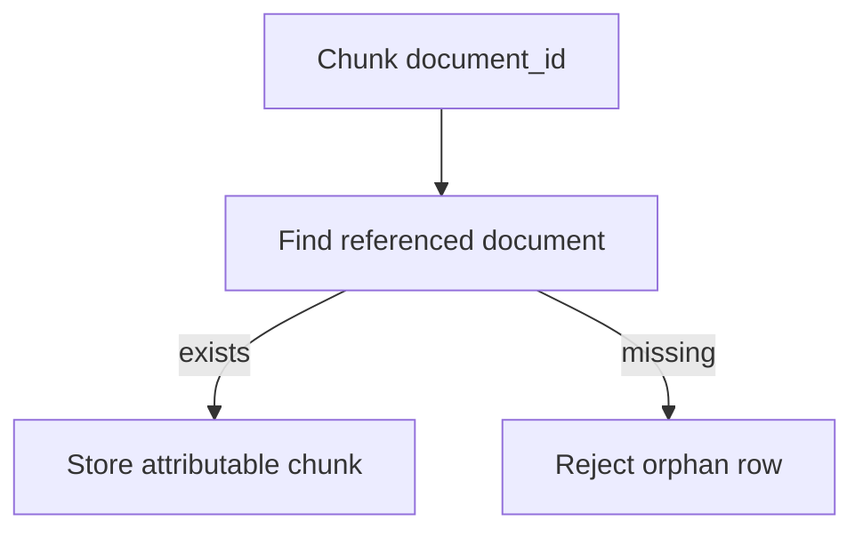

A **foreign key** constrains one or more columns to reference an eligible unique key, commonly a primary key, in a referenced table. The referenced table can be the same table. Nullable references can be absent under the database's NULL matching rules; add `NOT NULL` when every row must have a parent. For example, `chunks.document_id` can reference `documents.id`, making every stored chunk traceable to its source document. A missing non-null target triggers a referential-integrity failure.

Foreign-key rules can also control what happens when a referenced row is updated or deleted. The chosen behavior might reject removal, cascade it to related rows, or clear an optional reference. Select the behavior based on whether related records must remain auditable after a source changes.

## Enable enforcement in SQLite

[SQLite](https://www.sqlite.org/foreignkeys.html) foreign-key enforcement is a per-connection setting. Run `PRAGMA foreign_keys = ON` outside an active transaction and verify it before relying on declared references. Merely writing `REFERENCES documents(id)` in the schema isn't enough when enforcement is disabled. [PostgreSQL](https://www.postgresql.org/docs/current/ddl-constraints.html) normally enforces declared foreign-key constraints; a deferrable constraint may postpone its check until transaction commit.



## Example

```sql
CREATE TABLE chunks (
    id TEXT PRIMARY KEY NOT NULL,
    document_id TEXT NOT NULL REFERENCES documents(id),
    chunk_text TEXT NOT NULL
);
```

With SQLite foreign-key enforcement enabled, inserting a chunk whose `document_id` has no matching document raises an integrity error.

## Why it matters here

Document chunks, access-control entries, derived embeddings, and evaluation results need reconstructible source lineage. Foreign keys protect those relationships across every writer rather than trusting one ingestion function to remember its checks.

## Related terms

- [Primary key](glossary://primary-key)
- [SQL](glossary://sql)
- [Data model](glossary://data-model)
- [Provenance](glossary://provenance)
