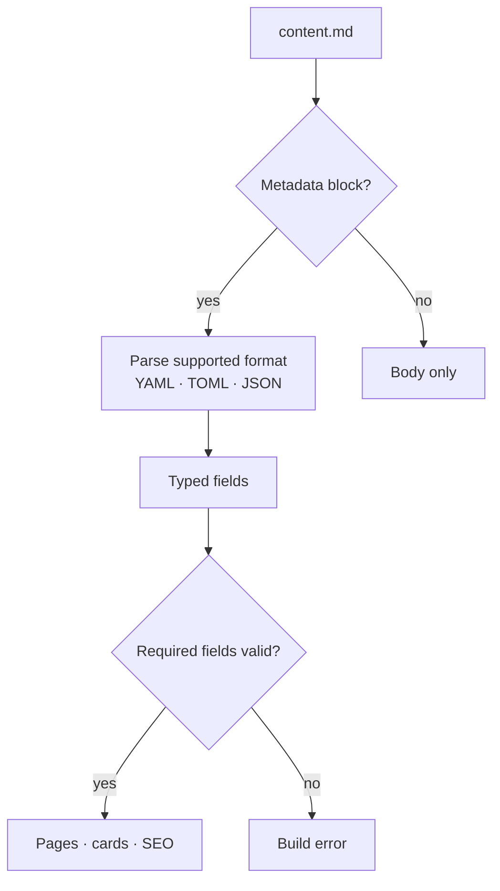

Frontmatter is structured metadata placed at the **very top** of a content file (almost always Markdown), separated from the body by delimiter lines. Build tools parse that block first, then treat everything after it as prose. The usual form is a [YAML](https://yaml.org/) map between triple dashes (`---`), a convention [Jekyll popularized](https://jekyllrb.com/docs/front-matter/) and that static site generators, docs platforms, and many content pipelines still follow.

The point is separation of concerns: the body teaches a human; the frontmatter tells machines how to route, index, sort, hide, SEO-tag, and validate the page. Without it, title, slug, section, difficulty, cover image, draft status, and ordering live only in directory names, CMS rows, or tribal knowledge, which break as soon as content is reviewed, built, or regenerated at scale.

## Intuition

Think of a content file as two documents glued together:

| Layer | Audience | Role |
|:---|:---|:---|
| Frontmatter | Build, CI, loaders | Typed fields: id, slug, section, difficulty, order, cover path |
| Body | Readers | Teaching prose, code, diagrams, quizzes |

The body can look perfect while the page is still unpublished, mis-ordered, missing from search cards, or linked with the wrong difficulty. Frontmatter is the machine-readable half of the [article bundle](glossary://article-bundle). Treat field names and enums as an API, not as free-form notes.

## How it works

1. **Locate the block.** It must be the first thing in the file (leading BOM or a blank line before the opener breaks many parsers). Common shapes:
   - YAML: opening and closing `---` (Jekyll, GitHub Docs, Pandoc YAML metadata blocks, most SSGs)
   - TOML: opening and closing `+++` (Hugo)
   - JSON: Hugo accepts a **bare** object that starts with `{` and ends at the matching `}` (no `---` wrapper). Many custom loaders instead put the same JSON object between `---` lines so one regex strips the block regardless of serialization.
2. **Parse the serialization.** YAML/TOML/JSON decode into a map of keys and typed values (strings, ints, bools, lists, nested objects).
3. **Strip it from the body.** The remainder is Markdown (or other markup) passed to the renderer.
4. **Consume fields.** Templates, route generators, indexes, SEO tags, prev/next navigation, and [validation gates](glossary://validation-gate) read the map. Unknown or invalid values should fail the build, not silently default into wrong product behavior.

[Pandoc](https://pandoc.org/MANUAL.html#extension-yaml_metadata_block) and [Hugo](https://gohugo.io/content-management/front-matter/) document the same idea under "YAML metadata" / "front matter": metadata describes and controls the published page; the body is content.

A minimal YAML example (Jekyll-style):

```yaml
---
layout: post
title: Blogging Like a Hacker
---
```

Hugo can carry the same fields in YAML, TOML, or bare JSON; only the delimiters and syntax change.

## Example

A curriculum lesson uses frontmatter as the routing and card contract. Suppose 158 visible lessons; each must land in a roadmap section, sort position, difficulty badge, and Learn card. An invalid `section` enum or duplicate `slug` can leave Markdown rendering intact while hiding the page from the index, putting "Easy" on a hard serving topic, or breaking previous/next links for every neighbor.

YAML form (common in docs and blogs; field names and enums are project-defined):

```yaml
---
title: "KV Cache"
slug: kv-cache
section: "Inference & Production Scale"
difficulty: Medium
tags: [inference, memory]
coverImage: illustrations/_generated/kv_cache_dark.png
order: 12
---
```

JSON between the same `---` delimiters (used by loaders that want strict JSON and a [JSON Schema](glossary://json-schema) without a YAML library; this site's lesson `content.md` files use this shape):

```markdown
---
{
  "id": "kv-cache",
  "title": "KV Cache",
  "slug": "kv-cache",
  "section": "Inference & Production Scale",
  "difficulty": "Medium",
  "order": 12,
  "coverImage": "illustrations/_generated/kv_cache_dark.png",
  "shortDescription": "Reuse attention keys and values across decode steps."
}
---

# KV Cache

During decode, each new token should not recompute...
```

A tiny parser sketch matches the delimiter pattern, decodes the middle, and returns body separately:

```ts
const FRONTMATTER = /^---\r?\n([\s\S]*?)\r?\n---\r?\n?/

function splitFrontmatter(source: string): { meta: unknown; body: string } {
  const match = source.match(FRONTMATTER)
  if (!match) return { meta: null, body: source.trim() }
  // Project choice: JSON.parse, YAML.parse, etc.
  return {
    meta: JSON.parse(match[1]),
    body: source.slice(match[0].length).trim(),
  }
}
```

Concrete failure: `"difficulty": "medium"` when the schema only allows `"Easy" | "Medium" | "Hard"`. The article body still builds; the card pipeline either drops the lesson or shows a blank badge until a schema check fails in CI.

## Diagram



## Content contract

Frontmatter is the contract between writers and loaders:

- **Required fields stay small and typed.** Id, title, slug, section, difficulty, order (or equivalent) should be explicit. Optional fields need documented defaults so omission is intentional.
- **Enums are closed sets.** Section names, difficulty levels, categories: change them in schema and consumers together.
- **Paths are real.** Resolve cover images and asset refs to files after the asset build; plausible-looking path strings can still point to missing files.
- **Rename is a breaking change.** Renaming `shortDescription` to `summary` without updating the loader and schema is [schema drift](glossary://schema-drift): pages may still parse while indexes go empty.
- **Sidecar vs embedded.** Some systems keep metadata only in frontmatter; others allow `metadata.json` next to `content.md`. Pick one source of truth per bundle and validate that both are not disagreeing.

Review frontmatter changes like code: field renames, date formats, and new enum values need the same scrutiny as an API PR.

## What fails in production

- **Invalid or missing delimiters:** body starts with `---` mid-file, or BOM/encoding issues break the "must be first" rule; metadata is ignored and defaults apply.
- **Parse errors:** unquoted colons, tabs vs spaces, trailing commas (JSON), or YAML type surprises (`on`/`off` as booleans) corrupt fields.
- **Schema-valid but product-wrong:** slug matches the pattern but collides with another lesson; `order` duplicates scramble sort; `hidden: true` leaves a page out of the roadmap while the body is still on disk.
- **Stale machine fields:** body updated for a new section, frontmatter still says the old section; SEO, cards, and navigation lag the prose.
- **Soft defaults in loaders:** missing `coverImage` becomes `undefined` instead of a gate failure; social previews ship broken for weeks.

Hard-fail required fields, enums, unique slugs, and asset paths in CI so the body cannot "look fine" while the product surface is wrong.

## Why it matters here

LeetLLM is a docs-as-code curriculum: lessons and glossary entries live in Git and go through a [content pipeline](glossary://content-pipeline) into [static generation](glossary://static-generation). Lesson metadata supplies identity, section, difficulty, cover, and card copy. Canonical roadmap and prev/next ordering also depend on the explicit section and slug sequences in `web/src/lib/questions.ts`; a frontmatter `order` field alone does not override that sequence. Glossary entries themselves use YAML frontmatter (`title`, `importance`) that the glossary build parses before section headings. Invalid frontmatter becomes a product bug when it hides pages, assigns the wrong difficulty, breaks navigation, or leaves index gaps. Validate frontmatter like an API contract so publish stays predictable.

## Related terms

- [Article bundle](glossary://article-bundle)
- [Content pipeline](glossary://content-pipeline)
- [Static generation](glossary://static-generation)
- [Schema drift](glossary://schema-drift)
- [JSON Schema](glossary://json-schema)
