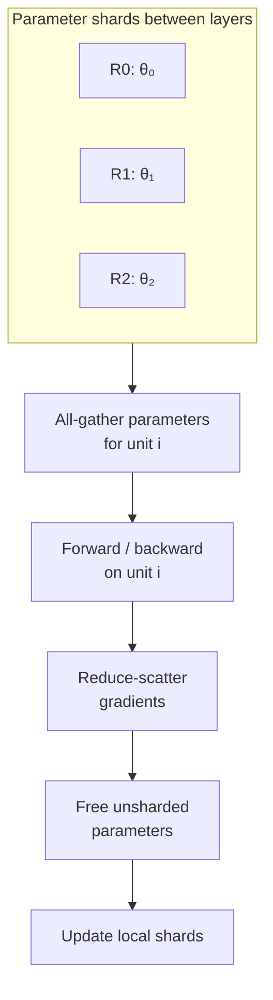

Fully Sharded Data Parallel (FSDP) is PyTorch's native data-parallel strategy that shards model parameters, gradients, and [optimizer state](glossary://optimizer-state) across ranks so each GPU keeps only a fraction of the full training state. It is the same idea as DeepSpeed ZeRO stage 3: you still split the *batch* across workers, but you also partition the *model state* that naive [data parallelism](glossary://data-parallelism) (DDP) would fully replicate.

With full sharding and resharding enabled, each rank holds parameter shards between compute phases. Before a wrapped module runs, ranks **all-gather** that module's parameters into a temporary full copy for compute. After backward on that unit, local full gradients are **reduce-scattered** back into sharded gradients, the temporary unsharded params are freed, and the optimizer steps on the shards it owns. Parameter retention and hybrid sharding policies change this lifecycle. FSDP uses reduce-scatter for gradients and all-gather for parameters, while DDP normally all-reduces gradients.

PyTorch today has two APIs: the original `FullyShardedDataParallel` (FSDP1, flat-parameter sharding; treated as legacy / deprecated in recent PyTorch 2.x docs) and FSDP2 (`fully_shard`), which shards each parameter on dim-0 as a `DTensor`, gives communication-free sharded state dicts, and is the recommended path as of current 2.x guidance.

## Intuition

Naive DDP keeps a full replica of weights, gradients, and Adam buffers on every GPU. For mixed-precision Adam, Rajbhandari et al. (ZeRO) count roughly $16\Psi$ bytes of model state for a model with $\Psi$ parameters: $2\Psi$ for FP16/BF16 weights, $2\Psi$ for gradients, and $12\Psi$ for FP32 master weights plus two Adam moments. A 7B model is already on the order of $7\times 10^9 \times 16 \approx 112$ GB of *replicated* training state per rank before activations. That is why a model that "fits as a weight file" still OOMs under full replication.

FSDP (like ZeRO-3) partitions those three pieces across $N$ data-parallel ranks so steady-state model state per rank scales roughly as $1/N$, plus a temporary unsharded copy of the *current* FSDP unit during compute. You trade memory for collectives: every unit pays all-gather (and often a second all-gather in backward if you reshard after forward) and a reduce-scatter on gradients.

## How it works

1. **Shard at init.** Parameters are chunked across the data-parallel group (FSDP2: dim-0 `DTensor` shards). Construct the optimizer *after* sharding so it sees sharded params and builds sharded moments.
2. **Wrap bottom-up.** Apply `fully_shard` to each transformer block (or other unit), then to the root. Each call groups the parameters it manages into a communication unit, not a new rank process group. Root-only wrapping gathers the whole model as one unit, limiting overlap and increasing peak memory.
3. **Forward.** Pre-forward hooks all-gather the unit's params; the unit runs with a full local copy; post-forward may free (reshard) them if `reshard_after_forward=True`.
4. **Backward.** If params were reshared, all-gather again for gradient computation; then reduce-scatter gradients so each rank keeps only its shard; free the unsharded params.
5. **Optimizer step.** Each rank updates its local shards. No rank needs a permanent full model.
6. **Prefetch / overlap.** All-gathers and reduce-scatters run on separate CUDA streams so the next unit's gather can hide behind the current unit's compute. Explicit prefetch APIs exist when implicit scheduling is too late (CPU-bound graphs).

## Diagram



## Formula

**Replicated model state (naive DDP, mixed-precision Adam).** With $\Psi$ parameters:

$$
M_{\mathrm{DDP}} \approx 16\Psi \text{ bytes}
$$

(weights $2\Psi$ + grads $2\Psi$ + optimizer $12\Psi$). Activations, KV-style caches, and workspace are separate.

**Fully sharded steady-state model state.** Across $N$ ranks, ignoring temporary unsharded buffers and padding:

$$
M_{\mathrm{FSDP, steady}} \approx \frac{16\Psi}{N} \text{ bytes per rank}
$$

**Peak during a unit.** If unit $i$ has $\Psi_i$ parameters and you keep one full unsharded copy in low precision for compute (for example BF16, $2$ bytes/param) while still holding your shards of everything:

$$
M_{\mathrm{one\ unit\ sketch}} \approx \frac{16\Psi}{N} + 2\Psi_i
$$

This **one-unit accounting sketch** omits other allocations that can overlap at peak: full gradients, communication buffers, prefetched neighboring units, root parameters retained after forward, activations, and allocator overhead. The $16\Psi$ coefficient applies to the stated ZeRO-style dtype inventory; PyTorch AMP recipes can use different state inventories. Finer wrap units lower the gathered-weight term but increase the number of collectives. Setting `reshard_after_forward=False` (similar to FSDP1 `SHARD_GRAD_OP`) keeps parameters unsharded between forward and backward: you skip the backward all-gather and use more memory. See the [FSDP2 API](https://docs.pytorch.org/docs/2.14/distributed/fsdp.fully_shard.html) for retention and prefetch policies.

## Example

Eight ranks fine-tune a ~7B causal LM that will not fit under DDP on 80 GB GPUs. Under the stated dtype inventory, steady-state model state alone is ~$112/8 \approx 14$ GB per rank. Wrap each transformer block, then the root, to gather block-sized units rather than the full model; prefetching can keep more than one unit resident. With BF16 compute, a 200M-parameter block is roughly $0.4$ GB unsharded. Budget additional full gradients, communication buffers, and activations, and measure actual peak memory (pair FSDP with [activation checkpointing](glossary://activation-checkpointing) when activations dominate).

```python
from torch.distributed.fsdp import fully_shard, MixedPrecisionPolicy
import torch

mp = MixedPrecisionPolicy(param_dtype=torch.bfloat16, reduce_dtype=torch.float32)

for block in model.layers:
    fully_shard(block, mp_policy=mp)
fully_shard(model, mp_policy=mp)  # root: embeddings, head, etc.

# Optimizer after fully_shard so it sees DTensor parameters
optim = torch.optim.AdamW(model.parameters(), lr=2e-5)

loss = model(batch).mean()  # use __call__, not .forward, so hooks run
loss.backward()
torch.nn.utils.clip_grad_norm_(model.parameters(), 1.0)
optim.step()
optim.zero_grad(set_to_none=True)
```

Typical production knobs: BF16 params for compute with FP32 reduce-scatter for numerics; `reshard_after_forward=True` on blocks for memory; often leave the root unresharded after forward because backward needs it immediately. Checkpoints are sharded (`DTensor` / Distributed Checkpoint); consolidating a full `model.pt` for export needs an all-gather or DCP `full_state_dict` path, not a naive single-rank `torch.save` of local tensors.

## Memory versus communication

| Choice | Memory | Communication |
| --- | --- | --- |
| DDP (full replica) | Highest steady-state | Gradient all-reduce only |
| Shard grads + optimizer only | Medium | Less param traffic |
| Full FSDP (params + grads + optim) | Lowest steady-state | All-gather params each unit + reduce-scatter grads |
| Finer wrap units | Lower peak $\Psi_i$ | More, smaller collectives |
| `reshard_after_forward=False` | Higher (keep full params) | No backward re-all-gather |
| CPU offload | Fits larger models | Host-device copies dominate |

On a fat NVLink node, compute often hides all-gathers. Across nodes on a weak fabric, step time becomes network-bound and FSDP can be slower than a smaller model under DDP. Hybrid shard (HSDP: shard within node, replicate across nodes via a 2D mesh) is the usual compromise for multi-node.

## What fails in production

OOMs that "should fit" after sharding are often activations, not model state: fix sequence length, microbatch, or checkpointing before adding more ranks. Wrapping only the root gives one full-model all-gather and destroys overlap. Building the optimizer before `fully_shard` attaches state to the wrong tensors. Calling `model.forward(...)` instead of `model(...)` skips FSDP2 hooks unless you register the method. Checkpoints saved as rank-local shards without DCP/DTensor layout look like corrupt weights when loaded as a full dict on one GPU. Gradient accumulation can disable sync on intermediate microbatches (`set_requires_gradient_sync(False)` in FSDP2; `no_sync` in FSDP1) to avoid a reduce-scatter every microbatch; synchronizing each microbatch is also valid, and avoiding synchronization can retain larger gradient buffers. After a mid-step exception, FSDP2 may need `reset_iter_state()` on the root before the next iteration.

Profile all-gather and reduce-scatter time versus compute, peak memory per rank, and whether loss matches a small unsharded baseline at the same global batch. NCCL hangs usually mean mismatched wrap structure, uneven control flow across ranks, or a rank that never entered the collective.

## Why it matters here

FSDP is the first serious multi-GPU tool most engineers hit when a fine-tune or pretrain no longer fits under DDP. It connects optimizer memory accounting, collective communication, wrap policy, and checkpoint format. Curriculum topics on ZeRO, DeepSpeed, Megatron 3D parallelism, and large-model SFT all assume you can reason about sharded state and the all-gather / reduce-scatter tax.

## Related terms

- [Data parallelism](glossary://data-parallelism)
- [ZeRO](glossary://zero)
- [Optimizer state](glossary://optimizer-state)
- [Activation checkpointing](glossary://activation-checkpointing)
- [NCCL](glossary://nccl)
