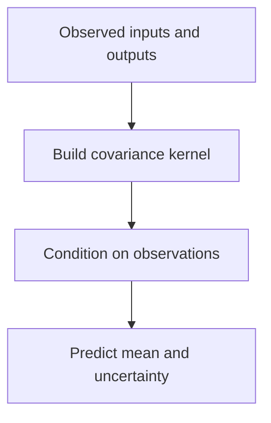

A Gaussian process (GP) defines a probability distribution over functions such that function values at every finite collection of inputs have a joint Gaussian distribution. It is specified by a mean function and a positive-semidefinite covariance kernel describing how outputs at different inputs move together. After observing training data, Gaussian-process regression produces a posterior predictive mean and uncertainty.

## Conditioning creates local uncertainty

Let $K$ be the training kernel matrix, $k_*$ the covariances between a new input and the training inputs, and $\sigma_n^2$ the variance of independent additive Gaussian observation noise. With zero prior mean and fixed kernel/noise parameters, predictive mean is $k_*^\top(K+\sigma_n^2I)^{-1}y$. Latent predictive variance is $k(x_*,x_*)-k_*^\top(K+\sigma_n^2I)^{-1}k_*$. Observation variance also includes measurement noise. Exact dense fitting typically requires cubic time and quadratic storage in the number of observations. Implement the equations with linear solves, usually Cholesky, rather than explicitly computing an inverse ([GPML, Chapter 2](https://gaussianprocess.org/gpml/chapters/RW2.pdf)). Non-Gaussian likelihoods generally require approximate inference.

## Example

Observe a function value of 2 at input zero, use a unit-variance RBF kernel with length scale one, and assume noise variance 0.04. At input zero, posterior mean is $2/1.04\approx1.923$ and latent standard deviation is approximately 0.196. At input three, kernel similarity is approximately 0.011; the mean falls to approximately 0.021 and latent standard deviation returns to approximately 1.0. Distance from evidence increases uncertainty under this prior.

## Why it matters here

In a Gaussian process, the kernel defines covariance in a probabilistic function prior. The resulting uncertainty estimates inform active learning, small-data regression, and Bayesian optimization; kernel assumptions, calibration, and cubic exact-training cost shape production use.

## Related terms

- [Kernel method](glossary://kernel-method)
- [Radial basis function](glossary://radial-basis-function)
- [Prediction interval](glossary://prediction-interval)
