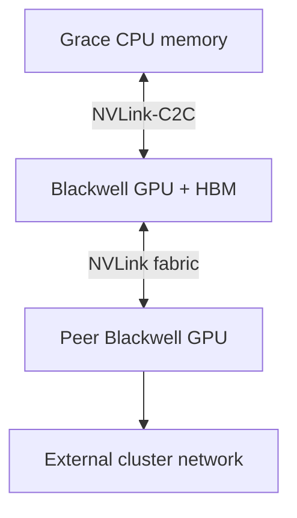

**GB200 Grace Blackwell Superchip** is an [NVIDIA compute module](https://www.nvidia.com/en-us/data-center/gb200-nvl72/) coupling one Grace CPU with two Blackwell GPUs through coherent NVLink-C2C connections. A GB200 NVL72 rack connects 36 Grace CPUs and 72 GPUs through its NVLink fabric, so distributed training and inference can exchange tensors inside the domain without routing every GPU pair through the external cluster network.

GB200 names a hardware platform, not one optimization. Workload speed still depends on tensor shapes, precision, kernel quality, communication groups, CPU offload, and whether ranks stay inside the fast NVLink domain.

## Hardware layers

Three links matter when reading a GB200 topology: HBM attached to each Blackwell GPU, coherent CPU-GPU memory access inside a superchip, and GPU-GPU NVLink across the rack. A trainer may use HBM for active tensors, Grace memory for optimizer offload, and rack-scale NVLink for tensor or expert collectives.

## Diagram

## Example

A 64-GPU learner can place all expert-parallel ranks inside one 72-GPU NVLink domain. The same job would behave very differently if its all-to-all group crossed slower network boundaries, even though GPU count and model configuration stayed unchanged.

## Why it matters here

This masterclass uses GB200s for both Megatron training and vLLM rollout generation. Understanding its memory hierarchy explains why aggressive optimizer offload can be plausible and why rank placement is a correctness-adjacent performance decision.

## Related terms

- [GPU](glossary://gpu)
- [HBM](glossary://hbm)
- [NVLink](glossary://nvlink)
- [NVL72](glossary://nvl72)
- [NCCL](glossary://nccl)
