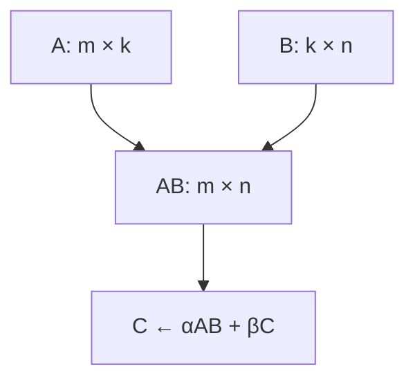

**GEMM** stands for general matrix multiplication. GPU libraries use the name for operations shaped like $C = \alpha A B + \beta C$. Transformer projections, feed-forward networks, attention projections, and MoE experts spend much of their compute inside GEMM kernels.

Matrix dimensions, dtype, layout, alignment, batching, and data movement determine whether hardware tensor cores stay busy. Extreme sharding can turn one large efficient GEMM into many skinny kernels with poor utilization.

## Shape intuition

For matrices $A\in\mathbb{R}^{m\times k}$ and $B\in\mathbb{R}^{k\times n}$, multiplying them costs roughly $2mkn$ floating-point operations. In LLMs, $m$ often combines tokens and batch, while $k$ and $n$ come from hidden or intermediate dimensions.

Think of $A$ as rows of token activations and $B$ as learned weights. Each output entry is a dot product: multiply matching values, then add them. A $2\times3$ matrix times a $3\times2$ matrix produces a $2\times2$ result. Shared inner dimension, here 3, must match.

## Diagram

## Example

An expert maps 6,144 hidden features through a 2,048-wide gated MLP. If only a handful of tokens reach one expert, its GEMMs may be too small to use a GB200 efficiently. Grouped GEMM batches several local experts into a larger launch.

## Grouped GEMM

MoE routing sends different token counts to different experts. Grouped GEMM schedules several independent expert multiplications together instead of launching one tiny kernel per expert. It reduces launch overhead and gives GPU more tiles to execute, but cannot repair severe routing imbalance by itself.

Balanced, well-aligned matrices can saturate Tensor Cores; skinny or tiny matrices may leave them idle. Tensor parallelism, expert parallelism, batch size, and token packing all change $m$, $n$, or $k$.

## Why it matters here

GLM-5.3 performance depends on attention-projection GEMMs and routed expert GEMMs. TP, ETP, routing balance, grouped kernels, and FP8 all change their shapes or execution efficiency. Identify the matrix dimensions and dispatched kernel before using a device's peak GEMM throughput to estimate end-to-end training speed.

## Related terms

- [Tensor](glossary://tensor)
- [Feed-forward network](glossary://feed-forward-network)
- [Mixture of experts](glossary://mixture-of-experts)
- [FP8](glossary://fp8)
- [Tensor Core](glossary://tensor-core)
- [Arithmetic intensity](glossary://arithmetic-intensity)
