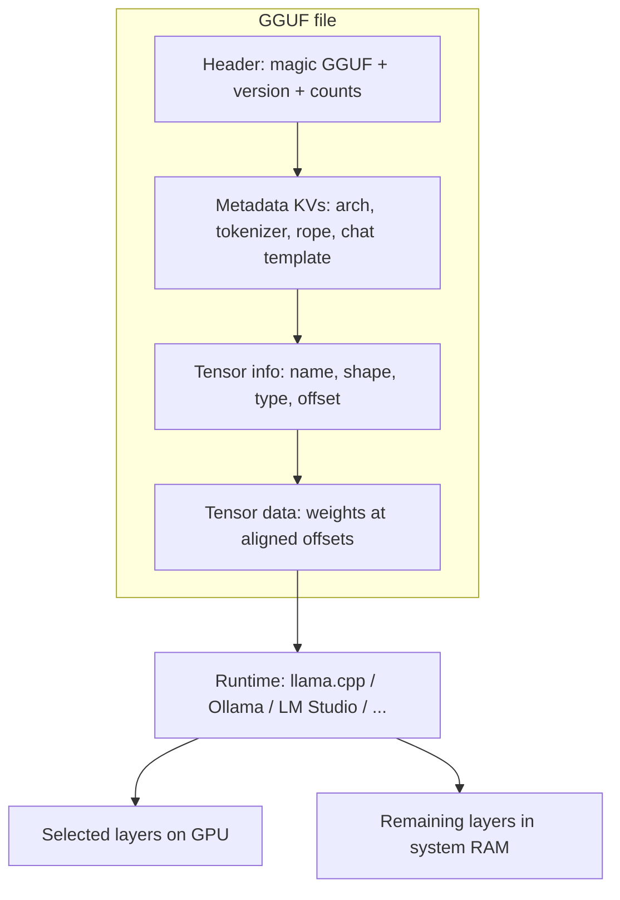

GGUF is a binary container for model tensors and the metadata a local runtime needs to load them, designed for single-file deployment but also supporting split model shards. Quantization is a separate operation: the file can hold FP16 tensors, block-quantized tensor types such as `Q4_K`, or a mix, plus architecture keys, tokenizer data, and RoPE or chat-template hints. `Q4_K_M` is a quantization preset that selects a mixture of per-tensor storage types. Georgi Gerganov designed GGUF as the successor to GGML/GGJT for the GGML and [llama.cpp](glossary://llama-cpp) ecosystem: a portable format that is extensible and `mmap`-friendly.

## Diagram



## How it works

A GGUF v3 file is little-endian by default and laid out so a reader can map the whole file into memory:

1. **Header** (24 bytes of fixed fields, then metadata): magic `GGUF` (`0x47 0x47 0x55 0x46`), format version (`3` in the current spec), `tensor_count` (`uint64`), and `metadata_kv_count` (`uint64`).
2. **Metadata key-value pairs**: hierarchical keys such as `general.architecture`, `llama.context_length`, `tokenizer.ggml.tokens`, and optional `tokenizer.chat_template`. New keys can appear without breaking older readers.
3. **Tensor info table**: each entry has a name (for example `blk.0.attn_q.weight`), dimension list, `ggml_type` (F16, Q4_K, IQ4_XS, ...), and a byte offset into the tensor payload.
4. **Aligned tensor payload**: weights sit at multiples of `general.alignment` (default 32). Runtimes often `mmap` this region so cold start can start reading tensors without a full deserialize-and-copy pass.

That design is the main difference from weight-only hub formats (for example SafeTensors alone). SafeTensors is excellent for tensors; GGUF aims to be a **load unit** for GGML-family executors, so architecture and tokenizer details travel with the weights.

Conversion is usually two steps from a training or Hugging Face [model checkpoint](glossary://model-checkpoint):

```bash
# High-precision GGUF first (names vary by llama.cpp revision)
python convert_hf_to_gguf.py ./Meta-Llama-3.1-8B-Instruct \
  --outtype f16 --outfile llama-3.1-8b-f16.gguf

# Then quantize to a target type inside the same container family
llama-quantize llama-3.1-8b-f16.gguf llama-3.1-8b-Q4_K_M.gguf Q4_K_M
```

## Quantization types inside the file

GGUF stores a per-tensor type; "we used GGUF" never fully specifies quality. Common families:

| Family | Examples | Notes |
|--------|----------|--------|
| Full / half precision | `F32`, `F16`, `BF16` | Conversion baseline; large files |
| Legacy block quants | `Q4_0`, `Q5_0`, `Q8_0` | Simple block scales; still seen on hubs |
| K-quants | `Q4_K_M`, `Q5_K_M`, `Q6_K` | Super-blocks with finer scales; common local default |
| IQ / iMatrix-aware | `IQ4_XS`, `IQ3_S`, `IQ2_XXS` | Often need a calibration importance matrix for better low-bit quality |

Approximate bits-per-weight for popular K-quants (including scale/min overhead, not ideal pure $n$-bit packing): `Q2_K` ~2.6, `Q3_K` ~3.4, `Q4_K` ~4.5, `Q5_K` ~5.5, `Q6_K` ~6.6. Real file size also includes tokenizer blobs, unquantized special tensors, and alignment padding.

## Example

An ~8B instruct model in FP16 is on the order of $8 \times 10^9 \times 2$ bytes ≈ **16 GB** of weights. After `Q4_K_M` quantization, the GGUF often lands near **4.5 to 5 GB** on disk (roughly $4.5$ bits/weight plus metadata). That is small enough for many laptops.

Run it with layer offload (runtime choice, not baked into the file):

```bash
# Offload 28 transformer blocks to GPU; remainder stays in system RAM
./llama-cli -m llama-3.1-8b-Q4_K_M.gguf -ngl 28 -c 8192 -p "Explain GGUF in two sentences."
```

Worked memory sketch for that run; values are order-of-magnitude estimates:

- Weights: ~5 GB mapped from the GGUF (some on VRAM via `-ngl`, rest in RAM)
- KV cache at 8k context still grows with layers, KV heads, head dim, and dtype (see [KV cache](glossary://kv-cache))
- Scratch buffers, compute graphs, and batch state add more

So a file that "fits" can still OOM once context length or concurrent sessions grow. Measure resident set and VRAM under the real prompt length, not the download size alone.

Hub filenames often encode the type, for example `Llama-3.1-8B-Instruct-Q4_K_M.gguf`. The official naming convention is roughly `BaseName-SizeLabel-Version-Encoding.gguf`, with optional shard suffixes like `00001-of-00004`.

## Trade-offs

**Strengths.** Single-file or sharded distribution; rich metadata; CPU-first and hybrid CPU/GPU paths; wide tool support (llama.cpp, Ollama, LM Studio, GPT4All, and [experimental vLLM GGUF support](https://docs.vllm.ai/en/latest/features/quantization/gguf/)); easy A/B of quantization presets by swapping files.

**Limits.** GPU-server serving often prefers AWQ/GPTQ/FP8 paths with highly optimized kernels when the full model fits on accelerators. GGUF quality depends on the quant type and converter revision. Tokenizer conversion from GGUF can be fragile on some stacks; many tools recommend pairing the GGUF with the base model's tokenizer when the runtime allows it. Provenance matters: a third-party quant of a base model is a different artifact than the original publisher's file.

## Debug path

When output is garbled or quality collapses after switching GGUFs:

1. Confirm container **and** type: `Q4_K_M` vs `IQ2_XXS` is a large quality jump.
2. Match runtime version to file features (newer types need newer `llama.cpp` builds).
3. Check [tokenizer artifact](glossary://tokenizer-artifact), special tokens, and chat template against the base instruct model.
4. Verify context length and RoPE scaling metadata for long-context models.
5. Separate weight OOM from KV-cache OOM; shrink context or batch before blaming quantization alone.
6. Compare against the F16/BF16 or high-bit GGUF on a fixed prompt suite (facts, formatting, tool-style prompts, long context).

## Why it matters here

LeetLLM's quantization curriculum treats GGUF as the portable **local** packaging path next to GPTQ/AWQ as GPU-oriented weight methods. Engineers meet GGUF the moment they leave abstract "4-bit" talk and actually run a compressed open-weight model on a laptop, a CPU box, or a workstation with partial GPU offload. Knowing that GGUF is the container, that the quant type is a separate choice, and that runtime memory is more than file size prevents the most common local-deploy mistakes.

## Related terms

- [llama.cpp](glossary://llama-cpp)
- [Quantization](glossary://quantization)
- [Model checkpoint](glossary://model-checkpoint)
- [Tokenizer artifact](glossary://tokenizer-artifact)
- [KV cache](glossary://kv-cache)
