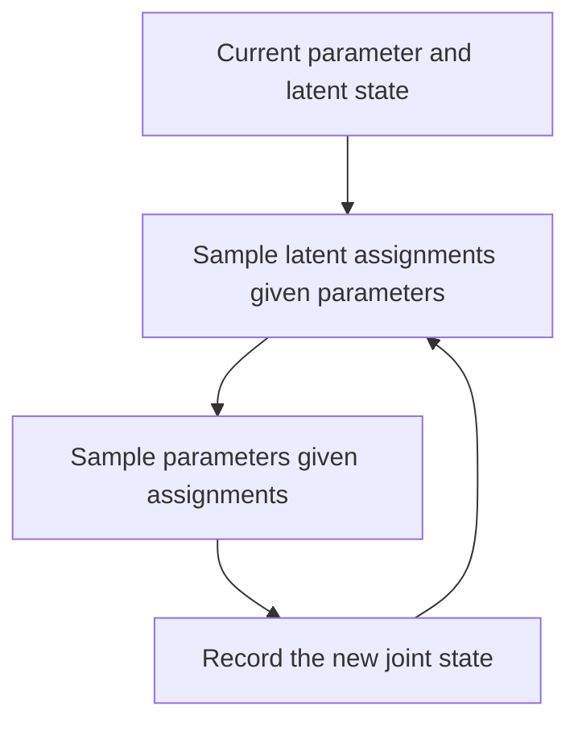

Gibbs sampling is a Markov chain Monte Carlo method that updates one variable, or one block of variables, by drawing from its exact conditional distribution given the current values of all other variables. When those conditional draws are valid and the chain can explore the relevant state space, the joint target distribution is stationary. Successive draws remain dependent even though each individual conditional update is accepted.

## Update one conditional block at a time

Gibbs sampling is especially useful when a joint posterior is complicated but individual conditional distributions are easy to sample. It can be viewed as a special Metropolis-Hastings transition whose candidate is drawn from the exact conditional, giving acceptance probability one. Strong dependence between variables can still make the chain mix slowly, so burn-in, convergence, and effective sample size remain relevant.

## Example

Consider a two-component latency mixture with unknown component assignments and component means. Start with candidate means. First sample which latent component could explain each observed latency given those means. Then sample updated component means conditional on the assignments. Repeating these steps creates a dependent sequence of complete mixture states rather than one deterministic hard clustering.

## Why it matters here

Latent-variable research models and hierarchical Bayesian systems often have convenient conditional pieces even when their full posterior lacks a closed form. Gibbs sampling connects those pieces to practical posterior exploration while keeping mixing limitations visible.

## Related terms

- [Markov chain Monte Carlo](glossary://markov-chain-monte-carlo)
- [Metropolis-Hastings](glossary://metropolis-hastings)
- [Latent variable](glossary://latent-variable)
- [Conditional probability](glossary://conditional-probability)
