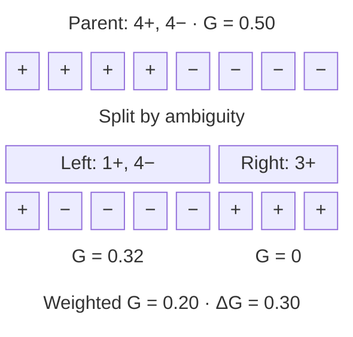

Gini impurity measures how mixed the class labels are inside a decision-tree node. A node containing one class has impurity zero. A node with evenly divided binary classes has impurity 0.5. Tree-building algorithms compare candidate splits by subtracting the weighted impurity of their children from the impurity of their parent.

## Formula and weighted decrease

For class proportions $p_1,\ldots,p_C$, $G=1-\sum_{c=1}^{C}p_c^2$. For binary data with positive proportion $p$, this becomes $G=1-p^2-(1-p)^2$. A split's decrease is $G_{parent}-(n_L/n)G_L-(n_R/n)G_R$. Child sizes must remain in the calculation; averaging child impurities without their sample counts can incorrectly favor a tiny pure leaf.

## Example

Eight access requests include four positive review labels, giving root impurity $1-0.5^2-0.5^2=0.5$. A threshold sends one positive and four negatives left, giving $G_L=1-0.2^2-0.8^2=0.32$. Three positives go right, giving $G_R=0$. Weighted child impurity is $(5/8)(0.32)+(3/8)(0)=0.20$, so the Gini decrease is 0.30. The split improves purity but still misses one positive in the left leaf.

## Why it matters here

Calculating impurity by hand explains why a tree chooses one threshold over another. A split describes predictive association in the sample; causal importance, calibration, and held-out performance require separate evidence.

## Related terms

- [Decision tree](glossary://decision-tree)
- [Random forest](glossary://random-forest)
- [Decision threshold](glossary://decision-threshold)
