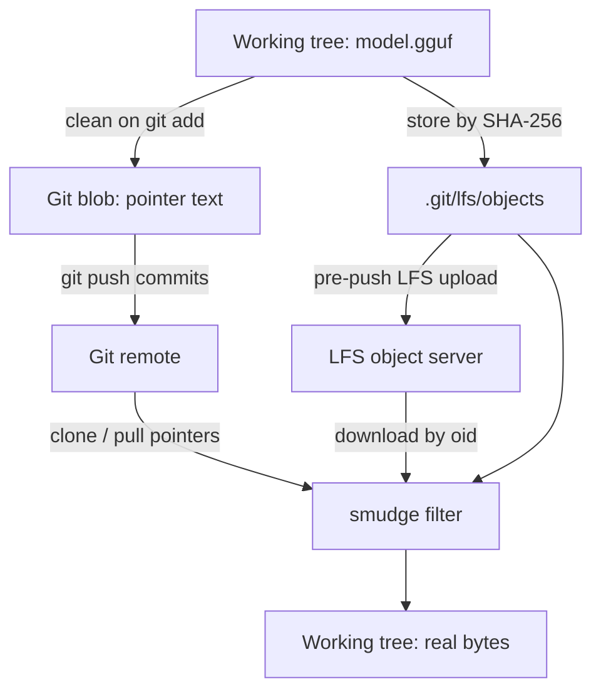

**Git LFS** (Large File Storage) is an open-source Git extension that version-controls large binaries without stuffing their full bytes into every Git pack and clone. Tracked paths still appear as normal files in your working tree, but Git itself stores only a small **pointer** (a few lines of UTF-8 text). The real content lives in a local LFS object cache and on a separate LFS server (GitHub, GitLab, Bitbucket, self-hosted, and so on). That split is why a repo can look complete while the multi-GB weight file is missing: the pointer checked out, the object never downloaded.

Git is designed for text and modest deltas. Every revision of a normal blob is retained in history, so a 4 GB model rewritten a few times balloons clones and CI. LFS keeps history cheap (pointers only) and transfers large objects on demand, at the cost of a second storage plane, bandwidth quotas, and client setup (`git lfs install` plus `.gitattributes` rules).

## Intuition

Treat LFS as content-addressed object storage integrated with Git's clean/smudge filters. On `git add`, LFS hashes the file and swaps the staged blob for a pointer. On checkout, it swaps the pointer back for real bytes (from cache or the server). The `git commit` / `git push` workflow stays familiar while LFS stores heavy payloads separately.

## How it works

1. **Configure filters and repository hooks:** [`git lfs install`](https://github.com/git-lfs/git-lfs/blob/main/docs/man/git-lfs-install.adoc) normally registers global `lfs` filters and installs a pre-push hook for the current repository when run inside one. Integrate existing custom hooks, and verify the upload hook in each repository.
2. **Track by path pattern:** `git lfs track "*.gguf"` (and similar) writes rules into `.gitattributes`, e.g. `*.gguf filter=lfs diff=lfs merge=lfs -text`. Patterns match names, not size; commit `.gitattributes` with the rest of the project.
3. **Clean on add:** the clean filter streams working-tree content, computes SHA-256, stores the object under `.git/lfs/objects/{oid[0:2]}/{oid[2:4]}/{oid}`, and stages a pointer instead of the binary.
4. **Push objects first:** the `pre-push` hook uploads LFS objects to the LFS endpoint, then the ordinary Git push sends commits that contain only pointers.
5. **Smudge on checkout:** Git feeds the pointer through the smudge filter; LFS loads the object from the local cache or downloads it by OID, then writes the real file into the working tree.

A v1 pointer is a short, deterministic text file (under 1024 bytes), for example:

```text
version https://git-lfs.github.com/spec/v1
oid sha256:4d7a214614ab2935c943f9e0ff69d22eadbb8f32b1258daaa5e2ca24d17e2393
size 12345
```

The `oid` is the content hash (currently `sha256`); `size` is the payload length in bytes. Empty files pass through unchanged.

Git hosts impose ordinary-blob limits plus separate LFS limits for file size, storage, and transfer. Those limits vary by host and plan, so check the repository host's current documentation before selecting LFS for a multi-gigabyte artifact. A file can fit under a per-file cap and still exhaust transfer quota through repeated CI clones. Prefer object storage or a model hub when every pipeline run would otherwise download large LFS history. Host quotas are product limits, not part of the LFS wire format.

## Diagram



## Example

A teammate adds a quantized local model for the course smoke tests:

```bash
# once per user account
git lfs install

git lfs track "*.gguf" "*.safetensors"
git add .gitattributes

# say weights-q4.gguf is ~2.1 GiB on disk
git add models/weights-q4.gguf
git commit -m "Add Q4 GGUF for local eval smoke"
git push origin main
```

What Git stores is ~130 bytes of pointer text with an `oid` and `size 2254857830` (example size). What LFS stores is the full ~2.1 GiB object. A fresh clone with LFS configured and network access restores `models/weights-q4.gguf` as a real binary. A clone that skipped smudging (`GIT_LFS_SKIP_SMUDGE=1` or a CI checkout that never fetched objects) leaves a tiny text file at that path. A missing `git-lfs` executable can instead fail checkout when the configured filter is required. Loaders receiving pointer text fail with format errors: GGUF magic missing, safetensors header invalid, or "file too small."

Quick sanity checks when artifacts are load-bearing:

```bash
# pointer files start with this version line; real GGUF does not
head -c 100 models/weights-q4.gguf

# expected: multi-GB; bad checkout: ~100-200 bytes
wc -c models/weights-q4.gguf

git lfs ls-files
git lfs pull
```

## Production failure modes

**Pointer-shaped checkout.** CI, Docker builds, or a teammate without LFS see a valid-looking path that is still a pointer. Unit tests that only assert "file exists" pass; serving and eval explode. Assert size, magic bytes, or that content is not an LFS pointer before packaging.

**Bandwidth and quota.** Hosts meter LFS storage and monthly transfer. Large models and frequent clean CI clones burn quota even when the Git pack stays small. Prefer object stores or model hubs for multi-GB weights when every pipeline run should not re-download LFS history.

**History already polluted.** Tracking a path with LFS does not rewrite past commits. A 3 GB file already in ordinary Git remains in the pack until you migrate (`git lfs migrate`) or filter history. Secrets committed as normal blobs stay in history even if later files move to LFS; rotate and rewrite separately.

**Partial migrate / wrong patterns.** Only patterns in `.gitattributes` are filtered. A `.pt` checkpoint next to tracked `.safetensors` can still land in plain Git and break the next push past host size limits.

## Why it matters here

AI repos constantly touch large binaries: [model checkpoints](glossary://model-checkpoint), [GGUF](glossary://gguf) weights, embedding indexes, audio fixtures, and diagram assets. The foundations curriculum treats LFS as the standard way to keep source history cloneable while still shipping those artifacts when the team intentionally tracks them. Knowing how pointers, clean/smudge, and CI fetch interact is the difference between a reproducible project skeleton and a "works on my laptop" failure that only shows up in deploy or CI.

## Related terms

- [Model checkpoint](glossary://model-checkpoint)
- [GGUF](glossary://gguf)
- [Checksum](glossary://checksum)
- [Reproducible environment](glossary://reproducible-environment)
- [Docker](glossary://docker)
