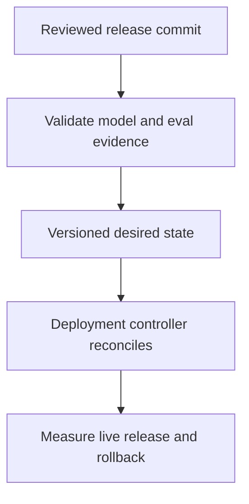

**GitOps** manages deployed infrastructure and application configuration through declarative desired state that is versioned and immutable, automatically pulled by agents, and continuously reconciled with the live environment ([OpenGitOps principles](https://opengitops.dev/)). Git is the usual source, though the principles allow other versioned stores. A reviewed commit describes what should run, while the controller observes cluster state and applies authorized changes. A direct deployment edit may persist until the reconciler detects drift; the controller can then restore the declared version. Continuous GitOps uses a controller to reconcile repeatedly, while a one-shot CI deployment ends after its push.

## Pair desired state with release evidence

For an AI service, the desired release should identify the exact model artifact, prompt revision, tokenizer or chat template, serving configuration, evaluation results, and rollback target. A reconciler can deploy a bad artifact faithfully if an earlier gate approved the wrong evidence. GitOps provides traceable promotion; explicit gates and policies establish model quality, safe authorization, and release readiness.

## Example

A team updates a deployment manifest from model digest `sha256:old` to `sha256:new` and includes the corresponding prompt version and evaluation report. Continuous integration checks that the artifact exists, the tokenizer matches, and a fixed regression suite clears its thresholds. After review, a controller applies the new manifest to a staging cluster and then a small production canary. If grounded-answer quality or tail latency regresses, reverting the manifest to the previous digest gives the reconciler an explicit, auditable rollback target.

## Why it matters here

The advanced MLOps chapter connects model lineage, evaluation gates, progressive rollout, and operational recovery. GitOps links those artifacts to an observable deployment decision and keeps model swaps within release policy.

## Related terms

- [Canary rollout](glossary://canary-rollout)
- [Eval gate](glossary://eval-gate)
- [Rollback](glossary://rollback)
- [Model checkpoint](glossary://model-checkpoint)
