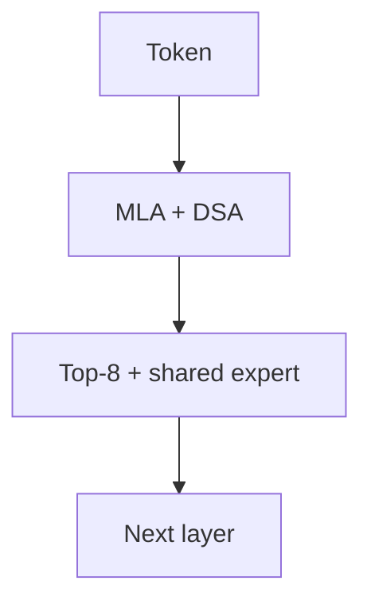

**GLM-5.2** is a decoder-only mixture-of-experts language model from Z.ai. Released configuration combines Multi-head Latent Attention, DeepSeek Sparse Attention, 256 routed experts per sparse layer, one shared expert, and a multi-token prediction module.

## Architecture snapshot

The [released configuration](https://huggingface.co/zai-org/GLM-5.2/blob/main/config.json) has 78 main decoder layers and 6,144-dimensional hidden states. First three feed-forward blocks are dense. Remaining 75 use sparse expert routing: each token selects eight of 256 routed experts while shared expert stays active. DSA selects up to 2,048 context positions, and IndexShare reuses selected indexes across groups of layers.

Published family accounting describes about 744 billion stored parameters and about 40 billion activated per token. The released checkpoint tensor inventory is closer to 753 billion parameters. Treat report-level accounting and artifact-level counting as different measurements; don't attribute the entire difference to MTP without a tensor-by-tensor reconciliation.

## Diagram

## Example

A token in a sparse layer can attend to up to 2,048 selected positions and execute eight routed experts plus one shared expert. The number of valid causal positions can be smaller early in a sequence. The checkpoint still stores all 256 routed experts for that layer.

## Why it matters here

GLM-5.2 remains a useful historical comparison. The masterclass now targets [GLM-5.3](glossary://glm-53), whose checkpoint, chat template, and license must be checked independently even where the architecture remains the same.

GLM-5.2 cannot be treated as a generic dense Transformer. Efficient training and serving need model-specific support for latent KV state, sparse position indexes, expert dispatch, checkpoint conversion, and MTP. Different engines may execute the same math through different kernels, so logits, tokenization, DSA indexes, routed experts, and checkpoint keys need explicit parity tests. Post-training also needs a stable trajectory ledger (token IDs, loss masks, rewards, group identity) whether the controller is SkyRL or slime.

## Related terms

- [GLM-5.3](glossary://glm-53)
- [Mixture-of-Experts](glossary://mixture-of-experts)
- [Multi-head Latent Attention](glossary://multi-head-latent-attention)
- [DeepSeek Sparse Attention](glossary://deepseek-sparse-attention)
- [Multi-token prediction](glossary://multi-token-prediction)
- [vLLM](glossary://vllm)
- [NVIDIA Megatron](glossary://nvidia-megatron)
