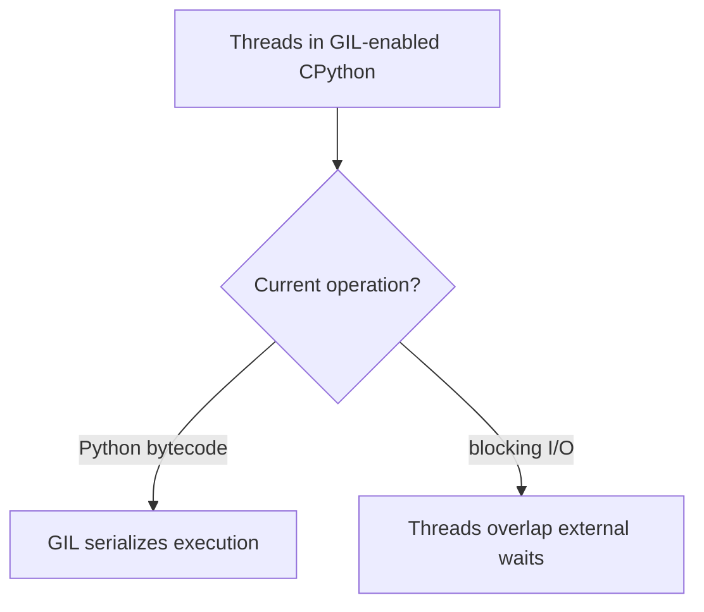

The Global Interpreter Lock (GIL) is a mutual-exclusion mechanism in conventional CPython builds that permits only one thread at a time to execute Python bytecode within an interpreter. Threads can still overlap blocking network and disk operations because many I/O calls release the lock while waiting. Native extensions may also release it around compiled work. The GIL limits some CPU-bound threading patterns, but it is neither a complete data-race defense nor a rule shared by every Python implementation or build.

## I/O overlap, CPU work, and free-threaded builds

On a GIL-enabled build, two threads executing tight pure-Python numeric loops generally compete for one bytecode interpreter rather than using two CPU cores simultaneously. Two threads waiting on independent HTTP responses can overlap their network waits. A process pool, vectorized native library, or deliberately free-threaded CPython build may improve CPU parallelism, but each option carries its own memory, serialization, or compatibility costs.

Modern CPython also offers optional free-threaded builds. Removing the GIL changes bytecode concurrency; it does not make a check-then-insert operation atomic across threads. Shared sets, dictionaries, ledger balances, and crawler claim points still need explicit synchronization or another proven concurrency contract.

## Example

A crawler spends 90 ms waiting for each of ten independent page fetches and 2 ms parsing the result. Multiple threads can overlap much of the network delay because the blocking calls release the GIL. If the same program instead spends 90 ms in a pure-Python parsing loop for each page, extra threads on a conventional build mostly contend for interpreter time. In either case, protect the shared check-and-update of `visited` with a lock because the two operations form one invariant.

## Why it matters here

AI system interviews frequently ask when worker fanout helps and when it only creates races. The GIL gives a precise answer: identify whether work is I/O-bound, native-code-bound, or Python-bytecode-bound, then name the interpreter build and state-ownership rules. That distinction prevents both the false claim that Python threads never help and the equally dangerous claim that free-threading removes the need for locks.

## Related terms

- [Thread safety](glossary://thread-safety)
- [Threading lock](glossary://threading-lock)
- [Thread pool executor](glossary://thread-pool-executor)
- [Worker fanout](glossary://worker-fanout)
