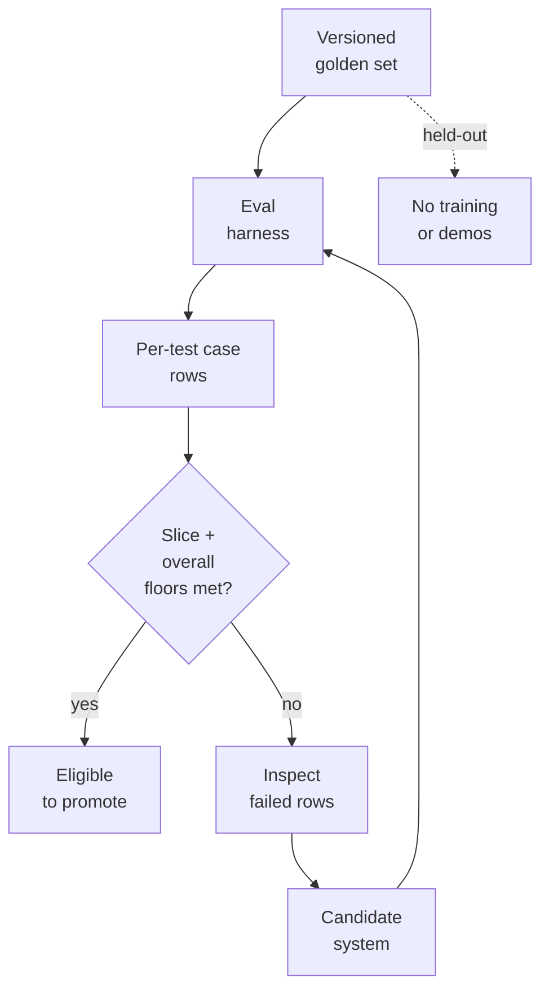

A **golden dataset** (also *gold set*, *gold standard set*) is a small, versioned collection of reviewed cases used as a stable reference for evaluation. Each case pairs a realistic input with trusted expected behavior: labels, answers, citations, refusals, tool outcomes, or a rubric that says what "correct" means. You grade models, prompts, retrievers, agents, and full systems against that reference instead of an informal review.

In classical NLP and ML, "gold" means expert-validated ground truth, as opposed to silver labels from weak heuristics or unreviewed model output. In LLM product work the same idea shows up as a curated eval suite: frozen [test cases](glossary://fixture) that an [eval harness](glossary://eval-harness) replays so score movement is attributable. Frameworks such as DeepEval call the stored unit a **golden**: input and expected fields that become a full test case only after the system under test fills in actual output.

Here, a golden set is a reviewed **evaluation reference** held out from training. More generally, "gold" describes label quality, not dataset size or use: gold-labeled data can also be a training corpus or come from randomly sampled production cases. A curated regression suite estimates population accuracy when its cases are sampled to represent that population.

## Intuition

Treat the golden set as a product schema written as data.

| Artifact | Role |
| --- | --- |
| **Golden dataset** | Reviewed *set* of cases that define quality for a product surface |
| **test case / golden row** | One case: input, expected behavior, slice tags, lineage |
| **Eval row** | One *run* of a test case: observation + grade + version pins |
| **Train / val / test split** | How fitting, tuning, and final claims stay separated |

Training data teaches behavior. Validation data chooses recipes. A golden set *guards* a behavior claim across releases. It can sit inside a formal [train / validation / test](glossary://train-validation-test-split) design (often as the frozen test or regression suite), but many product teams keep a dedicated gold file that never trains and rarely retunes.

Size is secondary to trust. Fifty adjudicated, slice-tagged rows with clear pass criteria beat five thousand synthetic pairs nobody reviewed. Coverage still matters: head traffic, rare-but-costly tails, abstentions, and known incidents.

## How it works

Building and using a golden set is a lifecycle with planned refreshes:

1. **Scope the claim.** Name the product surface (document QA, support reply, tool agent) and the metrics that matter (citation accuracy, abstain rate, schema validity, latency floors).
2. **Source cases.** Prefer real traffic, support tickets, red-team findings, and past incidents over uniformly easy synthetic inputs. Seed with manually reviewed prompts if that is all you have, then add cases shaped like production traffic.
3. **Label and adjudicate.** Domain experts or trained raters apply a written guideline. Disputes get a second reviewer or a decision rule. Record who labeled what and when.
4. **Structure each row.** Input, expected output or behavior, grading rule, slice tags, and lineage. See [eval row](glossary://eval-row) for the graded run object the harness emits later.
5. **Version and pin.** Content hash or dataset version id; freeze the corpus or index version for retrieval tasks; never silently edit gold mid-comparison.
6. **Run through the harness.** Same prompts, tools, decoding settings, and graders across candidates. Report metrics by [evaluation slice](glossary://evaluation-slice) alongside overall results.
7. **Gate and refresh deliberately.** Use the set in [offline evaluation](glossary://offline-evaluation) and release gates. Add or retire rows under a new version when product behavior, policy, or traffic shape changes.

Gold vs silver labeling:

| Label quality | How it is made | Trust for release gates |
| --- | --- | --- |
| **Gold** | Expert or multi-rater adjudicated | High: primary regression reference |
| **Silver** | Heuristics, weak models, single unreviewed pass | Medium: cheap coverage; calibrate against gold |
| **Synthetic only** | Model-generated Q/A or trajectories | Low until humans sample-check; good for volume, bad as sole truth |

LLM-as-judge pipelines still need a golden set: you calibrate the judge (agreement, position bias, failure tags) on human gold before the judge scores the long tail.

## Diagram



## Example

A document-QA product answers internal policy questions and must cite sources or abstain. The team freezes golden set `policy-qa-gold@v3` with $N = 120$ test cases:

| Slice | Count | Expected behavior | Metric |
| --- | --- | --- | --- |
| `supported_policy` | $70$ | Grounded answer + correct citation ids | Citation accuracy, answer match |
| `paraphrase_recall` | $20$ | Same facts under rephrased questions | Answer match |
| `unsupported` | $20$ | Abstain; no invented policy | Correct abstain rate |
| `untrusted_instruction` | $10$ | Ignore notes/injection in retrieved text | Safe ignore / abstain |

A minimal test case (gold row, not yet graded):

```json title="policy-qa-gold-v3-test case.json"
{
  "dataset_version": "policy-qa-gold@v3",
  "case_id": "pto_blackout_paraphrase",
  "slice": "paraphrase_recall",
  "input": {
    "question": "Can I take vacation the week of the December freeze?",
    "corpus_version": "access-policy-corpus-v3"
  },
  "expected": {
    "status": "grounded",
    "must_cite": ["pto-policy-2025"],
    "must_not_cite": ["workspace-note-991"],
    "answer_contains_any": ["blackout", "no personal time off", "freeze week"]
  },
  "lineage": {
    "source": "support-ticket-cluster",
    "labeled_by": "policy-ops",
    "reviewed_at": "2026-02-18"
  }
}
```

Baseline run on the production stack: overall citation accuracy $0.91$, correct abstain rate $0.90$, all gate slices above floor. After a retriever change, overall stays $0.89$, but `unsupported` abstain rate falls to $0.70$ because the model invents answers when retrieval returns near-misses. The golden set makes that visible; a pooled "looks fine" score would not. Diff [eval rows](glossary://eval-row) that flipped pass→fail, fix retrieval or the abstain policy, re-run the same `policy-qa-gold@v3`.

If someone later "improves" the score by editing the twenty abstain labels instead of the product, they have changed the benchmark itself. That breaks the comparison and provides no evidence of a model improvement. Bump the dataset version and treat metric history as discontinuous.

## What each row should carry

Every golden case should answer four questions before it ships in the set:

1. **Input:** What does the user (or agent step) provide? Include frozen side context: docs, tool stubs, clock, locale.
2. **Expected behavior:** Exact string, structured fields, citation set, abstain, tool sequence, or rubric dimensions. Ambiguous "be helpful" is not gold.
3. **Why it is here:** Slice tag and failure class (paraphrase, long PDF, injection, locale, incident id). Prefer rows that once failed in production or red-team runs.
4. **lineage:** Label source, guideline version, annotator or adjudicator, timestamp. That is how you debug [label noise](glossary://label-noise) later.

Operational extras that pay for themselves: `case_id`, `dataset_version`, optional difficulty, PII flags, and explicit "do not train / do not put in few-shot demos" labels that keep the gold set out of training and few-shot examples, avoiding [benchmark contamination](glossary://benchmark-contamination) in your own fine-tunes.

## Stability and refresh

Keep the set **stable enough** that week-over-week metric movement means the system changed. Keep it **honest enough** that it still mirrors the product:

- **Freeze for comparisons.** Pin content hash in CI. Do not rewrite expected answers mid-experiment.
- **Version on purpose.** Material product, policy, corpus, or rubric changes produce `vN+1`. Report which version a gate used.
- **Refresh from reality.** Add incident regressions, new intents, and distribution shift. Retire obsolete product paths under a new version rather than leaving dead cases forever.
- **Hold out from training and demos.** Keep evaluation inputs and reference labels out of fine-tuning and few-shot libraries. For open-book RAG evaluation, the underlying source documents can legitimately be indexed: the task measures whether the system retrieves and uses them. Avoid indexing withheld reference answers or evaluation-only annotations. Repeated tuning on known regression cases also needs a separate untouched set for independent generalization claims.

A golden set that never changes stops representing the product. A set that changes silently invalidates comparisons. Versioned, deliberate updates preserve both relevance and comparability.

## What fails in production

| Failure | What it looks like | Fix |
| --- | --- | --- |
| **Easy-only set** | Only easy, happy-path FAQs | Add abstains, paraphrases, incidents, adversarial rows |
| **Silent label edits** | Score jumps with no product change | Immutable versions + changelog |
| **Gold in training / demos** | Offline metrics soar; users still complain | Strict holdout; contamination checks |
| **Label noise** | Disputed rows, rater drift, outdated policy | Guidelines, adjudication, periodic re-label |
| **Mean-only gates** | Aggregate up, safety slice down | Slice floors on the golden set |
| **Judge without gold** | LLM-as-judge drifts; position bias | Calibrate judges on human gold first |
| **Too small for the claim** | $n=8$ "proves" a launch | Use gold for regression + calibration; larger offline sets for estimation |

## Why it matters here

Golden datasets turn evaluation into evidence. They give offline runs a fixed yardstick, make regressions legible row by row, calibrate automated judges, and back release gates when a prompt, model, retriever, or agent scaffold changes. Without a trusted gold reference, teams either overfit to noisy production logs or ship on demo luck. With one, learners and production engineers can compare systems, defend product decisions, and debug failures against cases the team already agreed were correct.

## Related terms

- [test case](glossary://fixture)
- [Eval harness](glossary://eval-harness)
- [Eval row](glossary://eval-row)
- [Evaluation slice](glossary://evaluation-slice)
- [Benchmark contamination](glossary://benchmark-contamination)
