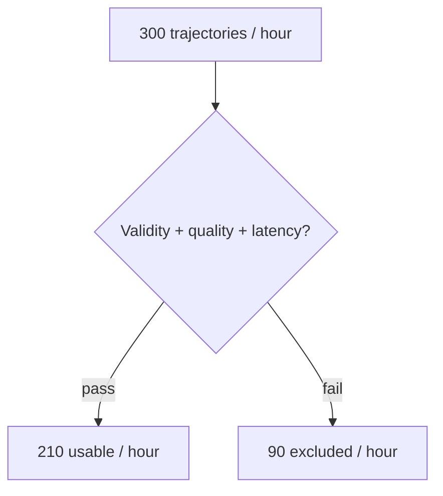

**Goodput** is rate of useful completed work that satisfies defined quality or service constraint. Throughput counts total work. Goodput removes work that is late, invalid, filtered, failed, stale beyond policy, or otherwise unusable.

## Example

An RL system may generate 300 trajectories per hour but accept only 210 with valid grading, acceptable staleness, complete metadata, and membership in groups that its loss can use. Training goodput is 210 usable trajectories per hour. For group-normalized objectives, training signal comes from reward variation within the group; each trajectory can succeed or fail. Failed attempts and zero or negative rewards can provide useful training signal.

Definition must name numerator, rejection conditions, and wall-time denominator. Comparing goodput across dashboards without same contract is misleading.

## Measurement contract

Write the acceptance predicate before optimizing. For agent RL it may require a well-defined terminal state, parseable trajectory records, a genuine graded reward rather than an error sentinel, policy version within budget, complete log probabilities, aligned masks, and routing/index replay metadata where the algorithm requires it. Invalid tool attempts can themselves be graded failures rather than discarded records. Count denominator from wall clock including queue, tool, judge, checkpoint, and weight-sync time. Publish rejection categories so higher goodput cannot hide a relaxed quality gate.

## Why it matters here

GPU tokens/s can improve while usable RL data declines. Training operator optimizes accepted trajectories and healthy updates per wall time, not raw activity.

## Related terms

- [Tokens per second](glossary://tokens-per-second)
- [SLO](glossary://slo)
- [RL rollout](glossary://rl-rollout)
- [Rollout staleness](glossary://rollout-staleness)
