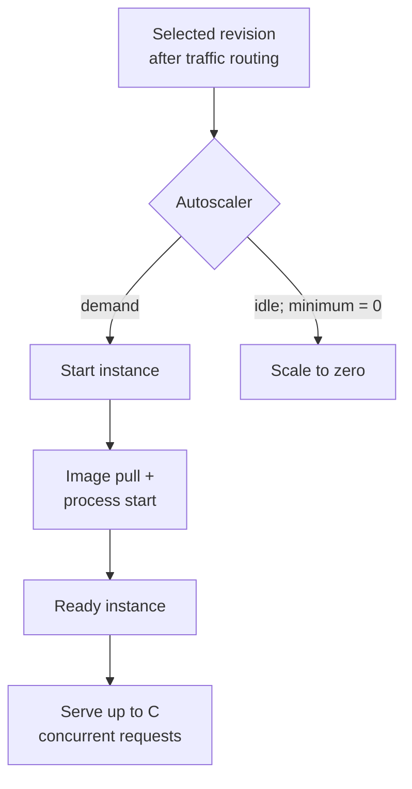

**Google Cloud Run** is a managed compute platform that runs [container images](glossary://container-image) behind HTTPS endpoints (services), as finite batch work (jobs), or as non-HTTP workers (worker pools). For services, you ship an image that speaks HTTP; Cloud Run provisions instances, scales them between your min and max, assigns traffic across immutable **revisions**, and bills for the CPU/memory (and optional GPU) those instances use.

You do not operate a Kubernetes control plane. You operate revision config: image digest, env, CPU, memory, concurrency, timeout, min/max instances, and traffic percentages. That contract is why a Next.js site, a FastAPI proxy in front of a model provider, and a GPU inference container can share the same deploy mental model while failing for very different reasons.

## Intuition

Treat Cloud Run as a regional load balancer plus an instance factory. Each deploy freezes a **revision** (image + revision settings). Instances of that revision start when traffic or min-instances demand them, handle up to $C$ concurrent requests each, and may go idle or scale to zero when demand drops. New instances add startup latency; billing also depends on request-based versus instance-based allocation and configured warm capacity.

For AI apps the platform is often the *web and orchestration* layer (SSR, API routes, auth, tool brokers), while heavy generation sits on a provider API or a separate GPU revision. Either way, request timeout, concurrency, cold start, and traffic split are the knobs that show up as user latency and $504$ / $429$ errors.

## How it works

### Resource model

| Object | Role |
|---|---|
| **Service** | Named regional HTTP endpoint; multi-zone within the region |
| **Revision** | Immutable snapshot of image + config after each deploy or setting change |
| **Instance** | One running container (or multi-container set with one ingress) of a revision |
| **Traffic** | Percentage (and optional tags) routing live requests to revisions |

Jobs run tasks to completion without a public URL. Worker pools run non-request workloads without the service URL contract. Most AI product surfaces start as a **service**.

### Container contract

The ingress container must:

1. Listen on `0.0.0.0` so Cloud Run can reach the container; loopback binding to `127.0.0.1` limits access to the container itself
2. Serve HTTP on the port Cloud Run injects as `$PORT` (default $8080$)
3. Be ready before the load balancer sends traffic (startup probes matter for slow model loads)

Cloud Run terminates TLS at the edge of the platform; your container sees HTTP (or h2c if you enable end-to-end HTTP/2). Stateless request handling is the happy path: local disk is ephemeral, and scale-out multiplies in-memory state unless you externalize it (Supabase, Redis, object storage).

### Autoscaling

By default a revision scales to the instance count needed for load, down to **zero** when idle (unless min instances $> 0$). The autoscaler combines:

1. **Metrics-based scaling** on average CPU utilization and average request concurrency (default targets about $60\%$ of capacity)
2. **On-demand scaling** when no free instance can take a request (this is what scales *from* zero)

Rough recommended instance counts from the official scaling drivers:

$$
N_{\mathrm{CPU}} = \frac{\left(\frac{\text{avg CPU usage per second over last minute}}{\text{CPUs per instance}}\right)}{\text{CPU target}}
$$

$$
N_{\mathrm{conc}} = \frac{\left(\frac{\max(\text{avg concurrent requests over }1\mathrm{min},\ 10\mathrm{min})}{C}\right)}{\text{concurrency target}}
$$

where $C$ is the configured **maximum concurrent requests per instance**. Cloud Run takes the higher driver need, then clamps to min/max instances. Adaptive concurrency tuning (ACT) can *lower* effective concurrency per instance when CPU stays above about $90\%$, so you may never see configured $C$ fully used under load.

If pending requests cannot get a slot, they wait up to $\max(10\,\mathrm{s},\ 3.5 \times t_{\mathrm{startup}})$ before failing with **$429$**. When a response is not returned within the request timeout (default $300\,\mathrm{s}$, max $3600\,\mathrm{s}$), the client sees **$504$**; the container is not killed and may keep burning CPU on the abandoned work unless your code watches the deadline.

### Concurrency, min instances, billing

| Knob | What it controls | AI-relevant default thinking |
|---|---|---|
| Max concurrency $C$ | Max parallel requests per instance (up to $1000$) | Lower for memory-heavy or non-thread-safe handlers; higher for I/O-bound proxying to providers |
| Min instances | Always-warm floor | Set $\ge 1$ for interactive SLOs; $0$ saves cost, adds cold start |
| Max instances | Cap on scale-out | Protects DB connection pools, provider quotas, and GPU quota |
| CPU / memory | Per-instance resources | OOM kills under concurrent streams or large HTML SSR; extra vCPUs need worker threads, processes, or parallel native work for CPU parallelism. Async JavaScript overlaps I/O but does not parallelize a CPU-bound loop |
| Request timeout | Time until $504$ | Must exceed worst legitimate streaming or tool chain; framework timeouts must match |
| CPU always allocated (instance-based billing) | CPU between requests | Needed for background work and required for GPU services |

Default CLI/Terraform concurrency for new services is $80 \times$ vCPUs; console default is $80$. That only helps if the process can safely handle that many concurrent handlers (Node async I/O yes; global mutable model session state no).

### Revisions and traffic

Changing the image or revision-template settings creates a new revision. Service-level settings such as traffic assignments can change without creating one. Traffic can stay on the previous revision (`--no-traffic`), go $100\%$ to latest, or split percentages. **Tags** attach a stable URL to a revision for smoke tests without moving production traffic. Rollback reassigns traffic to the prior revision; the image remains unchanged.

Maximum instances guides autoscaling; the [autoscaling documentation](https://docs.cloud.google.com/run/docs/about-instance-autoscaling) describes temporary excess instances during replacements and traffic spikes. Enforce strict downstream connection and spend limits separately. Minimum instances reduce cold starts, while demand beyond warm capacity still triggers startup.

## Diagram



## Example

**LeetLLM-style web origin (CPU service).** Deploy a Next.js container to region `us-central1` with smoke-before-traffic:

```bash
gcloud run deploy leetllm \
  --source . \
  --region us-central1 \
  --no-traffic \
  --tag deploy-smoke \
  --allow-unauthenticated \
  --port 8080 \
  --memory 1Gi \
  --cpu 1 \
  --min-instances 1 \
  --max-instances 3 \
  --env-vars-file deploy.env
```

What that configuration encodes:

- **`--no-traffic` + `--tag deploy-smoke`**: create a revision and a tag URL; production still hits the previous revision
- **`1` CPU / `1Gi` memory**: enough for SSR and API routes that call external model providers, not for loading weights
- **min $1$, max $3$**: avoid cold start for interactive browsing; cap runaway scale-out
- After smoke tests on the tag URL pass, `gcloud run services update-traffic leetllm --to-revisions=NEW=100` moves live traffic; on failure, point traffic back at the previous revision

With Cloudflare in front, a successful Cloud Run rollout can still serve stale HTML until the edge is purged. Origin health and edge cache are separate systems.

**AI proxy math.** Suppose each instance is configured with $C = 80$ and the concurrency target is $0.6$. Sustained average concurrency of $96$ requests implies:

$$
N_{\mathrm{conc}} \approx \frac{96 / 80}{0.6} = 2
$$

so about two warm instances. If each request streams a provider call for $30\,\mathrm{s}$ and you push $10$ new streams per second, average concurrency is roughly $\lambda \times T = 10 \times 30 = 300$ (Little's law), which needs far more instances or a lower per-request duration:

$$
N \gtrsim \frac{300 / C}{0.6}
$$

At $C = 80$, that is on the order of $6$ to $7$ instances before headroom, min/max, and ACT. If max instances is $3$, clients start seeing queueing and $429$ under the same load even though CPU looks moderate.

**GPU revision (inference).** Cloud Run supports GPU-backed instances in eligible regions and configurations. Exact accelerators, minimum CPU and memory, quotas, and billing requirements change, so pin deployment settings to the [current GPU documentation](https://docs.cloud.google.com/run/docs/configuring/services/gpu). Weight loading still contributes to cold start. Cap max instances by available GPU quota and set concurrency from measured VRAM and batch behavior, not from CPU-oriented defaults.

## Serving knobs checklist

Inspect when latency, cost, or errors move:

- Revision health and startup duration
- Cold start rate vs min instances
- Configured $C$ vs observed concurrent requests and ACT
- Memory and OOM under multi-stream load
- Request timeout vs provider and framework timeouts
- Max instances vs $429$ pending-queue failures
- Traffic percentages and leftover tags with min instances (billing surprise)
- For GPU: quota, region, zonal redundancy, weight-load time, readiness that waits for model ready

## Trade-offs

| Choice | Gain | Cost / risk |
|---|---|---|
| Min instances $= 0$ | No idle bill (request-based billing) | Every spike pays cold start |
| Min instances $\ge 1$ | Stable TTFT / first-byte for web | Idle CPU/memory charge |
| High $C$ | Fewer instances, lower cost for I/O-bound apps | Latency and OOM if handlers share heavy state |
| $C = 1$ | Simple isolation per request | Many cold starts under spikes |
| Long timeout (up to $60$ min) | Long tool chains / jobs via HTTP | Stale connections; need idempotent retries |
| GPU on Cloud Run | Managed inference without a cluster | Quota, region limits, instance billing, model-load cold path |
| Full K8s / GKE instead | Custom schedulers, multi-GPU, deep control | You own nodes, networking, and rollout plumbing |

## Why it matters here

LeetLLM's production path is **visitor → Cloudflare → Cloud Run (Next.js) → Supabase**. The curriculum site is a concrete Cloud Run service: container build, env injection, min/max instances, tagged smoke revision, traffic cutover, and rollback on failed live checks. That is the same pattern used for AI product origins that proxy to model APIs.

For LLM engineers, Cloud Run forces the operational questions that demos skip: does the process listen on `$PORT`? What is $C$ under streaming? Will a $5$-minute default timeout kill a long tool loop? Does scale-to-zero make p95 TTFT look like model latency when it is really cold start? Can you canary a revision without moving $100\%$ of traffic? GPU-capable revisions exist for self-hosted inference, but most curriculum and product apps win first by getting the HTTP service contract, concurrency, and rollout discipline right.

## Related terms

- [Container image](glossary://container-image)
- [Cold start](glossary://cold-start)
- [Traffic split](glossary://traffic-split)
- [Autoscaling](glossary://autoscaling)
- [Cloudflare](glossary://cloudflare)
