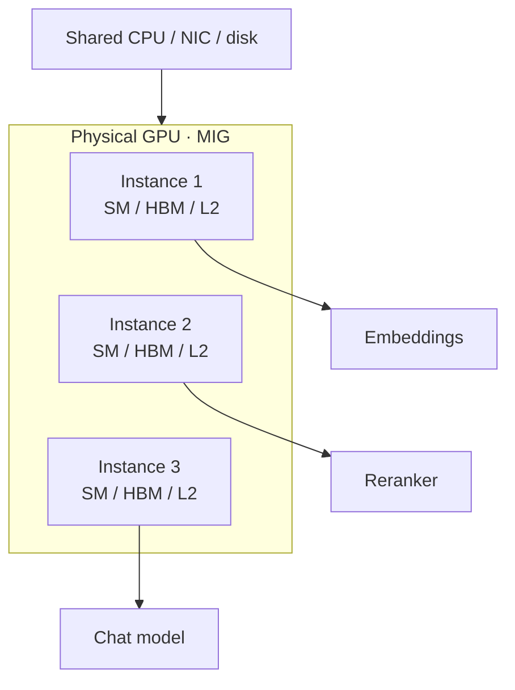

**GPU partitioning** divides one physical [GPU](glossary://gpu) into smaller capacity units so multiple workloads can share the accelerator with explicit bounds on memory, compute, or time. The word covers a spectrum: hardware-isolated instances (NVIDIA Multi-Instance GPU, MIG), cooperative software sharing (CUDA Multi-Process Service, MPS), scheduler time-slicing, and pure software quotas. Isolation strength, reconfiguration cost, and noisy-neighbor risk differ by mechanism.

## Intuition

Modern data-center GPUs often have more HBM and SMs than a single small model needs. Leaving a full A100 or H100 dedicated to a 1B embedding encoder wastes money; packing three unrelated services onto one device without partitions turns memory OOMs and SM contention into random production incidents. Partitioning is how you turn "one big GPU" into several *capacity products* with different guarantees.

GPU sharing spans three isolation levels:

| Mechanism | What is split | Isolation strength | Typical use |
|---|---|---|---|
| **MIG** | Physical SMs, HBM capacity/bandwidth, L2, copy engines | Strong (hardware QoS + fault isolation) | Multi-tenant or mixed services that need predictable latency |
| **MPS** | Logical SM share and optional memory caps | Medium (address isolation; shared bandwidth and weaker fault isolation) | Trusted cooperative processes underutilizing the GPU |
| **Time-slicing** | Time on the full device (or on a MIG slice) | Weak (no hard memory/bandwidth walls) | Dev, notebooks, oversubscribed inference with soft SLOs |
| **Software quotas** | App-level batch size, concurrency, tokens | App-dependent | Engine limits when the platform cannot re-slice silicon |

## How it works

### MIG (physical partitions)

On supported Ampere and later GPUs (for example A100, A30, H100), MIG partitions the silicon into **GPU instances (GIs)**. Per NVIDIA's MIG concepts:

- A **GPU memory slice** is about $1/8$ of device memory resources (capacity and bandwidth).
- A **GPU SM slice** is about $1/7$ of the streaming multiprocessors when MIG is enabled.
- A **GPU instance** combines memory slices, SM slices, and engines (copy engines, optional NVDEC/JPEG). Inside a GI you can further create **compute instances (CIs)** that subdivide SM slices while sharing that GI's memory.

Profile names encode the allocation as `<compute>g.<memory>gb`. On **A100-40GB**, common GI profiles include `1g.5gb`, `2g.10gb`, `3g.20gb`, `4g.20gb`, and `7g.40gb`. On **A100-80GB** the memory numbers scale (for example `1g.10gb`, `2g.20gb`, `3g.40gb`, `7g.80gb`). Driver-defined profile combinations determine valid placement within the physical layout; creating and destroying instances at arbitrary locations can fragment the board until you rebalance.

Each MIG instance looks like a separate CUDA device to the app. Paths through L2 banks, memory controllers, and DRAM address buses are dedicated, which is why MIG provides memory-bandwidth QoS and error isolation that CUDA streams and MPS do not.

### MPS (logical concurrent clients)

CUDA **Multi-Process Service** multiplexes cooperative CUDA processes through an MPS server so kernels from different processes can overlap on the GPU instead of thrashing full GPU contexts. Benefits (from NVIDIA's MPS docs): higher utilization when each process underfills the device, less context-switch overhead, and smaller on-GPU scheduling storage than fully separate contexts.

MPS can limit clients with **active thread percentage** (or static SM partitioning on newer stacks) and optional pinned device-memory limits. Clients have separate GPU address spaces, but memory bandwidth, L2, and capacity are still shared unless you enforce software caps. On Volta and later, a fatal GPU fault can affect other clients that share the same device subset; the server may enter a fault state until affected clients exit. MPS provides cooperative multi-process sharing; untrusted multi-tenant workloads need a stronger isolation boundary.

### Time-slicing and platform oversubscription

Without MIG, the default multi-process behavior is often **time-sliced** execution: processes take turns on SMs. In Kubernetes, the NVIDIA device plugin can advertise *replicas* of `nvidia.com/gpu` so several pods schedule against one physical GPU. That improves packing for small jobs while leaving HBM shared. One pod can allocate most of device memory and push neighbors into OOM or thrashing. You can time-slice *inside* a MIG instance when you need more pods than hardware slices allow. [CUDA MPS can operate inside GPU instances](https://docs.nvidia.com/datacenter/tesla/mig-user-guide/concepts.html), but the [Kubernetes device plugin's MPS sharing mode](https://github.com/NVIDIA/k8s-device-plugin) does not currently support MIG-enabled devices. Distinguish CUDA capability from an orchestrator's integration limits.

### What still shares

Even with perfect MIG isolation on the GPU die, pods still share host CPU, PCIe/NVLink endpoints, NIC, disk, model-server control planes, request queues, autoscalers, and caches. Partitioning moves the noisy neighbor off shared SMs and HBM; retrieval indexes, semantic caches, and logs still need [tenant isolation](glossary://tenant-isolation).

## Diagram



## Example

You have one **A100-80GB** node and three production services that each waste a full GPU:

1. Sentence embedding encoder (weights ~1.5 GB in BF16, low concurrency).
2. Cross-encoder reranker (weights ~1 GB, bursty).
3. 7B chat model in 4-bit weights (~4 GB weights, needs headroom for [KV cache](glossary://kv-cache)).

**MIG geometry (homogeneous small slices):** enable MIG and create seven `1g.10gb` instances (~9.5–10 GB usable HBM and ~1/7 of SMs each). A100-class GPUs have eight memory slices and seven SM slices, so packing seven `1g.*` instances leaves one memory slice stranded (~10 GB on an 80 GB card). Assign:

- Instance 0 → embedding vLLM/Triton worker
- Instance 1 → reranker worker
- Instance 2 → 7B chat worker
- Instances 3-6 → spare for canaries, evals, or more replicas

Rough memory budget on the chat `1g.10gb` slice:

$$
M_{\mathrm{free}} \approx 10\,\mathrm{GB} - M_{\mathrm{weights}} - M_{\mathrm{runtime}}
$$

With $M_{\mathrm{weights}} \approx 4\,\mathrm{GB}$ and $M_{\mathrm{runtime}} \approx 1\,\mathrm{GB}$ for engine overhead, about $5\,\mathrm{GB}$ remains for KV and activations. For a decoder-only model, KV size scales as:

$$
M_{\mathrm{KV}} \approx 2 \cdot L \cdot n_{\mathrm{kv}} \cdot d_{\mathrm{head}} \cdot S \cdot B \cdot b
$$

where $L$ is layers, $n_{\mathrm{kv}}$ is KV heads, $d_{\mathrm{head}}$ is head dim, $S$ is tokens per sequence (prompt + generation), $B$ is concurrent sequences, and $b$ is bytes per element (2 for FP16/BF16 KV, less if quantized). If $M_{\mathrm{KV}}$ exceeds $M_{\mathrm{free}}$, continuous batching cannot admit more sequences and you hit OOM or preemption long before SM FLOPs are saturated.

**Operator sketch** (admin path; list profiles on the target SKU first):

```bash
# Enable MIG on GPU 0; create seven 1g.10gb instances + compute instances
sudo nvidia-smi -i 0 -mig 1
sudo nvidia-smi mig -lgip                    # list profile names/IDs for this SKU
sudo nvidia-smi mig -i 0 -cgi 1g.10gb,1g.10gb,1g.10gb,1g.10gb,1g.10gb,1g.10gb,1g.10gb -C
nvidia-smi -L                                # each MIG UUID appears as a CUDA device
```

In Kubernetes with the NVIDIA GPU Operator, pods request a specific MIG resource (for example `nvidia.com/mig-1g.10gb: 1`) instead of a whole `nvidia.com/gpu`. For weaker isolation on non-MIG SKUs, the device plugin's time-slicing ConfigMap sets `replicas: N` so N pods can schedule per GPU without hard memory walls.

**Contrast:** put the same three processes on one GPU with MPS and `CUDA_MPS_ACTIVE_THREAD_PERCENTAGE=33`. Utilization may rise, but a chat traffic spike can steal bandwidth from embeddings and a fatal CUDA fault can knock co-located clients offline. That may be fine for a single-team batch farm; it is a poor default for untrusted multi-tenant SaaS.

## Trade-offs

- **Predictability vs utilization.** MIG reserves capacity that can sit idle if a slice is underloaded. Time-slicing and MPS raise average utilization by allowing work to fill leftover SMs, at the cost of latency variance.
- **Memory is the binding constraint for LLMs.** Partition compute without enough HBM for weights + KV is useless. Size partitions from memory first, then check whether the SM fraction meets TTFT/TPOT targets under continuous batching.
- **Reconfiguration cost.** MIG instance layouts typically change when the GPU is idle, so production re-slicing is a capacity-planning event. Engines still do dynamic batching *inside* a fixed partition.
- **Trust boundary.** Hardware partitions reduce GPU-side crosstalk; they do not encrypt prompts across tenants or filter vector search. Pair with application-level tenant isolation.
- **Observability.** Metrics and power may be full-GPU or per-instance depending on stack. Track memory used, SM util, and latency **per partition UUID** alongside node averages ([NVIDIA DCGM](glossary://nvidia-dcgm) and exporter setup matter here).
- **What fails in production.** Common failure modes: packing a model that barely fits weights with no KV headroom; time-sliced pods without memory caps; assuming MPS equals multi-tenant isolation; fragmenting MIG placements so the free profile you need no longer fits; forgetting that host CPU/NIC still couples "isolated" GPU instances under heavy tokenization or multi-modal I/O.

## Why it matters here

LLM platforms mix large generative models, small encoders, rerankers, and eval jobs. GPU partitioning is the capacity design tool that decides whether those jobs share silicon safely, how you price and schedule fractional GPUs, and whether p95 latency stays stable when a neighbor's batch grows. For multi-tenant serving, treat partitions as hardware capacity units and still enforce isolation in data paths, caches, and APIs.

## Related terms

- [GPU](glossary://gpu)
- [HBM](glossary://hbm)
- [KV cache](glossary://kv-cache)
- [Tenant isolation](glossary://tenant-isolation)
- [Autoscaling](glossary://autoscaling)
