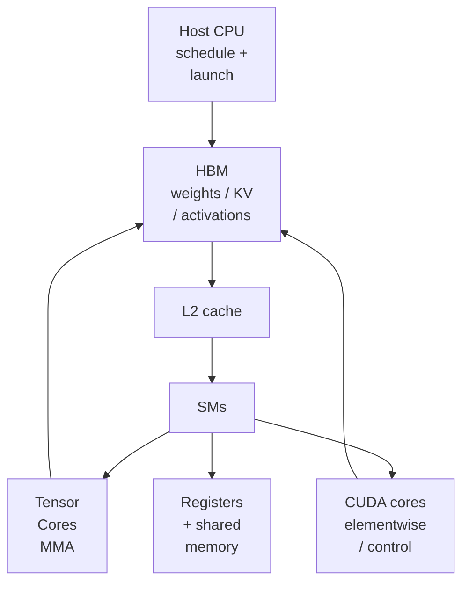

A graphics processing unit (GPU) is a throughput-oriented processor with thousands of lightweight arithmetic units, specialized matrix engines (Tensor Cores on NVIDIA devices), and high-bandwidth device memory (often HBM). For AI/ML and LLM work it is the default accelerator for large matrix multiplies, attention, and optimizer steps: the same instruction stream runs across huge arrays of similar numeric work, which matches deep-learning tensor math far better than a latency-oriented CPU.

## Intuition

A modern CPU has a small number of complex cores optimized for branchy, sequential code and low latency. A data-center GPU is built for the opposite pattern: many streaming multiprocessors (SMs), each running many concurrent warps, so that while some threads wait on memory, others keep the arithmetic units busy.

Deep-learning layers are full of dense linear algebra. A linear layer is a GEMM; multi-head attention is a family of matmuls plus softmax; training adds the same shapes again for the backward pass. Those kernels are highly parallel and regular, so they map cleanly onto GPU hardware. The cost of that design is that **device memory capacity, memory bandwidth, and host/device data motion become first-class product constraints**. Plan them from the start: a model that "fits" at batch size one can still fail under real concurrency when KV cache, activations, and batching overhead share the same HBM.

## How it works

On NVIDIA hardware (the stack most LLM engineers meet day to day), the mental model is:

| Layer | Role | Why it matters for LLMs |
| --- | --- | --- |
| **Host (CPU)** | Orchestrates, loads data, launches kernels | Tokenizer, scheduler, and accidental CPU work starve the device |
| **Device memory (HBM / VRAM)** | Holds weights, activations, KV cache, gradients | Hard capacity limit; bandwidth often bounds decode |
| **SMs** | Hardware processors that run thread blocks | Occupancy and resource limits cap concurrency |
| **CUDA cores** | Scalar / vector FP/INT units | General ops, elementwise, reductions |
| **Tensor Cores** | Matrix multiply-accumulate (MMA) units | Dense matmul throughput for training and inference |
| **L2 / shared mem / registers** | Faster on-chip storage | Tiling (FlashAttention-style) reuses tiles before returning to HBM |

Work is launched as a **kernel**: a grid of thread blocks. Each block runs on an SM. Inside a block, threads group into **warps** of 32 that execute under a SIMT (single-instruction, multiple-thread) model. Programming frameworks (CUDA, Triton, cuBLAS, FlashAttention) hide most of this, but the physics still show up as utilization, occupancy, and bandwidth counters.

Hopper-class example numbers from NVIDIA's H100 SXM product line (product page / architecture materials): about **132 SMs**, **80 GB HBM3**, peak memory bandwidth about **3.35 TB/s**, and fourth-generation Tensor Cores with dense BF16/FP16 peaks near **989 TFLOPS** (product tables often list about **1,979 TFLOPS** with 2:1 structured sparsity; always check which figure you quote). Those are **upper bounds**. Real kernels sit under a [roofline](glossary://roofline-model) set by arithmetic intensity and achieved bandwidth, not the datasheet peak alone.

## Example

**Serving a 7B decoder in BF16 on one GPU.**

Weight footprint alone (parameters $\times$ bytes per parameter):

$$
7 \times 10^{9} \times 2\ \mathrm{B} \approx 14\ \mathrm{GB}
$$

Weights fit comfortably on an 80 GB H100, while the working set also includes a [KV cache](glossary://kv-cache) for concurrent requests. A rough per-token size across all layers is

$$
\text{bytes/token} \approx 2 \times L \times H_{\mathrm{kv}} \times d_{\mathrm{head}} \times b
$$

with $L$ layers, $H_{\mathrm{kv}}$ KV heads (after GQA/MQA), $d_{\mathrm{head}}$ head dim, and $b=2$ for BF16/FP16. Example: $L=32$, $H_{\mathrm{kv}}=8$, $d_{\mathrm{head}}=128$ gives $2 \times 32 \times 8 \times 128 \times 2 = 131{,}072$ bytes $=128$ KiB per token. At 8 concurrent sessions with 8k context each:

$$
8 \times 8192 \times 128\ \mathrm{KiB} = 8\ \mathrm{GiB} \approx 8.59\ \mathrm{GB}
$$

of cache on top of weights, plus activations, fragmentation, and framework overhead. Raise concurrency or context length and the same "small" model OOMs even though 14 GB of weights looked safe.

**Training** multiplies pressure again: activations (or recomputed activations under checkpointing), gradients, and optimizer state (Adam keeps two FP32 moment tensors $m$ and $v$, about 4 bytes each per parameter, 8 bytes combined, plus mixed-precision master weights when used; with params and grads this matches the common $16\Psi$ accounting of params + grad + $m$ + $v$) share the same device. Multi-GPU paths add [tensor parallelism](glossary://tensor-parallelism) and collective traffic (NCCL over NVLink/PCIe), so interconnect becomes another roof next to compute and HBM.

## Worked numbers: why decode looks "idle"

Arithmetic intensity $I$ is FLOPs per byte of memory traffic. A large GEMM in long prefill can be compute-bound. Low-batch decode is closer to streaming the weights for one new token:

$$
I \approx \frac{2 n^{2}}{2 n^{2}} = 1\ \text{FLOP/byte}
$$

for an $n \times n$ weight in BF16 at batch $1$ (weight traffic only). On H100 SXM, a dense Tensor Core peak near $989 \times 10^{12}$ FLOP/s over $3.35 \times 10^{12}$ B/s gives a ridge point around

$$
I_{\mathrm{ridge}} \approx \frac{989}{3.35} \approx 295\ \text{FLOPs/byte}
$$

Decode at $\sim 1$ FLOP/byte sits far below that ridge. Peak useful work is then bounded by **HBM bandwidth $\times I$**. Monitors can show high memory bandwidth, modest Tensor Core utilization, and disappointing tokens/s for single-stream generation because the chip spends most of its time moving bytes.

Batching more tokens that reuse the same weights raises effective intensity. Prefill (many prompt positions at once) usually sits higher on the roofline than single-token decode. Continuous batching and quantization attack this same bottleneck from different angles: more reuse of each weight load, or fewer bytes per load.

## Debug path

Failures in production look like OOMs, high latency with "free" GPUs, or cost that does not track QPS. Separate the bottleneck:

1. **Capacity:** peak allocated memory under real batch, sequence length, and concurrency (`torch.cuda.max_memory_allocated`, server metrics). Count weights, KV cache growth, activations, and workspace.
2. **Compute vs bandwidth:** SM / Tensor Core utilization vs HBM bandwidth. High bandwidth + low Tensor Core util $\Rightarrow$ memory-bound. Low util on both $\Rightarrow$ the device is waiting on the host, I/O, or the inference scheduler.
3. **Transfer:** host$\leftrightarrow$device copies, tokenizer on CPU, tiny kernels launched from Python loops, or frequent syncs (`.item()`, printing device tensors).
4. **Scheduling:** queue wait, continuous batching efficiency, prefill vs decode mix, multi-GPU collective time.
5. **Honest timing:** use CUDA events or server-side TTFT / tokens-per-second windows, not bare host timers around async launches.

Faster hardware does not fix a pipeline that cannot keep the SMs fed or that OOMs on KV cache under load.

## Why it matters here

Almost every LeetLLM path that trains or serves models bottoms out on GPU behavior: tensor placement, mixed precision, HBM pressure, FlashAttention-style tiling, continuous batching, tensor/pipeline parallelism, and cost. Treat the GPU as a system with **capacity, bandwidth, compute, and a host that must feed it**, not as a black box that "runs CUDA."

## Related terms

- [CUDA](glossary://cuda)
- [HBM](glossary://hbm)
- [Arithmetic intensity](glossary://arithmetic-intensity)
- [Mixed precision](glossary://mixed-precision)
- [Tensor parallelism](glossary://tensor-parallelism)
