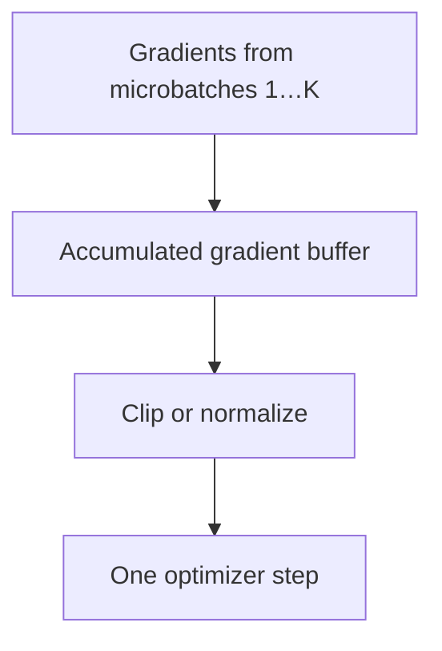

**Gradient accumulation** adds gradients from several microbatches before running one optimizer update. It increases effective batch size without storing every sample's activations at the same time.

For $K$ accumulation steps, training runs forward and backward $K$ times, preserves or adds gradient buffers, then clips and updates parameters once. Loss scaling must match the intended sum or mean convention so learning rate doesn't change accidentally with $K$.

Dividing each microbatch's mean loss by $K$ matches a full-batch mean only when microbatches have equal weight under the objective. Unequal sample counts or masked-token counts require the corresponding weighting or a shared denominator. Clear gradients before the accumulation window and clip after all its backward passes. Accumulation is not universally identical to one large forward pass: batch-dependent layers such as BatchNorm use microbatch statistics, and stochastic operations can differ.

## Effective batch

A simplified dense formula is:

$$
B_{\mathrm{global}} = B_{\mathrm{micro}} \times K \times D
$$

where $D$ is data-parallel replica count. Grouped RL data adds another semantic layer because one record may represent several trajectories from one prompt.

## Diagram

## Example

Microbatch 1, DP=1, and accumulation count 32 can create a nominal batch of 32 records. If each GRPO record carries eight sampled trajectories, operators must distinguish group count from trajectory and token count.

## Why it matters here

Long agent trajectories force tiny physical microbatches. Gradient accumulation bridges that hardware limit to the 32-group policy update while sample packing controls padding waste.

## Related terms

- [Microbatch](glossary://microbatch)
- [Optimizer](glossary://optimizer)
- [Gradient clipping](glossary://gradient-clipping)
- [Data parallelism](glossary://data-parallelism)
- [GRPO](glossary://grpo)
