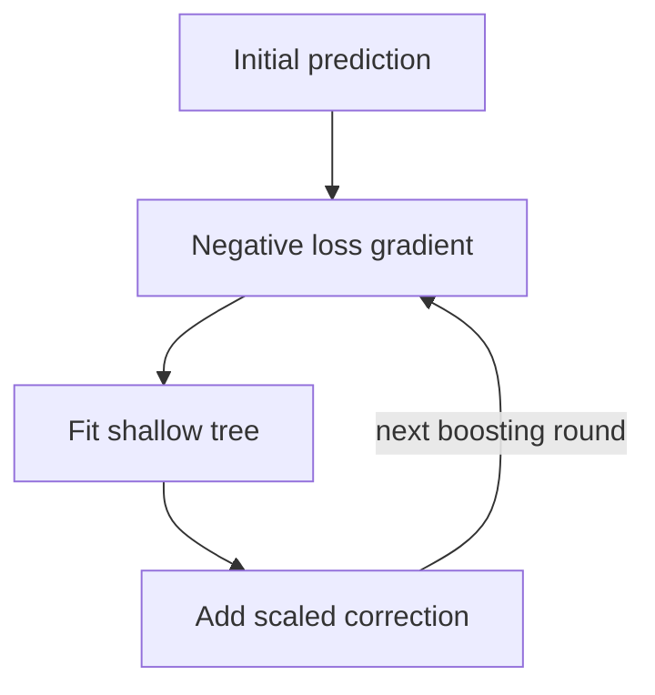

Gradient boosting constructs a prediction model by adding small learners sequentially. Each new learner approximates a direction that reduces the current objective, often using shallow decision trees. With squared error, that direction is proportional to the current residual; with logistic loss, it depends on the difference between binary labels and predicted probabilities.

## Additive updates

At round $m$, an additive model updates $F_m(x)=F_{m-1}(x)+\nu h_m(x)$, where $h_m$ is the new learner and $\nu$ is the learning rate. Smaller learning rates usually require more rounds. Production implementations may use second-order loss information, regularization, histogram approximations, missing-value routing, and early stopping. Residual fitting is exact language for squared loss; other objectives fit negative gradients or related Newton steps.

## Example

Suppose observed delivery durations are 20, 40, and 60 minutes, and the starting prediction is their mean, 40. Squared-error residuals are $-20$, 0, and 20. A shallow tree predicts corrections of $-20$, 0, and 20, and a learning rate of 0.25 produces updated predictions of 35, 40, and 45. Later trees correct the remaining errors without replacing the earlier model.

## Why it matters here

Boosted trees are important production baselines for feature-rich ranking, forecasting, and risk systems. Understanding additive rounds explains early stopping, training-serving feature parity, categorical handling, feature importance, and why deployment decisions pair training-loss improvements with held-out and production evaluation.

## Related terms

- [Decision tree](glossary://decision-tree)
- [Gradient](glossary://gradient)
- [Mean squared error](glossary://mean-squared-error)
