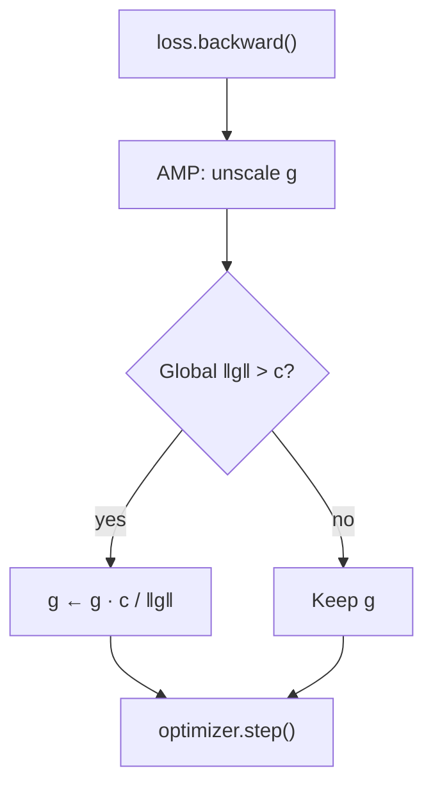

Gradient clipping rescales **gradients** after `loss.backward()` fills `.grad` tensors and *before* the optimizer steps. The optimizer computes the final parameter update from the clipped gradient, applying its own state and learning rate; Adam/AdamW also use moment estimates. After backward, you measure (or bound) those gradients and rescale them if they exceed a threshold. The usual production default is **global L2 norm clipping**: treat every trainable gradient as one concatenated vector $g$, and if $\|g\|_2 > c$, shrink $g$ so its norm equals $c$ while keeping direction.

Pascanu, Mikolov, and Bengio (2013) popularized norm clipping for exploding gradients in RNNs. The same guardrail is common in transformer and LLM training recipes (Hugging Face `TrainingArguments.max_grad_norm` defaults to $1.0$). Clipping caps the gradient presented to the optimizer and can reduce instability. The optimizer and learning rate still determine the resulting parameter update.

## Diagram



## Intuition

Exploding gradients often appear as rare, huge norms on hard batches: long sequences, sharp loss regions, bad labels, or unstable mixed precision. In the geometry Pascanu et al. describe, steep loss regions can produce an update that moves parameters far outside a stable region. Norm clipping preserves gradient direction while bounding its magnitude.

Use clipping with a sensible learning rate, clean data, and correct AMP unscale order. If every step hits the clip threshold, investigate those factors because clipping may be masking the underlying problem.

## Formula

**Global L2 norm clipping** (Pascanu et al.; PyTorch `clip_grad_norm_` with `norm_type=2`):

$$
\hat{g} \leftarrow \nabla_\theta \mathcal{L},
\qquad
\hat{g} \leftarrow
\begin{cases}
\dfrac{c}{\|\hat{g}\|_2}\,\hat{g} & \text{if }\|\hat{g}\|_2 > c \\[6pt]
\hat{g} & \text{otherwise}
\end{cases}
$$

Equivalently, multiply by $\min\!\big(1,\, c / \|\hat{g}\|_2\big)$. Direction is preserved; only magnitude is capped at $c$. Production PyTorch `clip_grad_norm_` uses a tiny $\varepsilon$ (default $10^{-6}$) in the scale factor, effectively $c / (\|\hat{g}\|_2 + \varepsilon)$, so a zero or near-zero norm can't NaN the rescale. Prefer `error_if_nonfinite=True` as well so non-finite grads fail loudly.

The global norm is the Euclidean norm of the full parameter gradient, as if all `.grad` tensors were flattened and concatenated:

$$
\|g\|_2 = \sqrt{\sum_i \|g_i\|_2^2}
$$

where $g_i$ is the gradient of parameter tensor $i$.

**Value (elementwise) clipping** (Mikolov-style; PyTorch `clip_grad_value_`):

$$
\hat{g}_j \leftarrow \mathrm{clip}(g_j,\, -v,\, v)
$$

for each coordinate $j$. This changes direction more aggressively than norm clipping and is less common as the default in modern LLM stacks.

**Adaptive gradient clipping (AGC)** scales per tensor using a gradient-to-weight norm ratio (Brock et al., NFNets). It is useful in some vision setups; LLM recipes almost always stick to global L2 norm.

## Worked numbers

Suppose three parameter groups have gradient norms $3$, $4$, and $12$ (after flattening each tensor). The global L2 norm is:

$$
\|g\|_2 = \sqrt{3^2 + 4^2 + 12^2} = \sqrt{9 + 16 + 144} = \sqrt{169} = 13
$$

With threshold $c = 1.0$, the scale factor is $1/13$. Every gradient tensor is multiplied by $1/13$, so the new global norm is $1$ and relative contributions across layers stay the same ($3:4:12$).

If instead $\|g\|_2 = 0.4 < 1.0$, nothing changes: clipping only shrinks oversized gradients; it never amplifies small ones.

## Example

Minimal PyTorch step with global norm clipping. `clip_grad_norm_` returns the **pre-clip** total norm (useful for logging whether the guardrail fired):

```python
import torch
import torch.nn as nn

model = nn.Linear(16, 4)
opt = torch.optim.AdamW(model.parameters(), lr=1e-3)
loss = model(torch.randn(8, 16)).pow(2).mean()

opt.zero_grad(set_to_none=True)
loss.backward()
total_norm = torch.nn.utils.clip_grad_norm_(
    model.parameters(), max_norm=1.0, error_if_nonfinite=True
)
opt.step()
# total_norm.item() is ||g|| before rescaling; after clip, ||g|| <= 1.0
```

With FP16 AMP, **unscale before clip**. Clipping scaled gradients uses the wrong effective threshold:

```python
scaler.scale(loss).backward()
scaler.unscale_(opt)
torch.nn.utils.clip_grad_norm_(model.parameters(), max_norm=1.0)
scaler.step(opt)
scaler.update()
```

Hugging Face `Trainer` exposes the same idea as `max_grad_norm=1.0` (default). For FSDP1, use the wrapper's `clip_grad_norm_` so the global norm includes shards. For FSDP2 DTensor parameters, ordinary `torch.nn.utils.clip_grad_norm_` supports distributed norm computation ([current tutorial](https://docs.pytorch.org/tutorials/intermediate/FSDP_tutorial.html)). Other sharding stacks need their own correct handling of sharded and replicated gradients; summing every local gradient across every rank can double-count replicated tensors.

## How it works in a training step

1. Forward compute loss; backward fills parameter `.grad`s.
2. If using loss scaling, unscale so norms match the true update scale.
3. Measure global $\|g\|$ (or per-value bounds).
4. If over threshold $c$, rescale all grads in place by $c / \|g\|$.
5. Optimizer reads clipped grads and updates weights (and moments for AdamW).

Clip once per **optimizer step**, after gradient accumulation finishes, not after every microbatch. Accumulated grads represent the effective batch; clipping mid-accumulation distorts the sum.

## What fails in production

| Symptom | Likely cause |
|--------|----------------|
| Clip fires almost every step | LR too high, bad data/labels, loss scale wrong, or $c$ too small |
| Loss still spikes / NaNs | Non-finite grads; clipping does not repair NaNs. Skip the step and fix scale/data |
| "Clipping does nothing" under AMP | Clipped *before* `unscale_`; threshold is applied to scaled grads |
| Norms look tiny after FSDP clip | Used single-rank clip API instead of FSDP's global clip |
| Training stable but slow | $c$ very small: every step is over-damped |

Log **pre-clip** global norm, clip rate (fraction of steps with $\|g\| > c$), learning rate, and loss scale together. Occasional clipping is normal insurance. Constant clipping flags a problem to investigate; judge training quality with loss and evaluation metrics.

Choose $c$ using healthy pre-clip norm measurements and validation behavior. Check transfer across loss reductions, batch sizes, and architectures. $1.0$ is a common framework default; tune it for the workload.

## Trade-offs

- **Stability vs step size.** Aggressive $c$ blocks catastrophic updates but can slow learning when large, well-conditioned steps would have been fine.
- **Norm vs value clip.** Norm clip preserves direction; value clip can distort layer-relative scales.
- **Masking vs fixing.** Clipping can hide a too-large LR, broken labels, or overflow until eval quality quietly stalls.
- **Distributed correctness.** Global norm needs all shards; local-only clip is a silent training bug.

## Why it matters here

LLM pretraining and fine-tuning loops commonly clip gradients. The formula, AMP operation order, and clip-rate chart distinguish occasional protection from persistent instability that requires a learning-rate, data, or numerical fix.

## Related terms

- [Gradient](glossary://gradient)
- [Backpropagation](glossary://backpropagation)
- [Loss scaling](glossary://loss-scaling)
- [Learning rate](glossary://learning-rate)
- [AdamW](glossary://adamw)
