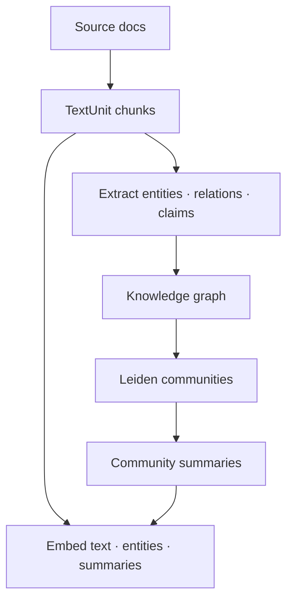

**GraphRAG** is retrieval-augmented generation that uses graph structure to organize or retrieve evidence for the model context. Microsoft Research's system (Edge et al., 2024; open-source at `microsoft/graphrag`) is a prominent implementation: an LLM extracts a knowledge graph from text, hierarchical community detection groups related entities, community reports are summarized offline, and query-time search uses those structures for both local entity questions and global "what is this corpus about?" questions. Other graph-based RAG systems need not use this community-report pipeline.

Baseline (vector) RAG answers well when evidence sits in a few passages near the query in embedding space. It struggles when the answer needs multi-hop links across documents that do not share wording, or when the question is corpus-wide sensemaking ("What are the main themes?", "How do services depend on payments?"). GraphRAG attacks those failure modes by making connections first-class index objects.

## Intuition

Vector search finds nearby text. A graph answers: *which things are connected, and what is true about that neighborhood?*

- **Local questions** fan out from a seed entity (a service, person, drug, statute) to neighbors, claims, and source chunks.
- **Global questions** use community summaries rather than top-$k$ source passages. Microsoft's global search map-reduces these reports; optional dynamic community selection can narrow the reports considered.

If the answer depends on edges (ownership, depends-on, co-occurs-with, cited-by) more than on lexical or embedding neighbors of the query string, GraphRAG is a candidate to evaluate against simpler retrieval. Its benefit depends on extraction and retrieval quality. If every question is a fact lookup inside one paragraph, plain chunk RAG is usually simpler and cheaper.

## Diagram

### Build the index



## How it works

Canonical GraphRAG (Microsoft pipeline and paper) has two phases.

### Index (offline)

1. **TextUnits.** Split documents into token-bounded chunks (default often $\sim$1200 tokens in the library; the paper used 600-token chunks with 100-token overlap). Each unit is the provenance breadcrumb for later nodes and edges.
2. **Graph extraction.** For each TextUnit, an LLM extracts:
   - **Entities** with title, type, description
   - **Relationships** with source, target, description
   - Optionally **claims / covariates** (time-bound factual statements about entities)
3. **Merge and summarize.** Entities with the same title and type merge; relationship descriptions for the same pair merge. Duplicate relationship counts become edge weights. An LLM compresses description lists into one concise description per node or edge.
4. **Community detection.** Hierarchical Leiden community detection groups the clustered entity graph into nested modules (communities within communities), useful for divide-and-conquer summarization. Coverage depends on graph filtering and clustering settings; inspect which source entities appear in reports at each hierarchy level.
5. **Community reports.** Bottom-up LLM reports summarize each community (key entities, relationships, claims). Higher-level communities summarize lower-level reports when raw elements do not fit the context window.
6. **Embeddings.** Embed TextUnit text, entity descriptions, and community report content so query-time retrieval can use vector search over those artifacts.

### Query (online)

| Mode | When to use | Mechanism (simplified) |
| --- | --- | --- |
| **Local search** | Questions about specific entities | Embed query, match entities / relationships / chunks, fan out to graph neighbors, pack structured context |
| **Global search** | Corpus-wide themes and trends | Shuffle community summaries into map batches; each batch yields a partial answer with helpfulness score $s \in [0, 100]$; drop $s=0$; sort remaining partials by $s$ and reduce into one global answer |
| **DRIFT search** | Local questions that benefit from corpus structure | Primer: match the query to top community reports and draft follow-ups; then run local search on those follow-ups and aggregate |
| **Basic search** | Factoid lookup baseline | Ordinary top-$k$ vector RAG over TextUnits |

Global search map-reduces query-relevant community summaries into a corpus-wide answer; basic search retrieves top-$k$ passages for generation. In the paper's evaluation, global search wins on comprehensiveness and diversity for sensemaking questions. It is usually more expensive at query time than local or basic search, while root-level community summaries cut query context tokens dramatically compared with map-reducing raw source text (often by an order of magnitude or more).

## Example

Incident corpus: runbooks, deploy tickets, service catalogs, postmortems.

**Index.** From a TextUnit "Inference-Gateway depends on Model-Serving. Model-Serving failed after deploy `d-4821` of Inference-Gateway; Model-Serving's owner is serving-oncall" the extractor yields:

| Kind | Record |
| --- | --- |
| Entity | `Model-Serving` (service) |
| Entity | `Inference-Gateway` (service) |
| Entity | `serving-oncall` (team) |
| Relation | `Inference-Gateway` → `depends_on` → `Model-Serving` |
| Relation | `Model-Serving` → `owned_by` → `serving-oncall` |
| Claim | Deploy `d-4821` of Inference-Gateway preceded Model-Serving failures |

Leiden may place both services in an "inference request path" community whose report already lists shared incidents and owners.

**Query (local):** "Who owns model serving after the 3pm deploy?"

Local search seeds on `Model-Serving` and deploy-related entities, walks `owned_by` and recent deploy edges, pulls the related TextUnits, and packs:

```text
Entity: Model-Serving
  owned_by: serving-oncall
  related: Inference-Gateway (depends_on), deploy d-4821
Sources: runbook-serving.md#s3, ticket INC-9912, postmortem-v7.md
```

The model answers with the team name and cites source TextUnits. Pure vector RAG might return only timeout logs without the ownership edge if the owner appears in a service catalog that never co-occurs with the deploy narrative.

**Query (global):** "What are the recurring failure themes across inference services?"

Global search map-reduces community reports (not raw logs). Partial answers from gateway, model-serving, and scheduler communities reduce into a theme list: deploy coupling, cache invalidation, and on-call ownership gaps. Baseline top-$k$ RAG may miss this breadth when locally relevant passages are not representative of the corpus.

## Trade-offs

| Dimension | GraphRAG | Baseline vector RAG |
| --- | --- | --- |
| Multi-hop / relational questions | Strong when edges are correct | Weak unless chunks already narrate the hop |
| Global sensemaking | Designed for it (community map-reduce) | Poor; top-$k$ is not a corpus summary |
| Factoid "needle" questions | Use local or basic search; graph is optional overhead | Often enough |
| Index cost | High: extraction + Leiden + report LLM calls per corpus | Embed + store chunks |
| Query cost | Global search is map-reduce heavy; local is moderate | One ANN + generate |
| Freshness | Graph and reports go stale until re-extract / re-summarize | Re-embed changed chunks only |
| Failure mode | Confident wrong structure (bad merge, hallucinated edges) | Confident wrong passage selection |

**Production risks.** GraphRAG multiplies provenance requirements:

- Bad entity resolution (`Payments API` vs `payments-api` vs `Pay API`) fragments or falsely merges nodes.
- Stale edges after renames, reorgs, or decommissioned services look authoritative.
- Over-compressed community reports drop the quote or number the user needs; more hops on a bad summary make answers more confident and more wrong.
- Extraction cost scales with chunks $\times$ LLM calls; prompt tuning for domain entity types is usually required for usable graphs.
- ACLs still apply: unauthorized TextUnits must not produce entities that enter another tenant's graph or context.

**Debug path.** For a bad graph-backed answer, ask in order:

1. Which TextUnits created each cited node or edge?
2. Which extraction prompt / model version and job timestamp produced them?
3. Did entity merge use exact title match only (duplicates) or soft match (false merges)?
4. Did the query path use local, global, DRIFT, or basic search?
5. Does the final answer cite source text, or only a community summary?

If step 5 is "summary only," treat the answer as secondary literature and re-ground on TextUnits before acting.

## Why it matters here

GraphRAG encodes *structure* for RAG: ownership, dependency, citation, reported causal claims, and theme clusters that embedding neighborhoods do not capture. Extracted edges describe candidate relationships; causal conclusions need source validation or experiments. On LeetLLM-style work (agents over runbooks, multi-doc reasoning, enterprise search) you will choose among chunk RAG, hybrid lexical+dense search, and graph-augmented indexes. Know when global community summaries beat top-$k$ passages, when local graph fan-out beats a bigger context window, and when extraction quality becomes the real reliability budget.

## Related terms

- [RAG](glossary://rag)
- [Dense retrieval](glossary://dense-retrieval)
- [Chunking](glossary://chunking)
- [Hybrid search](glossary://hybrid-search)
- [Provenance](glossary://provenance)
