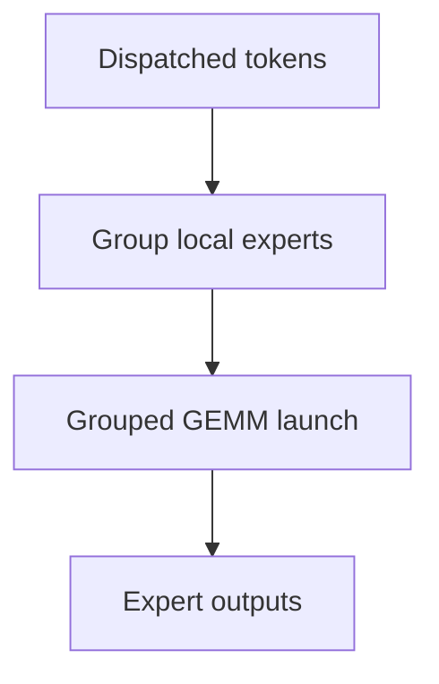

**Grouped GEMM** executes collection of independent matrix multiplications through one grouped operation. Matrices can have different row counts while sharing compatible dtype and layout constraints.

## MoE role

After expert dispatch, each local expert receives different number of tokens. Launching one small GEMM per expert wastes launch and scheduling overhead. Grouped GEMM submits local expert projections together so GPU sees larger work set and can schedule tiles more efficiently.

It does not solve expert load imbalance or network all-to-all. If one expert receives most tokens, grouped execution still inherits skew. Measure dispatch, grouped expert compute, and combine separately.

## Diagram

## Example

One EP rank owns four experts with token counts 96, 41, 18, and 7. Grouped GEMM schedules the four experts' compatible projection problems together at each projection stage. Gate and up projections may be concatenated into one matrix multiplication per expert; the down projection consumes the gated activation and runs afterward. Grouping independent problems does not make all three dependent stages one launch.

## Why it matters here

With GLM-5.3's 256 routed experts, a uniformly assigned EP64 layout places four experts per rank in each sparse layer. Grouped execution can improve local expert efficiency, but the token count per expert determines the matrix shapes. All-to-all traffic and imbalance remain separate costs to measure.

## Related terms

- [GEMM](glossary://gemm)
- [Mixture-of-Experts](glossary://mixture-of-experts)
- [Expert parallelism](glossary://expert-parallelism)
- [Fused kernel](glossary://fused-kernel)
