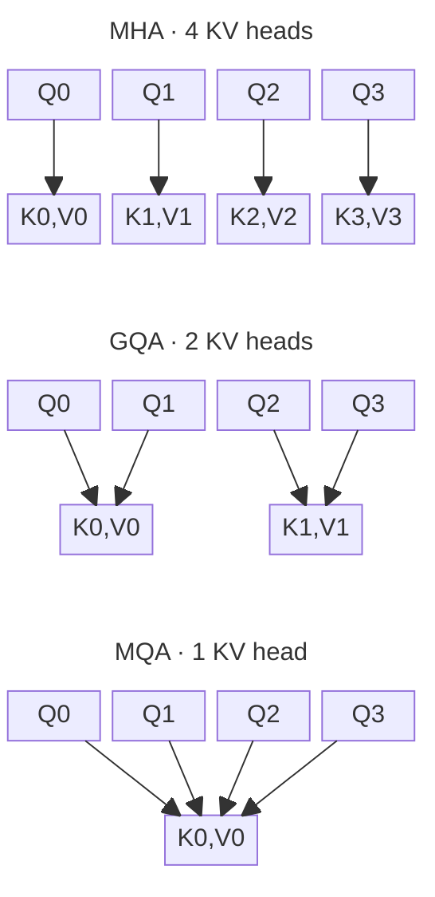

Grouped-query attention (GQA) is a decoder attention layout where many query heads share a smaller number of key and value heads. Query heads are partitioned into $G$ groups; each group uses one shared $K$ head and one shared $V$ head. It sits between full multi-head attention (one KV head per query head) and multi-query attention (one KV head for all query heads).

Ainslie et al. (EMNLP 2023) introduced GQA as a generalization of multi-query attention (Shazeer, 2019), and showed that an intermediate group count recovers most multi-head quality while keeping decode speed close to multi-query. Open models such as Llama 3 and Mistral 7B ship with GQA so long-context serving stays memory-feasible.

## Intuition

During autoregressive [decode](glossary://decode-phase), each new token must load the growing [KV cache](glossary://kv-cache) from memory. Cache size (and the bandwidth to stream it) scales with the number of **key/value heads**, not with the number of query heads. Full multi-head attention (MHA) stores a separate $K$ and $V$ for every query head, so cache grows with $n_q$. Multi-query attention (MQA) collapses to $n_{\mathrm{kv}}=1$, which is cheap but can lose modeling capacity and was reported as less stable in some training setups.

GQA keeps query diversity ($n_q$ stays large) while reducing the tensors that dominate the cache ($n_{\mathrm{kv}}$). Each of the $n_{\mathrm{kv}}$ groups shares one history of keys and values. Heads inside a group still compute distinct queries and attention distributions over that shared history.

In the paper's notation, **GQA-$G$** means $G$ groups (hence $G$ KV heads). Endpoints of the spectrum:

| Layout | Groups $G$ | Relation |
| --- | --- | --- |
| MQA | $G = 1$ | one KV head for all queries |
| GQA | $1 < G < n_q$ | intermediate (typical production choice) |
| MHA | $G = n_q$ | one KV head per query head |

Configs usually expose `num_attention_heads` ($n_q$) and `num_key_value_heads` ($n_{\mathrm{kv}}=G$). Heads per group are $n_q / n_{\mathrm{kv}}$ when that ratio is an integer, which implementations assume.

## How it works

For each layer, project the residual stream into queries for all $n_q$ heads, but only $n_{\mathrm{kv}}$ keys and $n_{\mathrm{kv}}$ values:

$$
Q = X W^Q,\quad
K = X W^K,\quad
V = X W^V
$$

with $W^Q \in \mathbb{R}^{d_{\mathrm{model}} \times n_q d_k}$ and $W^K, W^V \in \mathbb{R}^{d_{\mathrm{model}} \times n_{\mathrm{kv}} d_k}$ (head dimension $d_k$). Reshape $Q$ to $n_q$ heads and $K$, $V$ to $n_{\mathrm{kv}}$ heads. For query head $i$, use KV head

$$
g(i) = \left\lfloor \frac{i \cdot n_{\mathrm{kv}}}{n_q} \right\rfloor
$$

(or an equivalent contiguous block of $n_q / n_{\mathrm{kv}}$ queries per KV head). Then run standard scaled attention:

$$
\mathrm{head}_i = \mathrm{softmax}\!\left(\frac{Q_i K_{g(i)}^{\top}}{\sqrt{d_k}}\right) V_{g(i)}
$$

Concatenate the $n_q$ head outputs and apply $W^O$ as in multi-head attention. Training and prefill compute $K$ and $V$ for every position; decode appends one new $K$/$V$ row per KV head and reuses the cache. Kernels (including FlashAttention-style paths) often **repeat** or **broadcast** each KV head across its query group so the matmul sees matching head counts without materializing extra cache.

Uptraining from an MHA checkpoint (the original paper recipe): mean-pool the $W^K$ and $W^V$ matrices within each target group, then continue pretraining for a small fraction of original steps (they used about 5%). That conversion is optional for models trained with GQA from scratch.

## Diagram



All three examples keep four query heads. The arrows show which KV head each query uses; only the KV-head count changes.

## Example

**Llama 3 8B-style geometry** (common open config): $n_q = 32$, $n_{\mathrm{kv}} = 8$, $d_k = 128$. Each KV head serves $32/8 = 4$ query heads. Versus full MHA with 32 KV heads, the cache is $4\times$ smaller. Versus pure MQA ($n_{\mathrm{kv}}=1$), you keep eight distinct KV subspaces instead of one.

**Llama 3 70B-style**: $n_q = 64$, $n_{\mathrm{kv}} = 8$ (group size 8). Same eight KV heads, more query diversity; cache matches an 8-KV layout, not a 64-KV one.

**Paper timing (T5-XXL, uptrained 5%)**. Ainslie et al. report time per sample on TPUv4 and average quality over summarization, WMT, and TriviaQA:

| Model | Seconds / sample / TPUv4 chip (paper) | Average quality |
| --- | --- | --- |
| MHA-XXL | 1.51 | 47.2 |
| GQA-8-XXL | 0.28 | 47.1 |
| MQA-XXL | 0.24 | 46.6 |

GQA-8 nearly matches MHA quality at nearly MQA speed. Hardware and sequence length change the absolute times; the structural lesson is stable: a modest $n_{\mathrm{kv}}$ (often 8) captures most of the speed win without collapsing to one KV head.

## Worked numbers

Per-token KV cache (keys **and** values, all layers, one sequence), matching the usual serving formula:

$$
\text{bytes/token} \approx 2 \times L \times n_{\mathrm{kv}} \times d_k \times b
$$

where $L$ is layers and $b$ is bytes per element (2 for FP16/BF16).

Take $L = 32$, $d_k = 128$, $b = 2$, sequence length $T = 8192$, batch $B = 4$:

```python
def kv_bytes(layers, kv_heads, head_dim, seq_len, batch, bytes_per=2):
    return 2 * layers * kv_heads * head_dim * seq_len * batch * bytes_per

L, d, T, B = 32, 128, 8192, 4
for name, n_kv in [("MHA n_kv=32", 32), ("GQA n_kv=8", 8), ("MQA n_kv=1", 1)]:
    gb = kv_bytes(L, n_kv, d, T, B) / 1e9
    print(f"{name}: {gb:.2f} GB")
```

Results (decimal GB, $10^9$ bytes, matching the print above):

| Layout | $n_{\mathrm{kv}}$ | Cache at 8k $\times$ batch 4 |
| --- | --- | --- |
| MHA | 32 | $\approx 17.18$ GB |
| GQA | 8 | $\approx 4.29$ GB ($4\times$ less than MHA) |
| MQA | 1 | $\approx 0.54$ GB |

Weight parameters barely change relative to total model size (only $W^K$ and $W^V$ shrink), but **serving memory and decode bandwidth** track $n_{\mathrm{kv}}$. That is why two 7B-class models can need very different GPU budgets at long context.

## Trade-offs

- **Quality vs cache.** Fewer KV heads free memory and speed decode; too few can hurt quality (MQA is the extreme). GQA is the usual production compromise.
- **Group count.** Ainslie et al. found that moving from 1 to about 8 groups added modest latency while recovering quality; more groups approach MHA cost. Many open LLMs pick $n_{\mathrm{kv}}=8$ even as $n_q$ scales.
- **Tensor parallel.** With pure MQA, a single KV head is often replicated across partitions, wasting capacity. GQA with $n_{\mathrm{kv}}$ divisible by the parallel width partitions cleanly.
- **Prefill still does query-key work.** Prefill scores queries against keys for every position; GQA mainly wins when KV loading dominates (long decode, high concurrency). Pair it with [FlashAttention](glossary://flashattention), paging, and continuous batching to build a full serving stack.
- **Config bugs.** Using `num_attention_heads` instead of `num_key_value_heads` in capacity math overestimates cache by $n_q / n_{\mathrm{kv}}$. Shape errors show up as failed `repeat_kv` / head-axis expands when wiring custom kernels.

## Why it matters here

GQA is a common attention memory design in modern open LLMs; other architectures use layouts such as latent or hybrid attention. When you size the standard GQA [KV cache](glossary://kv-cache), plan concurrency, or compare models by parameter count, read $n_{\mathrm{kv}}$ alongside $n_q$. Long-context product limits, vLLM/TGI memory estimates, and decode tokens-per-second depend on that head count and the actual cache representation.

## Related terms

- [Multi-query attention](glossary://multi-query-attention)
- [KV cache](glossary://kv-cache)
- [Attention head](glossary://attention-head)
- [Decode phase](glossary://decode-phase)
- [Self-attention](glossary://self-attention)
