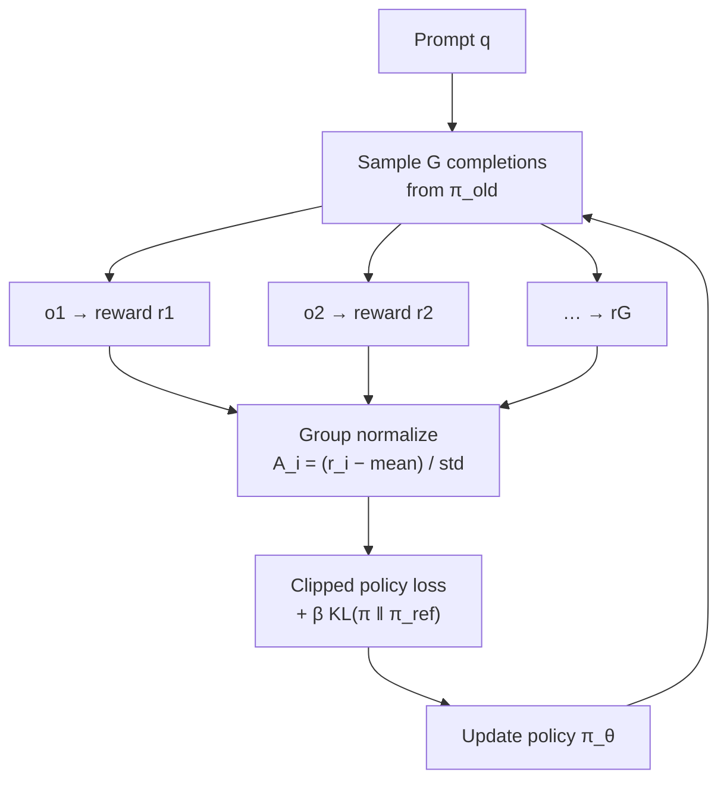

Group Relative Policy Optimization (GRPO; Shao et al., 2024) is a [policy gradient](glossary://policy-gradient) algorithm for language-model reinforcement learning. For each prompt it samples a *group* of $G$ completions, scores them, and uses that group's reward statistics as the baseline (advantage estimate). GRPO replaces the separate critic/value model used in many classic [PPO](glossary://ppo) stacks with this group-relative baseline.

The method was introduced in *DeepSeekMath* and later used at large scale for DeepSeek-R1-style reasoning training under [RLVR](glossary://rlvr) (rule-based or verifiable rewards for math, code, and format).

## Intuition

A common PPO-based LLM training stack has a **policy** (the model you update), a **reference** (for [KL](glossary://kl-divergence) anchoring), and a **critic** that predicts expected return so advantages have lower variance. In LLM alignment, a reference model supplies KL anchoring; PPO itself can also be used without one. The critic can be as large as the policy, increasing memory and wall-clock cost.

GRPO drops the critic. Instead of asking "how good is this completion vs a learned value?", it asks a cheaper question that fits LLM post-training:

> Among $G$ samples for the *same* prompt, which ones beat the local pack?

That is grading on a curve inside the group. Completions above the group mean get positive advantage; completions below get negative. The original objective uses PPO-style clipping to discourage large probability-ratio changes and a KL penalty to discourage drift from a reference. These mechanisms shape update size and direction; observed behavior depends on the objective, implementation, and settings, and some implementations disable the KL term.

This matches the data geometry of reasoning and [RLVR](glossary://rlvr): one hard problem, many candidate traces, one cheap verifier (exact answer match, unit tests, format tags). Sampling many answers per prompt is already natural; GRPO turns that sample set into the baseline.

## Formula

For question $q$, sample a group $\{o_i\}_{i=1}^{G}$ from the old policy $\pi_{\theta_{\mathrm{old}}}$. Score each output to get rewards $\{r_1,\ldots,r_G\}$. The group-normalized advantage is:

$$
A_i = \frac{r_i - \mathrm{mean}(\{r_1,\ldots,r_G\})}{\mathrm{std}(\{r_1,\ldots,r_G\})}
$$

(DeepSeek-R1 writes this as outcome-level $A_i$; DeepSeekMath also sets per-token advantages $\hat{A}_{i,t}=A_i$ for every token in completion $o_i$ under outcome supervision.)

GRPO then maximizes a clipped surrogate plus a KL term. In the published DeepSeekMath / DeepSeek-R1 objective, both the importance ratio and KL penalty are evaluated **per token**:

$$
\begin{aligned}
\mathcal{J}_{\mathrm{GRPO}}(\theta)
&=
\mathbb{E}_{q\sim P(Q),\,\{o_i\}\sim\pi_{\theta_{\mathrm{old}}}}
\Bigg[
\frac{1}{G}\sum_{i=1}^{G}
\frac{1}{|o_i|}\sum_{t=1}^{|o_i|}
\Bigg[
\min\Big(
\rho_{i,t}(\theta)\,\hat A_{i,t},\;
\mathrm{clip}\big(\rho_{i,t}(\theta),1-\varepsilon,1+\varepsilon\big)\,\hat A_{i,t}
\Big)
-
\beta\,\mathbb{D}_{\mathrm{KL}}^{i,t}(\pi_\theta\,\|\,\pi_{\mathrm{ref}})
\Bigg]
\Bigg]
\end{aligned}
$$

where the importance ratio for token $o_{i,t}$ is

$$
\rho_{i,t}(\theta)=
\frac{\pi_\theta(o_{i,t}\mid q,o_{i,<t})}
{\pi_{\theta_{\mathrm{old}}}(o_{i,t}\mid q,o_{i,<t})}.
$$

Under outcome supervision, $\hat A_{i,t}=A_i$ for every token in completion $o_i$; process supervision can give tokens different advantages. The KL term is likewise applied at each token **in the objective**, not folded into the reward the way some PPO-LM stacks do. The sampled-token estimator used in DeepSeekMath / R1 is

$$
\mathbb{D}_{\mathrm{KL}}^{i,t}(\pi_\theta\,\|\,\pi_{\mathrm{ref}})
=
\frac{\pi_{\mathrm{ref}}(o_{i,t}\mid q,o_{i,<t})}
{\pi_\theta(o_{i,t}\mid q,o_{i,<t})}
-
\log\frac{\pi_{\mathrm{ref}}(o_{i,t}\mid q,o_{i,<t})}
{\pi_\theta(o_{i,t}\mid q,o_{i,<t})}
-
1.
$$

Hyperparameters: clip range $\varepsilon$, KL weight $\beta$, group size $G$. DeepSeekMath reported $\beta=0.04$ and $G=64$ for math RL on 7B; tune these values for the task and training setup. Libraries such as Hugging Face TRL expose the idea as `GRPOTrainer` / `num_generations` for $G$, with several loss and normalization variants.

## Example

Concrete math prompt, binary verifier, $G=8$ samples:

| Sample $i$ | Pass? | $r_i$ |
|------------|-------|-------|
| 1–2        | yes   | 1     |
| 3–8        | no    | 0     |

Group mean $\bar{r}=2/8=0.25$. For this worked example, use the **population-style** divisor $G$ (`numpy.std` default, `ddof=0`):

$$
s=\sqrt{\frac{2(1-0.25)^2+6(0-0.25)^2}{8}}=\sqrt{0.1875}\approx 0.433.
$$

Advantages:

$$
A_{\mathrm{correct}}=\frac{1-0.25}{0.433}\approx +1.73,\qquad
A_{\mathrm{wrong}}=\frac{0-0.25}{0.433}\approx -0.58.
$$

**Implementer footgun:** `torch.std` defaults to **sample** std ($\mathrm{ddof}=1$), which divides by $G-1$. For small groups (for example $G=8$), that increases $s$ and shrinks $|A_i|$ relative to these worked numbers. The paper's `std` notation leaves this convention open. Match the chosen implementation deliberately (`correction=0` reproduces this example), and add a small numerical stabilizer so all-equal groups do not divide by zero.

The update **raises** log-likelihood of the two correct traces and **lowers** it for the six failures, with clipping and KL still limiting how hard each step pushes. If *all eight* fail ($r_i=0$ for every $i$), mean and std collapse and $A_i\approx 0$: there is almost no relative signal. This zero-signal group indicates a prompt beyond the policy's sample budget or a broken verifier.

```python
import numpy as np

def grpo_advantages(rewards: list[float], eps: float = 1e-8) -> np.ndarray:
    r = np.asarray(rewards, dtype=np.float64)
    # Population-style stats for this example; +eps for all-equal groups.
    # Choose population or sample std deliberately when matching a training implementation.
    return (r - r.mean()) / (r.std() + eps)

# Worked numbers above
print(grpo_advantages([1, 1, 0, 0, 0, 0, 0, 0]))
# ~ [1.73, 1.73, -0.58, ...]
```

## How it works

One training step (online GRPO):

1. **Sample prompts** $q$ from the RL dataset (math, code, mixed).
2. **Roll out** $G$ completions per prompt from $\pi_{\theta_{\mathrm{old}}}$ (often with non-zero temperature so the group is diverse).
3. **Score** each completion with a reward function: rule-based accuracy + format (R1-Zero style), unit tests, or a learned [reward model](glossary://reward-model).
4. **Normalize within the group** to get $A_i$ (outcome GRPO copies $A_i$ onto every token of $o_i$).
5. **Optimize** $\mathcal{J}_{\mathrm{GRPO}}$: clipped importance-weighted advantages minus $\beta$ KL to $\pi_{\mathrm{ref}}$.
6. **Advance** $\pi_{\theta_{\mathrm{old}}}$ (and optionally refresh $\pi_{\mathrm{ref}}$ in iterative setups).

DeepSeekMath also describes **process-supervised** GRPO (step-level rewards summed into per-token advantages) and **iterative** GRPO (periodically refresh the reward model from new on-policy samples). Production reasoning stacks often stick to outcome RLVR because process labels are expensive and easy to game.

## Diagram



## Trade-offs

| Strength | Cost / failure |
|----------|----------------|
| No critic: less GPU memory than full PPO | Need $G$ generations per prompt; generation dominates cost |
| Natural fit for verifiable tasks | If the verifier is gameable, the *best* group member can still be wrong |
| Simple advantage estimator | Degenerate groups (all equal rewards) give near-zero signal |
| Online exploration finds new traces | Length, format, and language-mix hacks can absorb the reward |
| Works with RM or rule rewards | Neural RMs can still reward-hack at R1 scale without care |

**What fails in production**

- **Verifier quality.** Group ranking only reorders whatever $r$ you feed it. Hidden tests, canonical answer parsing, and format checks define the learned behavior.
- **All-pass or all-fail groups.** Easy prompts waste samples; hard prompts need larger $G$, curriculum, or better base models before GRPO moves the needle.
- **Generation budget.** $G\in\{4,8,16,64\}$ multiplies tokens generated. Throughput planning must count rollouts alongside optimizer steps.
- **KL / length collapse.** Too small $\beta$ can yield long, messy CoT that still passes the checker; too large $\beta$ freezes the policy near the reference.
- **Off-policy staleness.** Large $\mu$ (many optimizer epochs on the same rollouts) or huge policy lag without clipping can destabilize training.

Useful monitors: mean/std reward per group, fraction of groups with mixed success, KL to reference, response length, pass rate on held-out verifiers the training reward never sees, and slice evals outside the RL task mix.

## Why it matters here

GRPO is the practical RL workhorse behind much open reasoning-model work: it uses group-relative baselines for "many samples per prompt + verifiable score." If you build math/code post-training, agent checkers, or RLVR loops, GRPO (or a close relative) is the algorithm you will implement, debug, and cost out first. Its updates depend on reward design, evaluation, and serving budgets, and it optimizes the policy once those pieces are in place.

## Related terms

- [RLVR](glossary://rlvr)
- [PPO](glossary://ppo)
- [Policy gradient](glossary://policy-gradient)
- [Reward model](glossary://reward-model)
- [KL divergence](glossary://kl-divergence)
