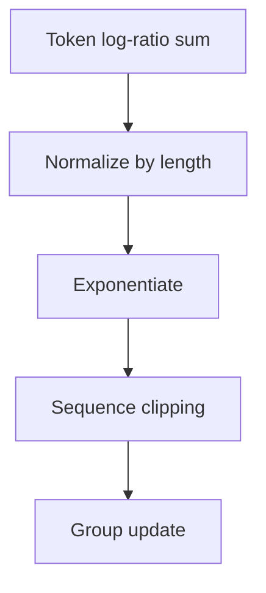

**Group Sequence Policy Optimization (GSPO)** uses group-relative rewards with length-normalized sequence likelihood ratio and sequence-level clipping. It contrasts with token-ratio [GRPO](glossary://grpo).

For completion $y_i$:

$$
s_i(\theta)=\exp\left(\frac{1}{|y_i|}\sum_t
[\log\pi_\theta(y_{i,t}\mid x,y_{i,<t})-\log\pi_{old}(y_{i,t}\mid x,y_{i,<t})]\right).
$$

Here $x$ is the prompt and $|y_i|$ counts response tokens. One sequence ratio multiplies the group-normalized sequence advantage and enters the clipped surrogate. The length normalization makes this the geometric mean of token ratios, rather than the unnormalized likelihood ratio required for exact importance-sampling reweighting. Its clipping range therefore needs its own calibration.

## Why it matters

Sequence reward naturally matches sequence correction. Aggregation can reduce instability from many token-level ratios and was proposed with large [mixture of experts](glossary://mixture-of-experts) training in mind.

Tradeoff is coarse credit: one ratio and one advantage don't identify which token or tool call caused outcome. Token-specific variants require additional estimator design.

## Example

One 1,000-token rollout has many slightly shifted token ratios. GSPO averages log-ratio across sequence, exponentiates once, and clips one sequence ratio against trajectory advantage.

## Why it matters here

GSPO is relevant when long sequence-level reward and MoE execution make token-ratio GRPO unstable. It doesn't solve turn-level credit assignment.

## Related terms

- [GRPO](glossary://grpo)
- [Policy ratio](glossary://policy-ratio)
- [Importance sampling](glossary://importance-sampling)
- [Mixture of experts](glossary://mixture-of-experts)
- [RL rollout](glossary://rl-rollout)
