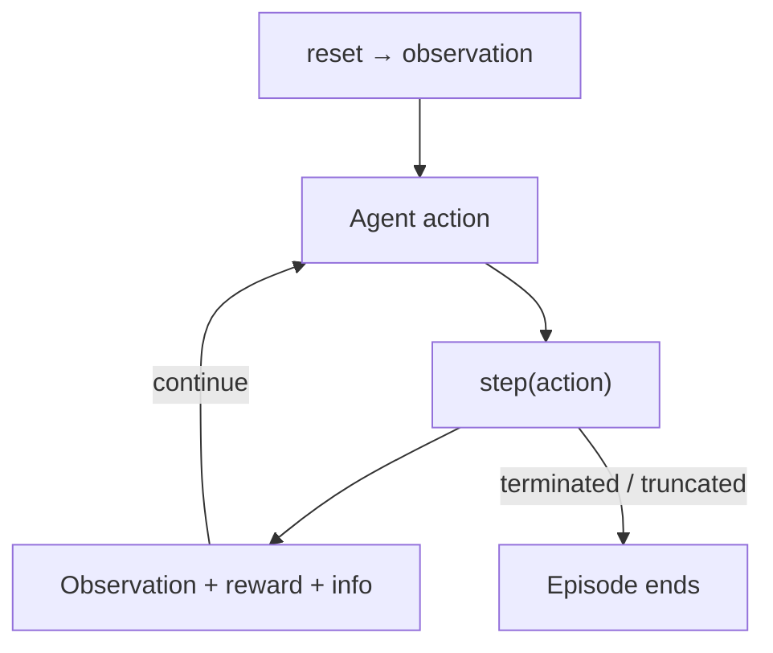

A **Gymnasium-style environment** gives a reinforcement-learning agent a small, repeatable interaction schema. The agent receives an observation, chooses an action, and gets the next observation plus a reward and an episode-ending signal. This keeps task mechanics separate from policy optimization, so the same trainer can work with math problems, code sandboxes, databases, browsers, or games.

Gymnasium's exact API uses `reset()` to return an initial `(observation, info)` pair. Its `step(action)` method returns `(observation, reward, terminated, truncated, info)`. `terminated` means the task reached a terminal state defined by the environment, including failure states. `truncated` means the episode stopped for a condition outside the task's MDP, such as an external time limit.

The word **style** matters. A project may preserve this interaction pattern without subclassing `gymnasium.Env` or matching its method signatures exactly. SkyRL-Gym, for example, currently uses `init()` plus `step()`, and its step result contains `observations`, `reward`, `done`, and `metadata`. Treat adapters as explicit compatibility partitions rather than assuming every Gymnasium-style task is a drop-in Gymnasium environment.

## Lifecycle



The loop sends each observation back to the agent until the environment reports a natural terminal state or an outside cutoff. The adapter must preserve why the episode ended because the trainer may handle successful completion and truncation differently.

## schema

| Operation | Standard Gymnasium role | Question to verify in an adapter |
| --- | --- | --- |
| `reset()` | Start an episode and return initial observation plus info | Is this renamed to `init()` or provided by a generator? |
| `step(action)` | Apply one action and return transition results | Is output a tuple, object, or typed dictionary? |
| `reward` | Score immediate result of action | Is reward per step, per turn, or only at episode end? |
| `terminated` | Mark a task terminal state, successful or failed | Does adapter combine this into one `done` flag? |
| `truncated` | Mark outside cutoff such as step or time limit | Can trainer distinguish cutoff from true completion? |
| `info` | Carry diagnostics outside observation | Is this called `metadata`, and does it include reward details? |

## Example

A Text-to-SQL environment starts with a user question and database schema. The model emits a SQL action. The environment executes the query in a sandbox, returns rows or an error as the next observation, assigns a reward, and decides whether the episode should continue.

```python title="gymnasium-style-text-to-sql.py"
class TextToSQLEnvironment:
    def init(self, prompt):
        return [{"role": "user", "content": prompt}], {}

    def step(self, action):
        rows, error = execute_in_sandbox(action)
        solved = error is None and answer_is_correct(rows)
        return {
            "observations": [] if solved else [
                {"role": "user", "content": error or str(rows)}
            ],
            "reward": 1.0 if solved else 0.0,
            "done": solved,
            "metadata": {"execution_error": error},
        }
```

This example is Gymnasium-style because it has an explicit episode start and action-to-transition loop. It doesn't use the exact Gymnasium API because its method and return shapes differ. The adapter must translate those fields before the trainer can reason correctly about rewards, masks, and completion.

## Why it matters here

Post-training systems need many task types without one trainer implementation per benchmark. A Gymnasium-style perimeter lets the environment own state transitions, tool execution, rewards, and episode completion while the generator and trainer consume normalized trajectories.

Signature mismatches can silently corrupt learning. Combining truncation with successful termination can produce wrong bootstrapping targets. Dropping metadata can hide evaluator errors. Treat environment API as typed schemas, test one complete episode, and log why it ended.

## Related terms

- [State machine](glossary://state-machine)
- [Trajectory evaluation](glossary://trajectory-evaluation)
- [Sandbox](glossary://sandbox)
- [Policy gradient](glossary://policy-gradient)
- [Reward model](glossary://reward-model)
